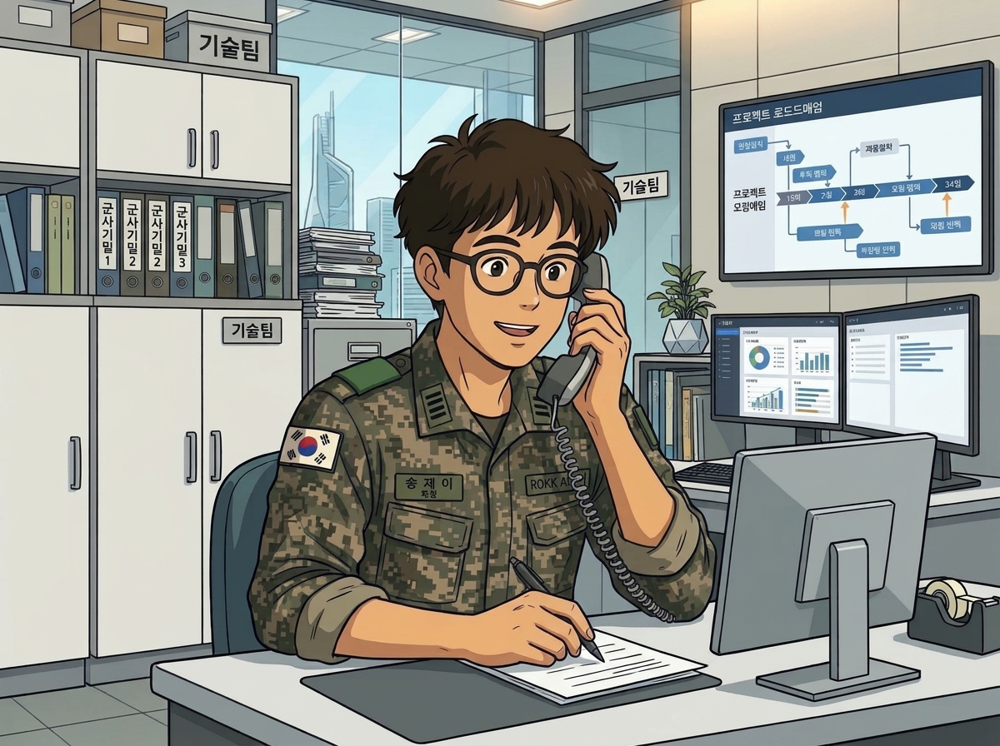
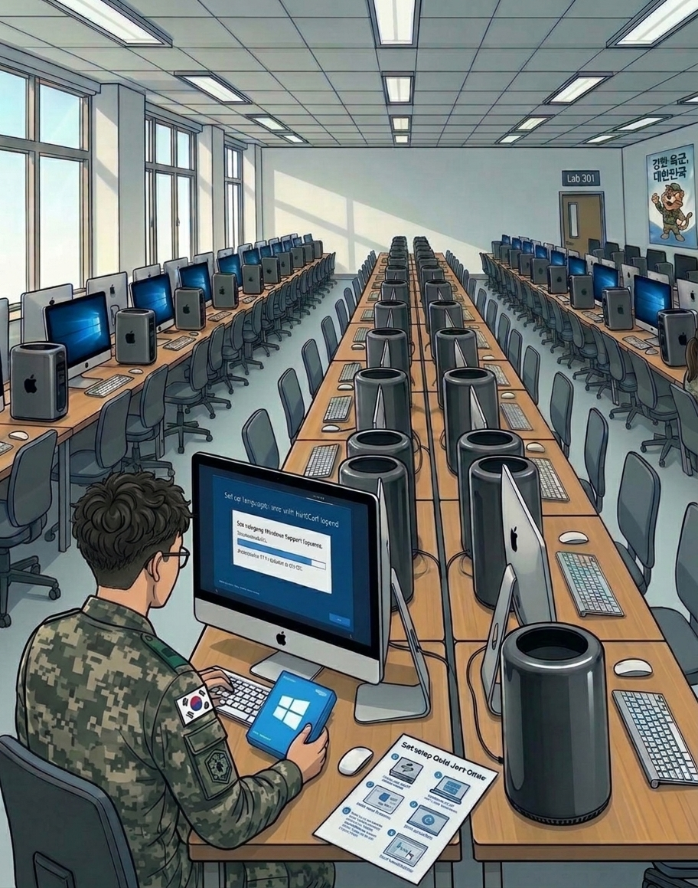
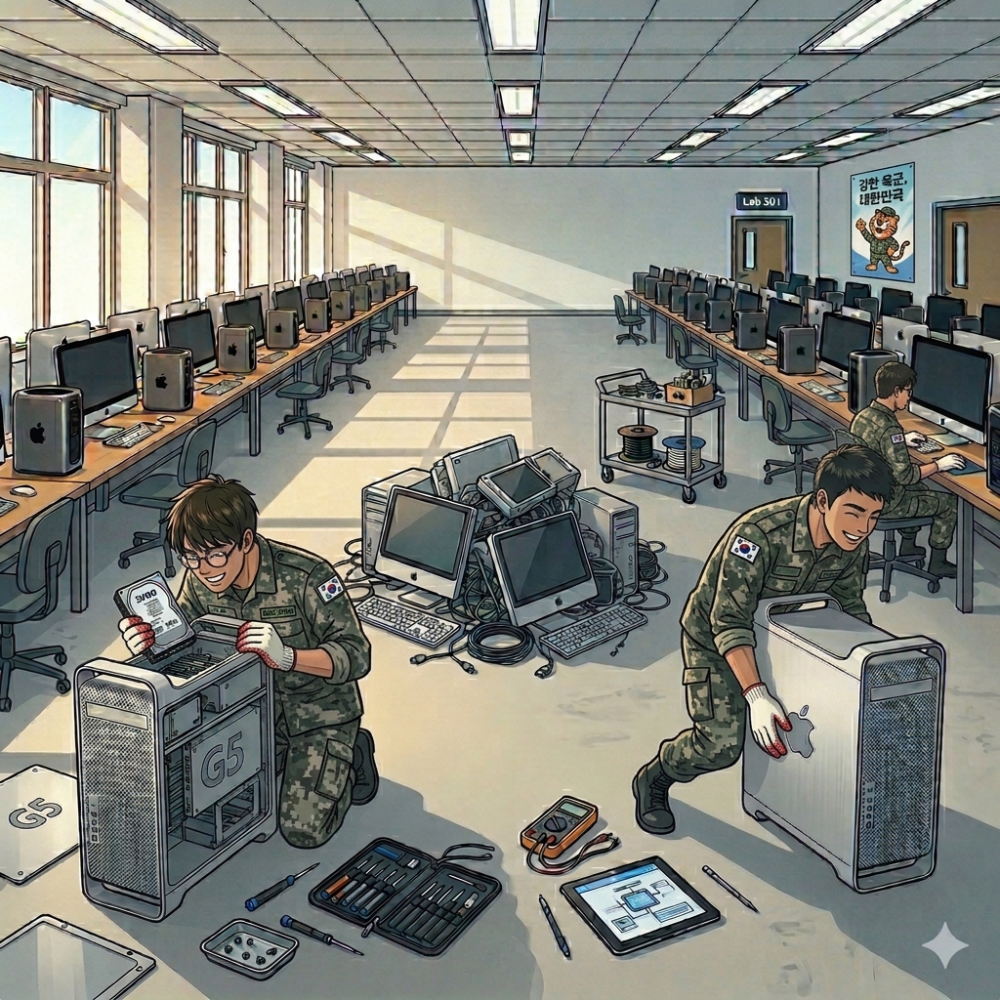
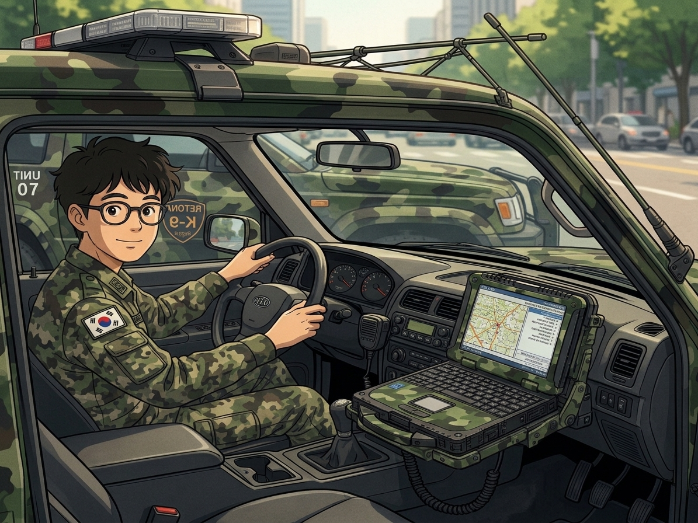
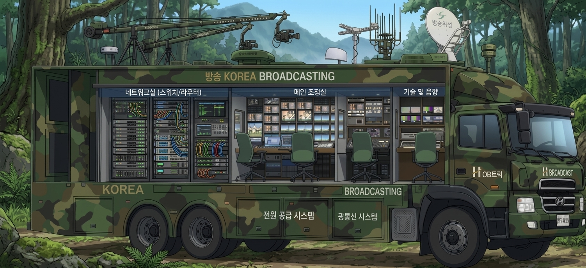

## The Helpdesk Life: Boots on the Ground
I worked as a Helpdesk in Republik of Korea Army for 21 months. It was a physically and mentally demanding grind, but the technical field experience was worth every drop of sweat.

Responding Daily Incidents

## The Human FAQ: Daily Incidents
I wasn't just a helpdesk; I was the primary contact for every technical hurdle in the building. The raw reality of my job involved fielding these exact questions every single day:
* "A switch or router died. Could you replace it?"
* "My computer doesn't connect to the internet."
* "My account keep failing to log in. Could you reset my password?"
* "My computer doesn't boot. It does turn on and it only makes beep sound"
* "A printer says I need to update its firmware. Could you do this for me?"
* "The projector does not display the image"
* "What is the right cable for this equipment? or Which one is DP, HDMI, DVI, or USB2?"

## The Software Installation Marathon
Our lab housed over 100 Mac workstations. Because they all ran Windows virtualized via Parallels alongside macOS, I was effectively managing 200 operating system instances. My colleague and I handled everything from upgrading aging OS versions to deploying heavy software suites like Adobe Creative Cloud and corporate antivirus packages. Back in the mechanical HDD era, bulk installations took enormous amounts of time. We had to coordinate lunch breaks in shifts, heading out while waiting for slow progress bars to creep toward 100%.

Installing Windows and enterprise software packages across workstations

## Hardware Modernization & Component Maintenance
When it came time for hardware refreshes, we upgraded and maintained heavy aluminum Mac desktop workstations. These machines were massive blocks of metal, weighing at least 20kg each. The hardware transition caused a ripple effect across all peripheral workflows—such as reformatting external storage drives to exFAT instead of NTFS to ensure seamless cross-platform data transfer. Hauling dozens of towers, cracking open chassis, and swapping faulty hard drives was a legitimate workout. It was intensive hands-on labor, but it built an intuitive understanding of component lifecycle management and physical hardware diagnostics.

Hands-on hardware teardowns, drive replacements, and system upgrades

## Field Operations & Mobile Dispatch Support
Beyond fixed desk support and classroom lab maintenance, duty often demanded mobile field operations. Whether dispatched in military utility vehicles equipped with ruggedized laptops for on-site tactical troubleshooting or maintaining critical field systems on the move, technical support meant keeping mission-essential gear operating regardless of the environment.

Field dispatch and mobile tactical IT support

## Mobile Communications & Broadcasting Infrastructure
For larger field operations, technical coverage expanded into dedicated mobile broadcasting and communications vehicles. These specialized OB trucks housed complete network racks with switches, routers, transmission hardware, and optical fiber patch bays. Keeping the underlying network and audio/video pipeline stable under live conditions taught me how vital disciplined cabling, power distribution, and real-time infrastructure monitoring truly are.

Mobile communications and broadcasting truck infrastructure

## Conclusion
Serving in an IT Helpdesk and technical field support role was demanding, yet it proved to be an invaluable foundation. I developed deep confidence in operating across diverse OS platforms, handling sudden hardware failures under pressure, and methodically troubleshooting network and peripheral issues.

From resolving user issues over the helpdesk line to hauling heavy aluminum workstation towers and managing field communications gear, that experience gave me a durable, hands-on respect for the physical and operational realities of IT infrastructure.
