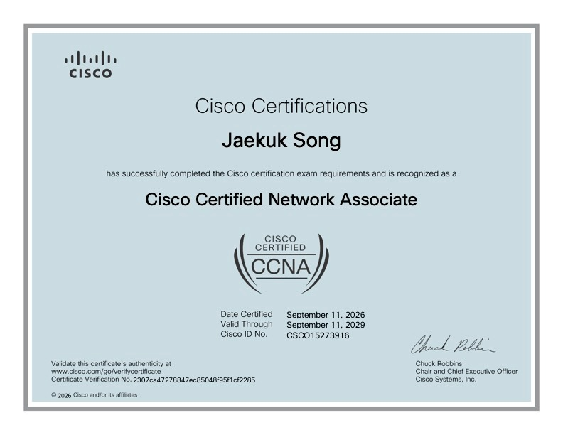

 Cisco Certified Network Associate (CCNA) Certificate 

## My progress and how I felt each week

**Week 1**
I started reading **9tut.com**, the best network tutorial. It was the most intuitive website for explaining core networking concepts.

**First Month**
I consistently studied every day, even if I only had 30 minutes, following the same discipline I used while preparing for the Security+ exam. I referenced a variety of materials, including YouTube videos and PDF textbooks. ChatGPT can hallucinate, so if you really want to use ChatGPT for studying, I found it best to upload the textbook and apply RAG principles, instructing it to answer strictly based on the textbook content.

**Second Month**
I spent a lot of time solving a wide variety of practice problems from the textbook. I installed Packet Tracer and repeatedly practiced network building and troubleshooting scenarios. As time went on, I felt my problem-solving skills sharpen and my typing speed noticeably increase when configuring networks.

**Third Month**
Although my exam preparation was already complete by the second month, when I went to book the exam, the earliest available schedule was in the third month. Because of the forgetting curve, I continued to dedicate a consistent amount of time each day to practice and review. 

