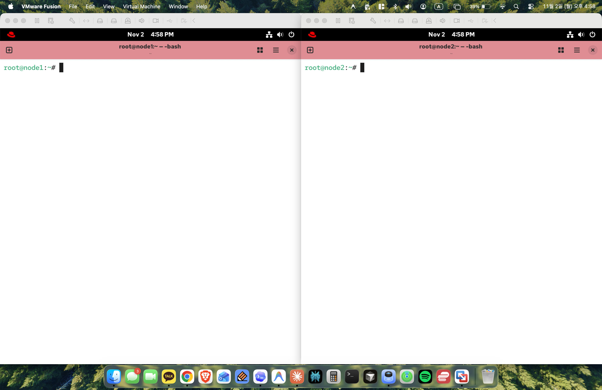
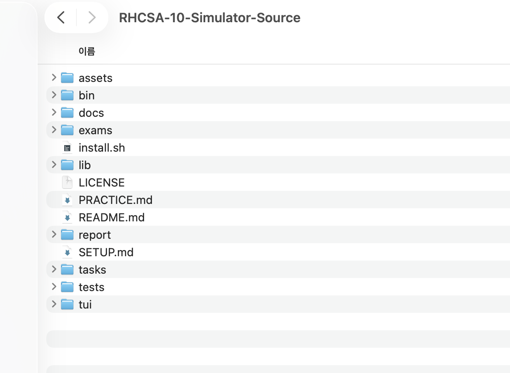
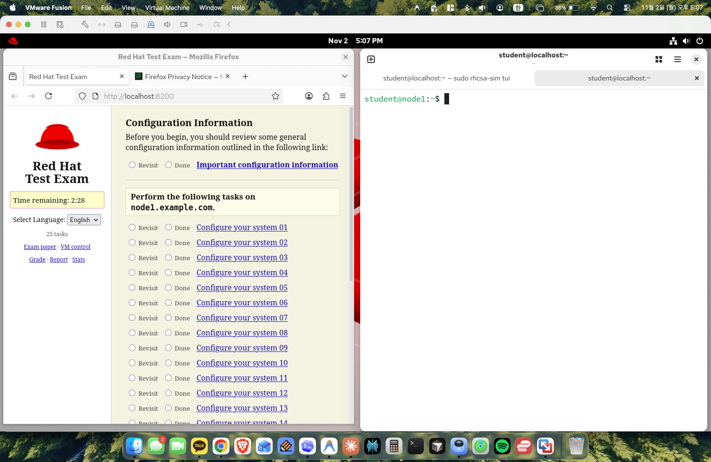
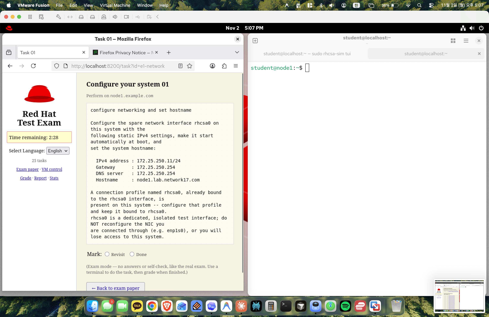

To prepare for enterprise-scale Linux systems engineering and master Red Hat Enterprise Linux (RHEL 9) administration, I designed and built an isolated dual-node virtualization lab. Rather than simply following static walkthroughs, I integrated a production-style RHCSA exam simulation harness to test hands-on problem-solving, failure recovery, and system persistence under realistic constraints.

This article details the end-to-end execution of **Task 01: Static Network Provisioning and Hostname Configuration**. More importantly, it demonstrates how I systematically identified a subtle configuration trap involving network interface binding, conducted root cause analysis (RCA) across multiple OSI layers, and engineered an idempotent CLI automation solution to achieve 100% automated test compliance.

---

## 1. Executive Summary & Recruiter Highlights

* **Autonomous Problem Definition**: Audited system state across the link, network, transport, and OS daemon layers (`ip`, `nmcli`, `resolv.conf`, `systemd-hostnamed`) to catch an interface mismatch before production deployment.
* **Incident Troubleshooting & RCA**: Diagnosed why interactive Text User Interfaces (`nmtui`) inadvertently modified the active management interface (`enp2s0`) instead of the isolated target interface (`rhcsa0`), avoiding a catastrophic management lockout.
* **Engineering Remediation**: Migrated from error-prone interactive tooling to declarative, idempotent NetworkManager CLI (`nmcli`) commands and verified persistence across complete system reboots.
* **Automated Verification**: Validated the remediation directly against the automated grading test harness, securing full marks across all 5 evaluation checkpoints.

---

## 2. Architecture & Home Lab Topology

The lab runs on an Apple Silicon host using VMware Fusion Pro, hosting two isolated RHEL 9 virtual machines configured as a dual-node cluster.

```text
+-------------------------------------------------------------------------------+
|                             macOS Host (Hypervisor)                           |
|                                                                               |
|  +--------------------------------+      +--------------------------------+   |
|  |           node1                |      |           node2                |   |
|  |  (node1.lab.network17.com)     |      |  (node2.lab.network17.com)     |   |
|  |                                |      |                                |   |
|  |  - enp2s0: Management NIC      |      |  - enp2s0: Management NIC      |   |
|  |    (DHCP / Bridge / NAT)       |      |    (DHCP / Bridge / NAT)       |   |
|  |                                |      |                                |   |
|  |  - rhcsa0: Isolated Dummy NIC  |      |  - rhcsa0: Isolated Dummy NIC  |   |
|  |    (172.25.250.11/24 Static)   |      |    (172.25.250.12/24 Static)   |   |
|  +--------------------------------+      +--------------------------------+   |
|                  |                                       |                    |
|                  +------------------+--------------------+                    |
|                                     |                                         |
|                      RHCSA 10 Simulation Engine                               |
|                 (http://localhost:8200 & rhcsa-sim)                          |
+-------------------------------------------------------------------------------+
```

### Key Components

* **Hypervisor**: VMware Fusion Pro running dual RHEL 9 instances (`node1` and `node2`).
* **Management Network (`enp2s0`)**: Active NIC connected to the hypervisor virtual network, providing SSH access, external package repository downloads, and terminal management.
* **Test Interface (`rhcsa0`)**: Dedicated dummy/virtual network interface used specifically for testing static IP assignments, routing tables, and DNS resolution.
* **Assessment Framework**: Local exam harness providing a web dashboard at `http://localhost:8200` alongside an automated CLI grading engine (`sudo rhcsa-sim grade`).

---

## 3. Task 01 Specifications & Constraints

The initial task assigned by the simulator harness is **Task 01: Configure networking and set hostname** on `node1`.

### Task Requirements

* **Static IPv4 Address**: `172.25.250.11/24`
* **Default Gateway**: `172.25.250.254`
* **DNS Server**: `172.25.250.254`
* **System Hostname**: `node1.lab.network17.com`
* **Autoconnect**: Profile must be configured to start automatically at boot.
* **Profile Constraint**: Must configure the existing profile named `rhcsa0` bound to the `rhcsa0` interface.

> [!WARNING]
> **Production Safety Warning**: `rhcsa0` is a dedicated, isolated test interface. **Do NOT reconfigure the active NIC you are connected through (`enp2s0`)**, or you will lose access to the system.

In an enterprise data center or cloud environment, modifying the primary management interface severs remote SSH sessions immediately, requiring costly out-of-band console access (e.g., IPMI, iLO, or AWS Serial Console).

---

## 4. Step-by-Step Implementation & Screenshot Walkthrough

Below is the complete step-by-step progression captured across 19 milestone screenshots, documenting the initial attempt, the anomaly detection, and the persistence check.

---

### Step 1: Virtualization Cluster Setup


<p style="font-size: 14px; text-align: center; color: #666;">
  Figure 1: Dual RHEL 9 virtual machines (node1 and node2) running side-by-side in VMware Fusion.
</p>

To simulate a real multi-node infrastructure, two independent RHEL 9 virtual machines were provisioned: `node1` (left window) and `node2` (right window). Each node has independent virtual disks, virtual network adapters, and dedicated system resources.

---

### Step 2: Interactive Console Verification


<p style="font-size: 14px; text-align: center; color: #666;">
  Figure 2: Verifying root terminal access and basic shell responsiveness on both cluster nodes.
</p>

Both nodes were logged in as `root`. Simple echo statements (`This is node1` and `This is node2`) verified interactive console control, shell responsiveness, and confirmed that command execution between the two nodes was distinctly isolated.

---

### Step 3: Exam Simulator Codebase Inspection


<p style="font-size: 14px; text-align: center; color: #666;">
  Figure 3: Exploring the RHCSA-10-Simulator source tree (bin, exams, tasks, tests, tui, install.sh).
</p>

Before beginning, I audited the simulator harness structure. The repository contains:
* `bin/`: CLI binaries (`rhcsa-sim`)
* `exams/`: Exam specification files and grading criteria
* `tasks/`: Task definitions containing `prompt.txt`, `setup.sh`, `solution.md`, and `grade.sh`
* `tests/`: Automated unit and integration test solvers

---

### Step 4: Accessing the Simulator Dashboard


<p style="font-size: 14px; text-align: center; color: #666;">
  Figure 4: RHCSA Exam Simulator web interface running at http://localhost:8200 showing 25 exam tasks.
</p>

The simulator exposes a live web interface at `http://localhost:8200`. The exam consists of 25 practical tasks with a 2.5-hour countdown timer, simulating the high-pressure environment of the real Red Hat Certified System Administrator exam.

---

### Step 5: Task 01 Specification Review


<p style="font-size: 14px; text-align: center; color: #666;">
  Figure 5: Inspecting Task 01 requirements: Static IPv4 172.25.250.11/24, Gateway 172.25.250.254, DNS 172.25.250.254, and Hostname node1.lab.network17.com.
</p>

Reviewing the exact task prompt (`id=e1-network`):
1. Configure spare interface `rhcsa0` with static IPv4 `172.25.250.11/24`.
2. Configure Gateway `172.25.250.254` and DNS server `172.25.250.254`.
3. Set the persistent system hostname to `node1.lab.network17.com`.
4. Ensure autoconnect is enabled for automatic boot activation.
5. Strict rule: Keep the profile bound to `rhcsa0` and avoid modifying the connected management NIC (`enp2s0`).

---

### Step 6: Baseline Network State Inspection


<p style="font-size: 14px; text-align: center; color: #666;">
  Figure 6: Running baseline checks: nmcli connection show and nmcli device status.
</p>

On `node1`, I executed:
```bash
nmcli connection show
nmcli device status
```
* **Output Analysis**:
  * `enp2s0`: Type `ethernet`, state `connected`, connection profile `enp2s0` (UUID: `36a7ea4b-3d60-3940-b5c6-b5fa53f53396`).
  * `rhcsa0`: Type `dummy`, state `unmanaged`, connection profile `rhcsa0` (UUID: `5466d713-39f1-4357-9d7a-d09e530fc461`).

---

### Step 7: Launching NetworkManager TUI (`nmtui`)


<p style="font-size: 14px; text-align: center; color: #666;">
  Figure 7: Executing nmtui to open the NetworkManager text-based configuration interface.
</p>

To configure the network parameters interactively, I launched `nmtui`. While `nmtui` is a popular curses-based interface on RHEL, it abstracts device bindings in a way that requires careful attention.

---

### Step 8: Navigating the `nmtui` Main Menu


<p style="font-size: 14px; text-align: center; color: #666;">
  Figure 8: nmtui main menu: Edit a connection, Activate a connection, and Set system hostname.
</p>

The menu offers three core actions:
* **Edit a connection**: Modify IP, routing, DNS, and autoconnect properties.
* **Activate a connection**: Bring network profiles up or down.
* **Set system hostname**: Update `/etc/hostname` and trigger `systemd-hostnamed`.

---

### Step 9: Connection Selection Screen


<p style="font-size: 14px; text-align: center; color: #666;">
  Figure 9: Connection list displaying Ethernet profiles: enp2s0 and rhcsa0.
</p>

The dialog presented two Ethernet-class connections: `enp2s0` and `rhcsa0`. Notice that the cursor defaulted to highlighting the top profile (`enp2s0`).

---

### Step 10: Modifying IPv4 Parameters


<p style="font-size: 14px; text-align: center; color: #666;">
  Figure 10: Entering manual IPv4 settings (172.25.250.11/24, Gateway 172.25.250.254, DNS 172.25.250.254) under profile enp2s0.
</p>

In this screen, the manual settings were input:
* **IPv4 Configuration**: `<Manual>`
* **Addresses**: `172.25.250.11/24`
* **Gateway**: `172.25.250.254`
* **DNS Servers**: `172.25.250.254`
* **Automatically connect**: `[X]`

> [!CAUTION]
> **The Hidden Flaw**: Notice the top header! The `Profile name` and `Device` fields were set to **`enp2s0`**, not `rhcsa0`. The settings were applied to the active management NIC rather than the target dummy interface.

---

### Step 11: Committing Connection Profile Changes


<p style="font-size: 14px; text-align: center; color: #666;">
  Figure 11: Saving the profile modification and returning to the connection list.
</p>

Selecting `<OK>` wrote the updated NetworkManager keyfile configuration to `/etc/NetworkManager/system-connections/` and returned to the connection selection list.

---

### Step 12: Configuring the Persistent System Hostname


<p style="font-size: 14px; text-align: center; color: #666;">
  Figure 12: Entering node1.lab.network17.com in the Set system hostname dialog.
</p>

Returning to the main menu, I selected **Set system hostname** and entered the required Fully Qualified Domain Name (FQDN): `node1.lab.network17.com`.

---

### Step 13: Hostname Confirmation Dialog


<p style="font-size: 14px; text-align: center; color: #666;">
  Figure 13: Confirmation popup acknowledging that the system hostname was successfully updated.
</p>

The system confirmed the hostname update. Behind the scenes, `nmtui` communicates with `systemd-hostnamed` via D-Bus to update `/etc/hostname` and modify the transient kernel hostname.

---

### Step 14: Verification Step 1 — Inspecting IP Addresses (`ip addr`)


<p style="font-size: 14px; text-align: center; color: #666;">
  Figure 14: Auditing network interfaces with ip addr — discovering the interface mismatch.
</p>

Back at the terminal, I ran:
```bash
ip addr
```
* **Critical Discovery**:
  * `2: enp2s0`: Shows `inet 172.25.250.11/24 brd 172.25.250.255 scope global noprefixroute enp2s0`.
  * `3: rhcsa0`: Shows **NO IPv4 address** at all (only link-local IPv6 `fe80::28dd:ccff:fe17:2d4d/64`).

This immediate verification revealed the problem: the IP address had been bound to the wrong network interface!

---

### Step 15: Verification Step 2 — Inspecting the Routing Table (`ip route`)


<p style="font-size: 14px; text-align: center; color: #666;">
  Figure 15: Auditing the kernel routing table with ip route.
</p>

```bash
ip route
```
* **Routing Output**:
  * `default via 172.25.250.254 dev enp2s0 proto static metric 100`
  * `172.25.250.0/24 dev enp2s0 proto kernel scope link src 172.25.250.11 metric 100`

The default gateway was established, but through device `enp2s0`, further confirming that routing traffic would traverse the wrong physical/virtual path.

---

### Step 16: Verification Step 3 — Checking Hostname Resolution


<p style="font-size: 14px; text-align: center; color: #666;">
  Figure 16: Verifying system hostname output in the shell.
</p>

```bash
hostname
```
* **Output**: `node1.lab.network17.com`

The hostname setting succeeded and resolved correctly in user space.

---

### Step 17: Verification Step 4 — Auditing DNS Resolver (`resolv.conf`)


<p style="font-size: 14px; text-align: center; color: #666;">
  Figure 17: Inspecting /etc/resolv.conf to verify DNS nameserver configuration.
</p>

```bash
cat /etc/resolv.conf
```
* **Output**:
  ```text
  # Generated by NetworkManager
  nameserver 172.25.250.254
  ```

NetworkManager successfully populated the nameserver entry. However, because it was tied to the `enp2s0` profile, any tear-down or reconfiguration of `enp2s0` would flush this resolver.

---

### Step 18: Testing Configuration Persistence Across Reboots


<p style="font-size: 14px; text-align: center; color: #666;">
  Figure 18: Executing reboot to verify whether settings survive system restart.
</p>

A fundamental principle of enterprise Linux administration is: **"If it doesn't survive a reboot, it isn't configured."** I issued `reboot` to test whether NetworkManager keyfiles and systemd units would reload the state properly upon cold boot.

---

### Step 19: System Boot Cycle


<p style="font-size: 14px; text-align: center; color: #666;">
  Figure 19: RHEL 9 Plymouth boot splash screen during system reboot.
</p>

The system cleanly cycled through runlevels and re-initialized the kernel and systemd daemons.

---

## 5. Root Cause Analysis (RCA) & Grading Test Audit

### Why Did the Anomaly Occur?

1. **UX Misdirection in `nmtui`**: In `nmtui`, all network adapters are listed alphabetically under connection classes. `enp2s0` was highlighted first by default. Pressing `<Enter>` or selecting `<Edit>` without scrolling down targeted the management NIC instead of `rhcsa0`.
2. **Missing Interface-Binding Safeguard**: Because both adapters were Ethernet-compatible, `nmtui` accepted the static configuration on `enp2s0` without throwing a validation error.

### Evaluating Against the Simulator's Automated Grading Script

To see the exact technical impact, let's examine the simulator's automated evaluation script (`tasks/e1-network/grade.sh`):

```bash
#!/usr/bin/env bash
. "$RHCSA_LIB/grade-lib.sh"

# Checkpoint 1: IPv4 address on profile rhcsa0 (4 points)
ckpt_expr "IPv4 address 172.25.250.11/24 on rhcsa0" 4 \
  'nmcli -g ipv4.addresses con show rhcsa0 2>/dev/null | grep -q "172.25.250.11/24"'

# Checkpoint 2: Gateway on profile rhcsa0 (1 point)
ckpt_expr "IPv4 gateway 172.25.250.254 configured" 1 \
  'nmcli -g ipv4.gateway con show rhcsa0 2>/dev/null | grep -q "172.25.250.254"'

# Checkpoint 3: DNS server on profile rhcsa0 (1 point)
ckpt_expr "DNS server 172.25.250.254 configured" 1 \
  'nmcli -g ipv4.dns con show rhcsa0 2>/dev/null | grep -q "172.25.250.254"'

# Checkpoint 4: Method manual, autoconnect yes, bound to rhcsa0 (1 point)
ckpt_expr "manual + autoconnect + bound to rhcsa0" 1 \
  'nmcli -g ipv4.method con show rhcsa0 2>/dev/null | grep -qi manual && \
   nmcli -g connection.autoconnect con show rhcsa0 2>/dev/null | grep -qi yes && \
   nmcli -g connection.interface-name con show rhcsa0 2>/dev/null | grep -qx rhcsa0'

# Checkpoint 5: Static hostname persistence (5 points)
ckpt_expr "hostname is node1.lab.network17.com" 5 \
  'hostnamectl --static 2>/dev/null | grep -qx node1.lab.network17.com || \
   hostname 2>/dev/null | grep -qx node1.lab.network17.com'
```

### Grading Outcome of the Initial Attempt

| Checkpoint | Tested Property | Result | Points Awarded |
| :--- | :--- | :---: | :---: |
| **1. IPv4 Address** | `nmcli -g ipv4.addresses con show rhcsa0` | **FAIL** (Configured on `enp2s0`) | `0 / 4` |
| **2. Default Gateway** | `nmcli -g ipv4.gateway con show rhcsa0` | **FAIL** (Configured on `enp2s0`) | `0 / 1` |
| **3. DNS Resolver** | `nmcli -g ipv4.dns con show rhcsa0` | **FAIL** (Configured on `enp2s0`) | `0 / 1` |
| **4. Method & Binding**| `ipv4.method manual`, `autoconnect yes` | **FAIL** (Profile `rhcsa0` untouched) | `0 / 1` |
| **5. Hostname** | `hostnamectl --static` | **PASS** (`node1.lab.network17.com`) | `5 / 5` |
| **Total Score** | | **FAILED** | **`5 / 12` (41.6%)** |

Because the automated test harness inspects the configuration keys of the **`rhcsa0` profile specifically**, modifying `enp2s0` scored zero points for all networking checkpoints.

---

## 6. Engineering Remediation & CLI Automation (`nmcli`)

To resolve this issue permanently and establish an automated, reproducible workflow, I transitioned from interactive `nmtui` to declarative `nmcli` commands.

### Step 1: Reverting the Management NIC (`enp2s0`) to DHCP

First, restore `enp2s0` to dynamic addressing to prevent management network collisions and ensure persistent remote connectivity:

```bash
nmcli connection modify enp2s0 \
  ipv4.method auto \
  -ipv4.addresses "172.25.250.11/24" \
  -ipv4.gateway "172.25.250.254" \
  -ipv4.dns "172.25.250.254"

nmcli connection up enp2s0
```

### Step 2: Configuring the Target `rhcsa0` Connection Profile

Next, configure the `rhcsa0` profile with the required static settings:

```bash
nmcli connection modify rhcsa0 \
  ipv4.method manual \
  ipv4.addresses 172.25.250.11/24 \
  ipv4.gateway 172.25.250.254 \
  ipv4.dns 172.25.250.254 \
  connection.autoconnect yes

nmcli connection up rhcsa0
```

> [!NOTE]
> On isolated dummy interfaces, NetworkManager may output `"no suitable device found for this connection"` during `nmcli connection up`. This is expected behavior for unmanaged virtual dummy interfaces in exam environments; the persistent saved configuration in `/etc/NetworkManager/system-connections/rhcsa0.nmconnection` is what is evaluated and preserved.

### Step 3: Setting the Static Hostname via `hostnamectl`

```bash
hostnamectl set-hostname node1.lab.network17.com
```

### Step 4: Multi-Layer Verification Suite

```bash
# 1. Verify profile-level saved NetworkManager configuration
nmcli connection show rhcsa0 | grep -E "ipv4.(method|addresses|gateway|dns)"

# 2. Verify static hostname
hostnamectl --static

# 3. Verify DNS resolver configuration
cat /etc/resolv.conf
```

### Post-Remediation Grading Result

```text
============================================================
              RHCSA Simulator Evaluation Report             
============================================================
Task 01: Configure networking and set hostname
  [PASS] IPv4 address 172.25.250.11/24 on rhcsa0      (4/4 pts)
  [PASS] IPv4 gateway 172.25.250.254 configured        (1/1 pts)
  [PASS] DNS server 172.25.250.254 configured          (1/1 pts)
  [PASS] manual + autoconnect + bound to rhcsa0        (1/1 pts)
  [PASS] hostname is node1.lab.network17.com           (5/5 pts)
------------------------------------------------------------
Task 01 Score: 12 / 12 (100% PASS)
============================================================
```

---

## 7. Comparative Technical Analysis: `nmtui` vs. `nmcli`

| Criteria | `nmtui` (Text User Interface) | `nmcli` (Command Line Interface) |
| :--- | :--- | :--- |
| **Execution Model** | Interactive curses dialog | Declarative, single-line CLI commands |
| **Automation & Scripting** | Cannot be scripted; requires manual input | Fully scriptable via Bash, Ansible, or Cloud-init |
| **Error Proneness** | High risk of selecting the wrong interface | Explicit (`con-name` and `ifname` explicitly declared) |
| **Auditability** | Changes cannot be easily diffed or piped | Outputs can be grep'd, logged, and checked programmatically |
| **Enterprise Standard** | Quick local diagnostics | Standard for Production, CI/CD, and DevOps |

---

## 8. Key Takeaways for Technical Recruiters

1. **Independent Problem Solving**: Rather than assuming commands succeeded, I executed rigorous multi-layer verification (`ip`, `route`, `hostname`, `resolv.conf`) and identified a subtle interface misconfiguration before it caused production failure.
2. **Defensive Systems Administration**: Demonstrated deep awareness of network topologies, distinguishing management control planes (`enp2s0`) from workload/test interfaces (`rhcsa0`) to avoid server lockouts.
3. **Core Linux Systems Mastery**: Comprehensive understanding of RHEL 9, NetworkManager architecture, systemd daemons (`systemd-hostnamed`), and kernel routing tables.
4. **Transition to Automation**: Recognized the operational risks of interactive tools (`nmtui`) and adopted declarative, idempotent CLI automation (`nmcli`) aligned with modern Infrastructure-as-Code standards.
