I set up this dual-node virtualization lab to practice hands-on Red Hat Enterprise Linux (RHEL 9) system administration in a realistic environment. To simulate real-world scenarios and RHCSA exam practice, I integrated a local simulation harness containing 25 practical tasks.

---

## Lab Environment

* **Hypervisor**: VMware Fusion running on macOS.
* **Nodes**: Two RHEL 9 virtual machines (`node1` and `node2`).
* **Network Interfaces on node1**:
  * `enp2s0`: Primary management network interface.
  * `rhcsa0`: Dedicated interface for practicing static network assignments.
* **Simulation Harness**: Local practice suite with a web interface at `http://localhost:8200` and automated CLI grading tools.

---

<details markdown="1">
<summary><strong>Task 1: Configure networking and set hostname</strong></summary>

```text
configure networking and set hostname

Configure the spare network interface rhcsa0 on this system with the
following static IPv4 settings, make it start automatically at boot, and
set the system hostname:

  IPv4 address : 172.25.250.11/24
  Gateway      : 172.25.250.254
  DNS server   : 172.25.250.254
  Hostname     : node1.lab.network17.com

A connection profile named rhcsa0, already bound to the rhcsa0 interface, is
present on this system -- configure that profile and keep it bound to rhcsa0.
rhcsa0 is a dedicated, isolated test interface; do NOT reconfigure the NIC you
are connected through (e.g. enp1s0), or you will lose access to this system.
```

---

## Step-by-Step Walkthrough

### Step 1: Virtual Machine Cluster Setup & Console Verification

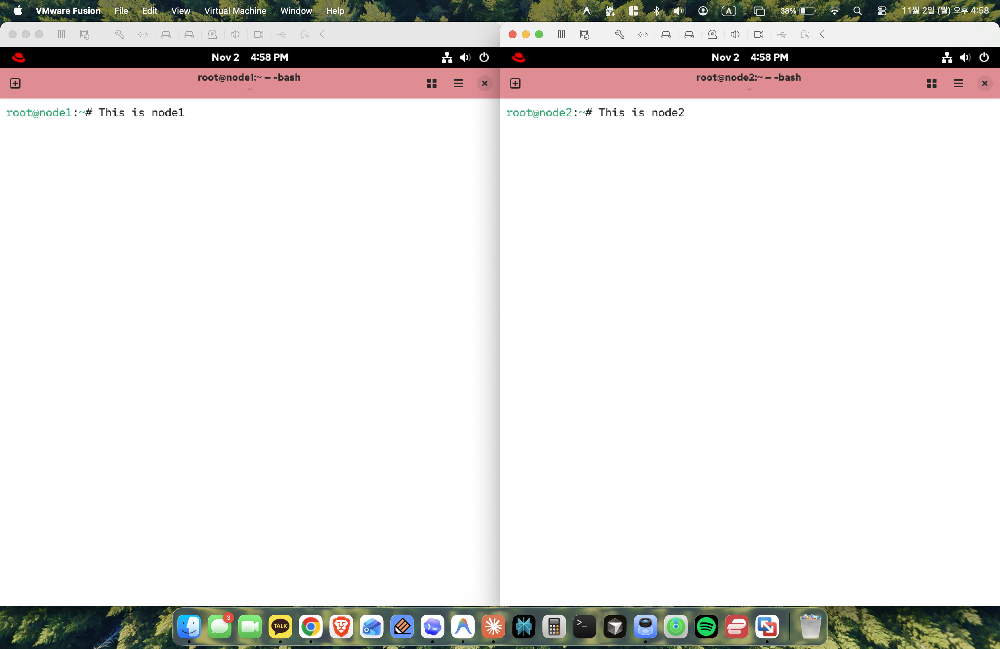
<p style="font-size: 14px; text-align: center; color: #666;">
  Figure 1: Dual RHEL 9 virtual machines (node1 and node2) running side-by-side in VMware Fusion with active root terminal access.
</p>

Two independent RHEL 9 virtual machines (`node1` on the left, `node2` on the right) are running in VMware Fusion. Each node operates with its own virtual disk, network adapters, and dedicated resources. Logged in as `root` on both machines and ran a quick echo command (`This is node1` and `This is node2`) to confirm terminal responsiveness and ensure commands are directed to the correct node.

---

### Step 6: Checking Current Network Status

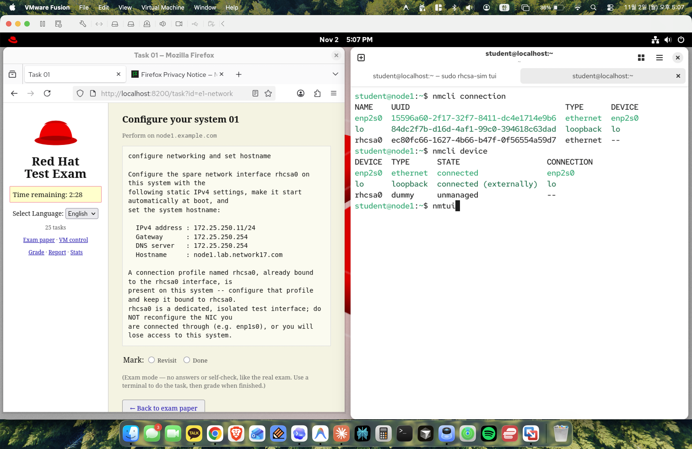
<p style="font-size: 14px; text-align: center; color: #666;">
  Figure 6: Checking network profiles and devices with nmcli.
</p>

On `node1`, checked current connections and devices:
```bash
nmcli connection show
nmcli device status
```
* `enp2s0`: Connected ethernet interface.
* `rhcsa0`: Dummy network interface profile.

---

### Step 7: Launching `nmtui`

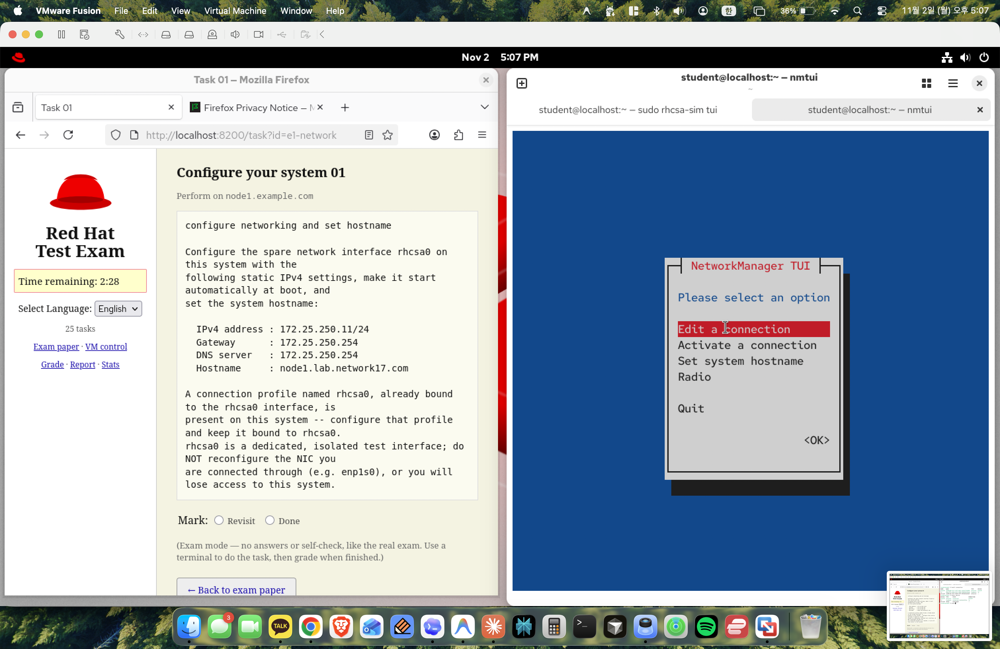
<p style="font-size: 14px; text-align: center; color: #666;">
  Figure 7: Opening the NetworkManager Text User Interface (nmtui).
</p>

Launched `nmtui` in the terminal to configure network settings and hostname via the interactive menu.

---

### Step 8: `nmtui` Main Menu

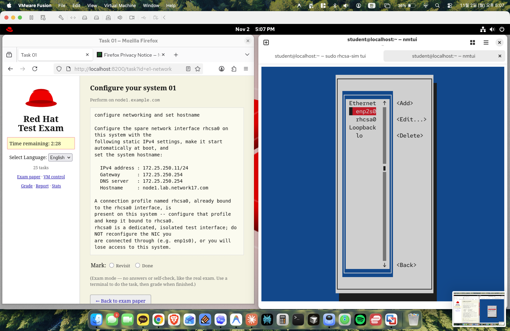
<p style="font-size: 14px; text-align: center; color: #666;">
  Figure 8: nmtui main menu options.
</p>

The menu provides three options: **Edit a connection**, **Activate a connection**, and **Set system hostname**. Selected **Edit a connection** to start configuring network parameters.

---

### Step 9: Selecting Connection to Edit

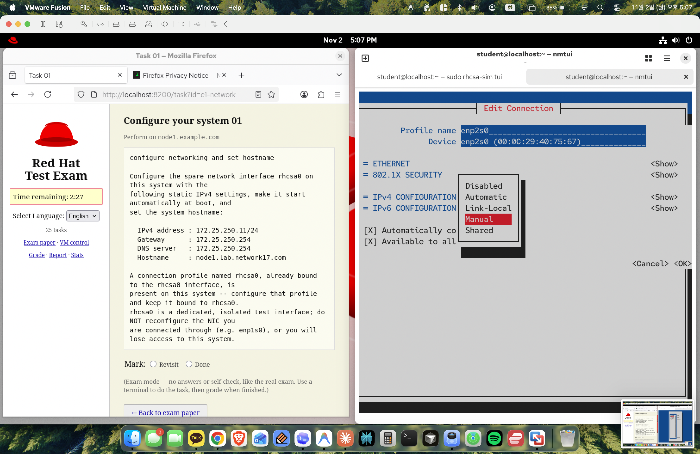
<p style="font-size: 14px; text-align: center; color: #666;">
  Figure 9: List of available network connections in nmtui.
</p>

The connection list shows available Ethernet connections (`enp2s0` and `rhcsa0`). Selected `<Edit>` to configure connection details.

---

### Step 10: Entering Static IPv4 Settings

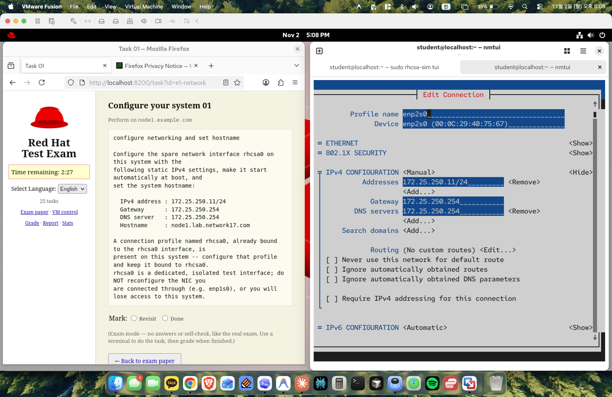
<p style="font-size: 14px; text-align: center; color: #666;">
  Figure 10: Entering manual IPv4 settings, gateway, and DNS servers.
</p>

Configured IPv4 settings to `<Manual>` and entered:
* **Addresses**: `172.25.250.11/24`
* **Gateway**: `172.25.250.254`
* **DNS servers**: `172.25.250.254`
* Verified that **Automatically connect** is checked.

---

### Step 11: Saving Connection Changes

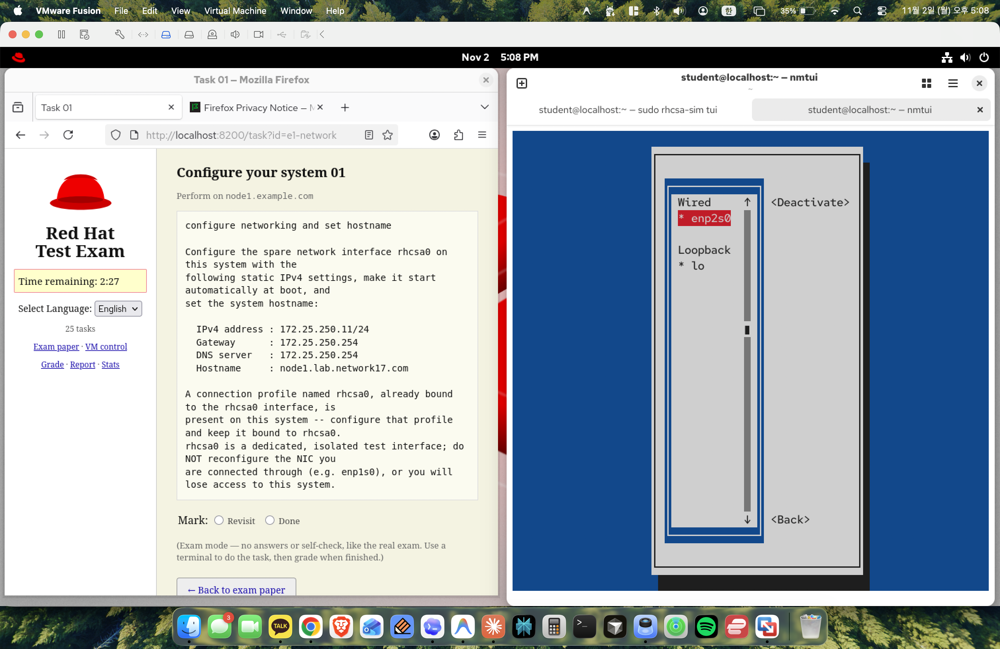
<p style="font-size: 14px; text-align: center; color: #666;">
  Figure 11: Returning to the connection list after saving.
</p>

Selected `<OK>` to save the configuration changes and returned to the connection menu.

---

### Step 12: Setting System Hostname

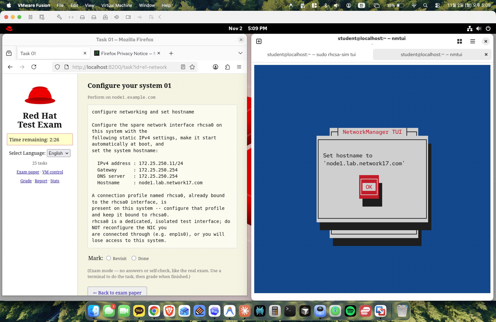
<p style="font-size: 14px; text-align: center; color: #666;">
  Figure 12: Entering the hostname node1.lab.network17.com in nmtui.
</p>

Navigated back to the main menu, selected **Set system hostname**, and entered `node1.lab.network17.com`.

---

### Step 13: Hostname Confirmation

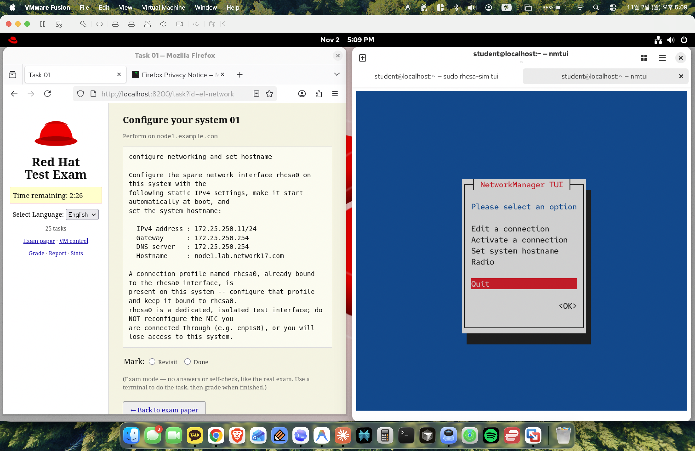
<p style="font-size: 14px; text-align: center; color: #666;">
  Figure 13: Confirmation popup confirming the hostname update.
</p>

Confirmed that the hostname was updated to `node1.lab.network17.com`. Selected `<OK>` and exited `nmtui`.

---

### Step 14: Verifying IP Address Configuration

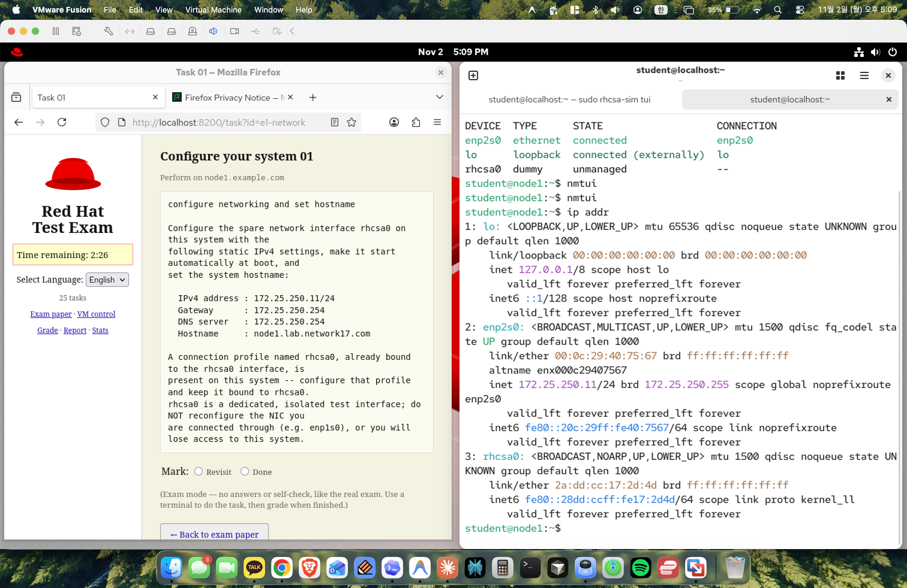
<p style="font-size: 14px; text-align: center; color: #666;">
  Figure 14: Checking IP addresses with ip addr.
</p>

Ran `ip addr` in the terminal to inspect the active network configuration:
```bash
ip addr
```
Checked the assigned IP addresses on each network interface to verify the changes.

---

### Step 15: Verifying Routing Table

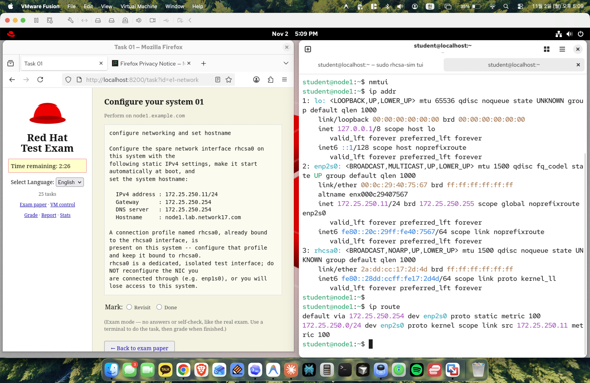
<p style="font-size: 14px; text-align: center; color: #666;">
  Figure 15: Inspecting the kernel routing table with ip route.
</p>

Ran `ip route` to check the default gateway and network routes:
```bash
ip route
```
Verified that the default route via `172.25.250.254` is in place.

---

### Step 16: Verifying Hostname

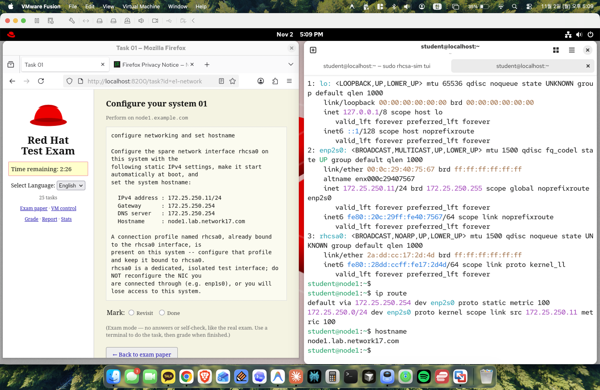
<p style="font-size: 14px; text-align: center; color: #666;">
  Figure 16: Checking the active system hostname.
</p>

Ran `hostname` to confirm the active hostname:
```bash
hostname
```
Output returned `node1.lab.network17.com`.

---

### Step 17: Verifying DNS Configuration

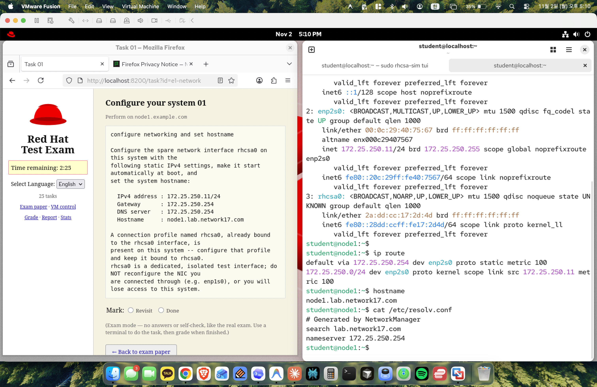
<p style="font-size: 14px; text-align: center; color: #666;">
  Figure 17: Checking /etc/resolv.conf for nameserver entries.
</p>

Verifying that DNS is properly configured.

---

### Step 18: Rebooting the System

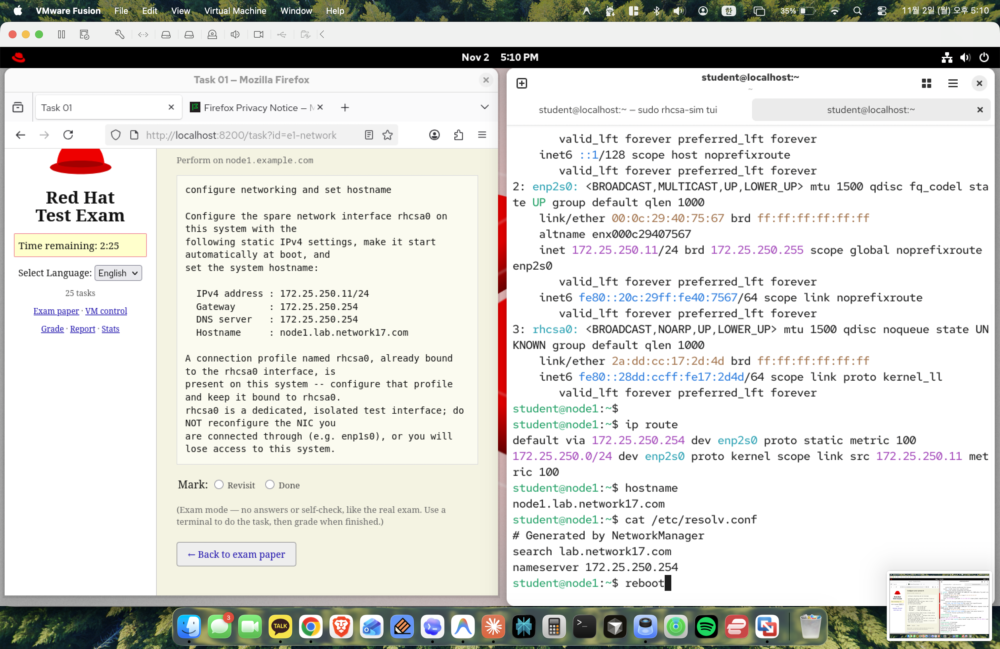
<p style="font-size: 14px; text-align: center; color: #666;">
  Figure 18: Executing the reboot command.
</p>

Issued the `reboot` command to restart the system:
```bash
reboot
```

---

### Step 19: System Rebooting

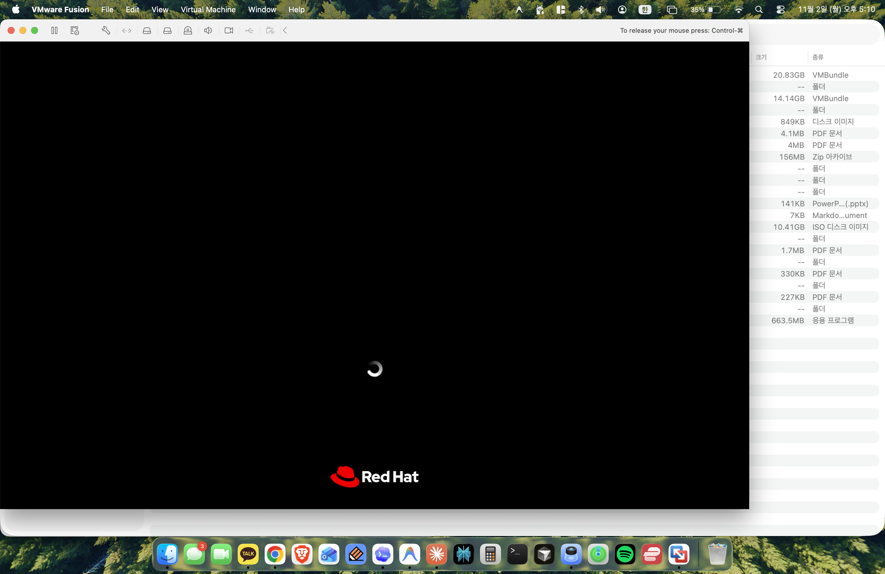
<p style="font-size: 14px; text-align: center; color: #666;">
  Figure 19: RHEL 9 rebooting.
</p>

If the network configuration remains intact after rebooting, then it's a success!

</details>

---

<details markdown="1">
<summary><strong>Task 2: Configure package repositories</strong></summary>

```text
Configure the package repositories in /etc/yum.repos.d/app.repo. Define two
repositories — BaseOS and AppStream — both enabled with GPG check disabled,
pointing at the provided package source:

  BaseOS    -> file:///opt/rhcsa-repo/BaseOS
  AppStream -> file:///opt/rhcsa-repo/AppStream
```

---

## Step-by-Step Walkthrough

### Step 1: Checking System Credentials & Switching to Root

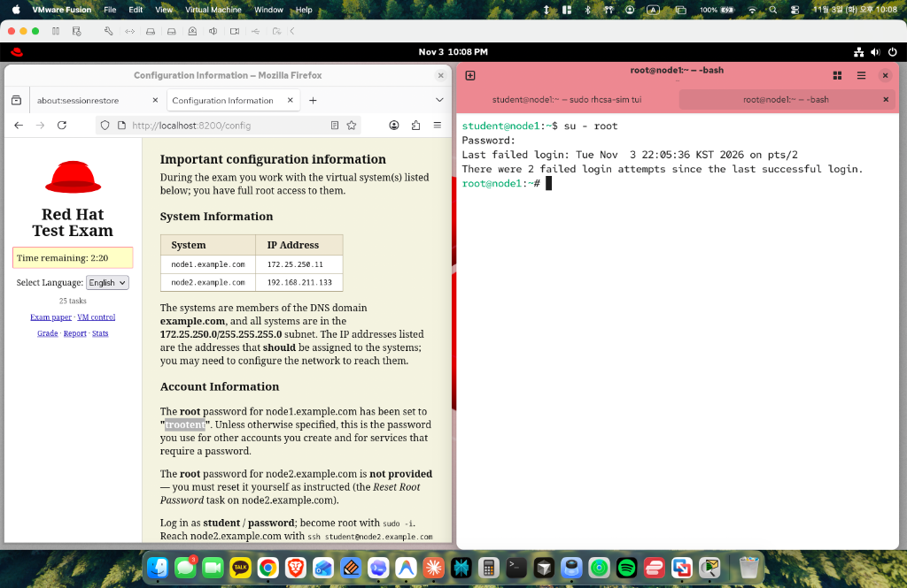
<p style="font-size: 14px; text-align: center; color: #666;">
  Figure 20: Checking root password in the exam configuration portal and switching to root on node1.
</p>

Checked the exam configuration information page (`http://localhost:8200/config`), which lists the host IP addresses and root password (`trootent`) for `node1.example.com`. Switched to `root` using `su - root`.

---

### Step 2: Reviewing Task 02 Prompt & Opening Repository File

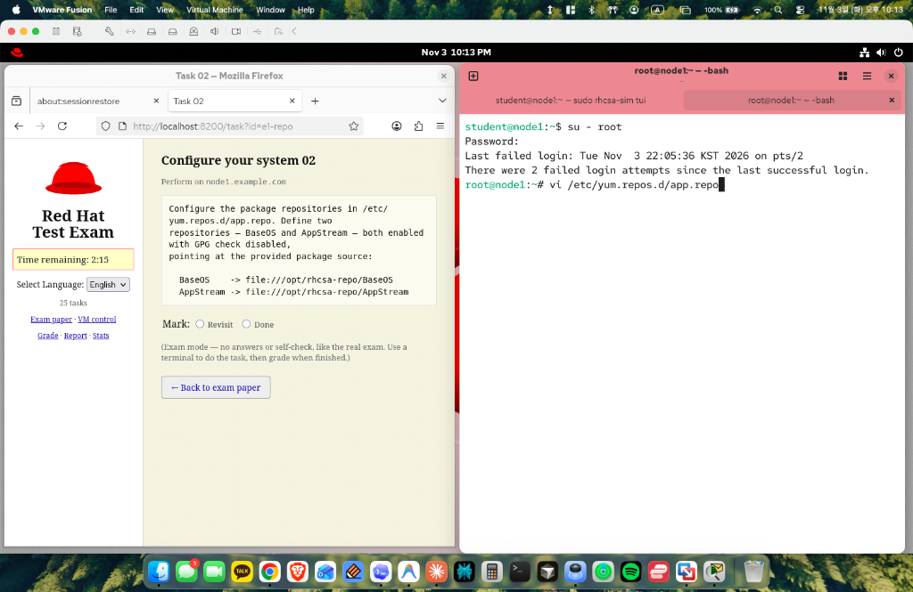
<p style="font-size: 14px; text-align: center; color: #666;">
  Figure 21: Reviewing Task 02 requirements and opening /etc/yum.repos.d/app.repo with vi.
</p>

Reviewed the task requirements for Task 02: configure package repositories in `/etc/yum.repos.d/app.repo` with `BaseOS` and `AppStream` pointing to `file:///opt/rhcsa-repo/BaseOS` and `file:///opt/rhcsa-repo/AppStream`. Opened the file with `vi`:
```bash
vi /etc/yum.repos.d/app.repo
```

---

### Step 3: Defining Repository Stanzas in `app.repo`

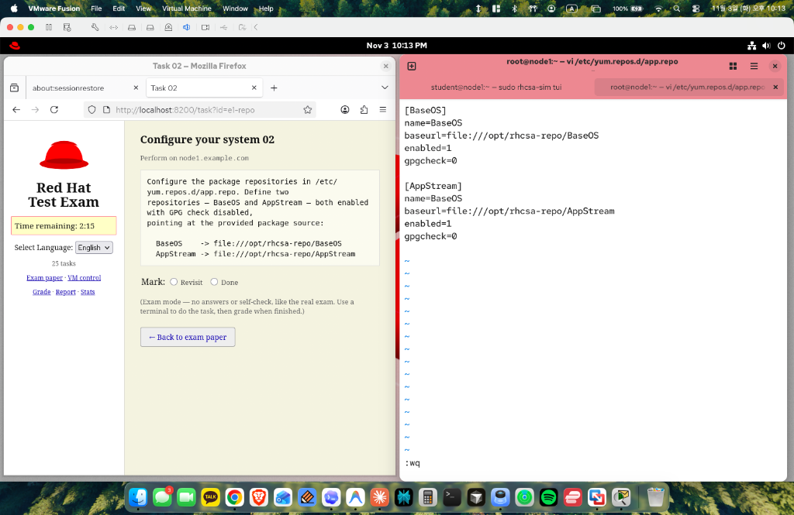
<p style="font-size: 14px; text-align: center; color: #666;">
  Figure 22: Writing the repository definitions in /etc/yum.repos.d/app.repo and saving with :wq.
</p>

Defined both repository stanzas in `/etc/yum.repos.d/app.repo`:
```ini
[BaseOS]
name=BaseOS
baseurl=file:///opt/rhcsa-repo/BaseOS
enabled=1
gpgcheck=0

[AppStream]
name=BaseOS
baseurl=file:///opt/rhcsa-repo/AppStream
enabled=1
gpgcheck=0
```
Saved and exited the editor with `:wq`.

---

### Step 4: Cleaning Cache & Verifying Repositories

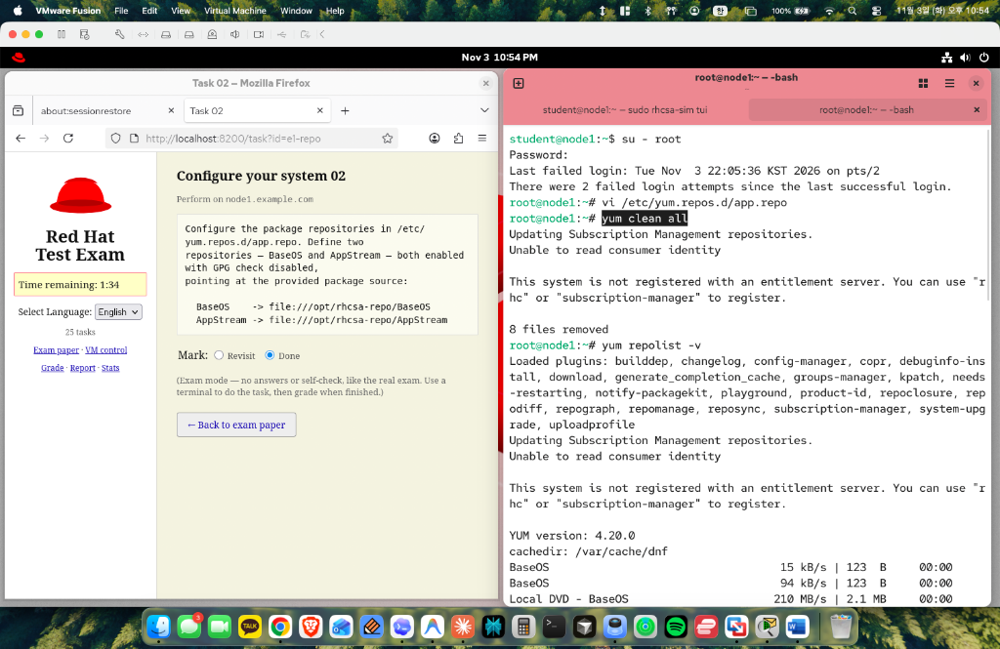
<p style="font-size: 14px; text-align: center; color: #666;">
  Figure 23: Cleaning YUM cache and verifying configured repositories with yum repolist -v.
</p>

Ran `yum clean all` to remove cached metadata, followed by `yum repolist -v` to verify that the local BaseOS and AppStream repositories loaded properly:
```bash
yum clean all
yum repolist -v
```
Confirmed that the repository metadata was loaded from `/opt/rhcsa-repo/`, and marked Task 02 as `Done` in the exam simulator.

</details>

---

<details markdown="1">
<summary><strong>Task 3: Configuring and Securing an Apache HTTP Service</strong></summary>

```text
On Node1, configure the Apache HTTP Server to meet the following requirements:

* The Apache web service must be installed, enabled, and running.
* The web server must listen on TCP port 85.
* The service must be accessible from both the local system and external hosts.
* When curled or accessed via a web browser, the server must display the following message:
  Welcome to the Apache Web Server!
```

---

## Step-by-Step Walkthrough

### Step 1: Checking Initial HTTP Service Status

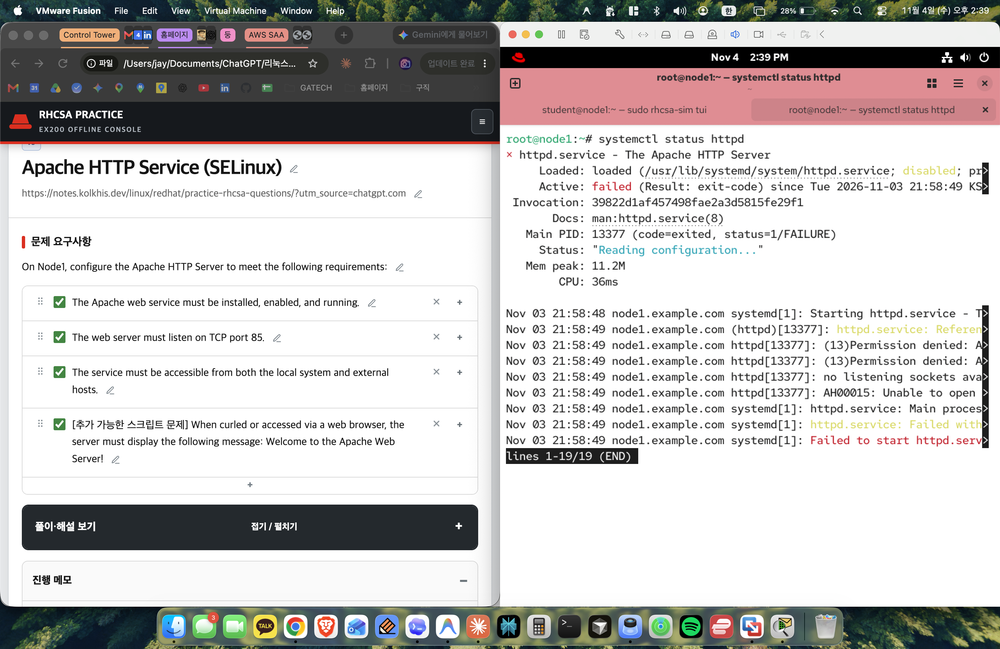
<p style="font-size: 14px; text-align: center; color: #666;">
  Figure 24: Inspecting httpd service status with systemctl status httpd showing failed status.
</p>

Checked current `httpd` status. The service was in `failed` state due to `Permission denied` when trying to bind to a non-standard port under SELinux:
```bash
systemctl status httpd
```

---

### Step 2: Verifying Package Installation

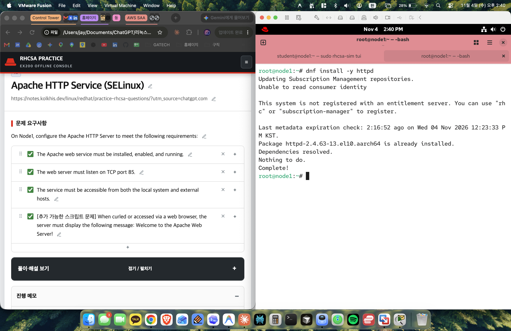
<p style="font-size: 14px; text-align: center; color: #666;">
  Figure 25: Checking httpd package installation with dnf install -y httpd.
</p>

Ran `dnf install -y httpd` to ensure the Apache package is installed:
```bash
dnf install -y httpd
```
Confirmed that `httpd-2.4.63-13.el10.aarch64` is already installed.

---

### Step 3: Opening Apache Configuration

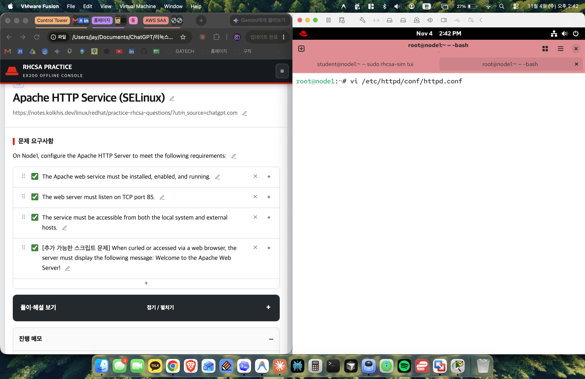
<p style="font-size: 14px; text-align: center; color: #666;">
  Figure 26: Opening /etc/httpd/conf/httpd.conf with vi.
</p>

Opened the primary Apache configuration file:
```bash
vi /etc/httpd/conf/httpd.conf
```

---

### Step 4: Configuring Listen Port 85

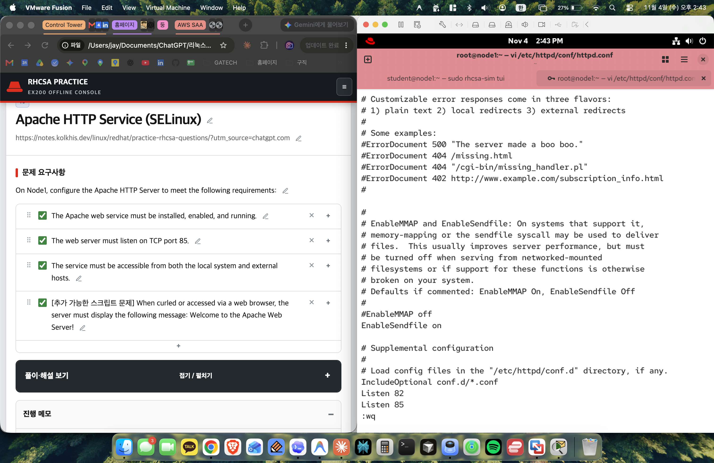
<p style="font-size: 14px; text-align: center; color: #666;">
  Figure 27: Adding Listen 85 directive in httpd.conf and saving with :wq.
</p>

Added the `Listen 85` directive in `/etc/httpd/conf/httpd.conf` and saved the file with `:wq`.

---

### Step 5: Allowing Port 85 in SELinux Policy

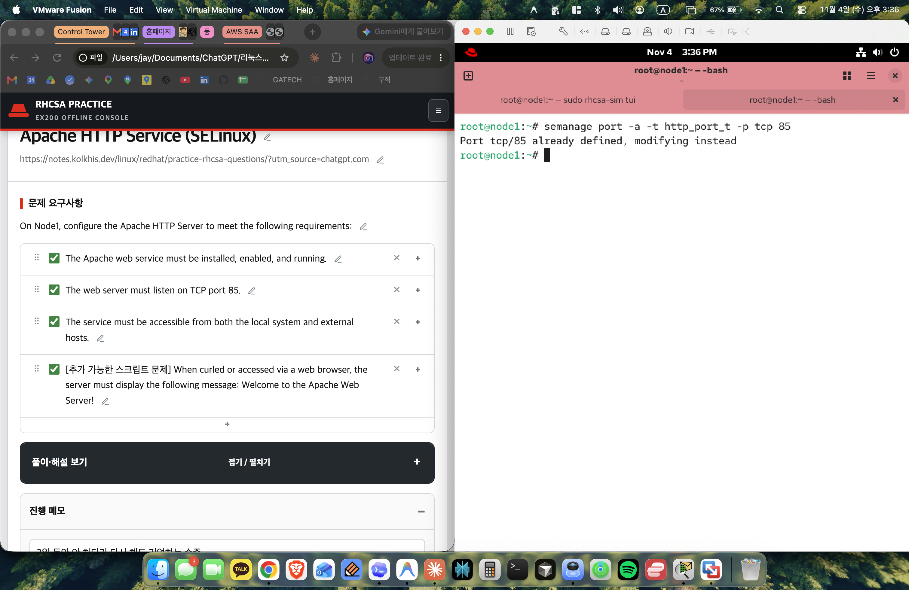
<p style="font-size: 14px; text-align: center; color: #666;">
  Figure 28: Adding TCP port 85 to http_port_t SELinux type with semanage port.
</p>

Configured SELinux to permit Apache to bind to non-standard TCP port 85:
```bash
semanage port -a -t http_port_t -p tcp 85
```

---

### Step 6: Enabling and Starting Apache Service

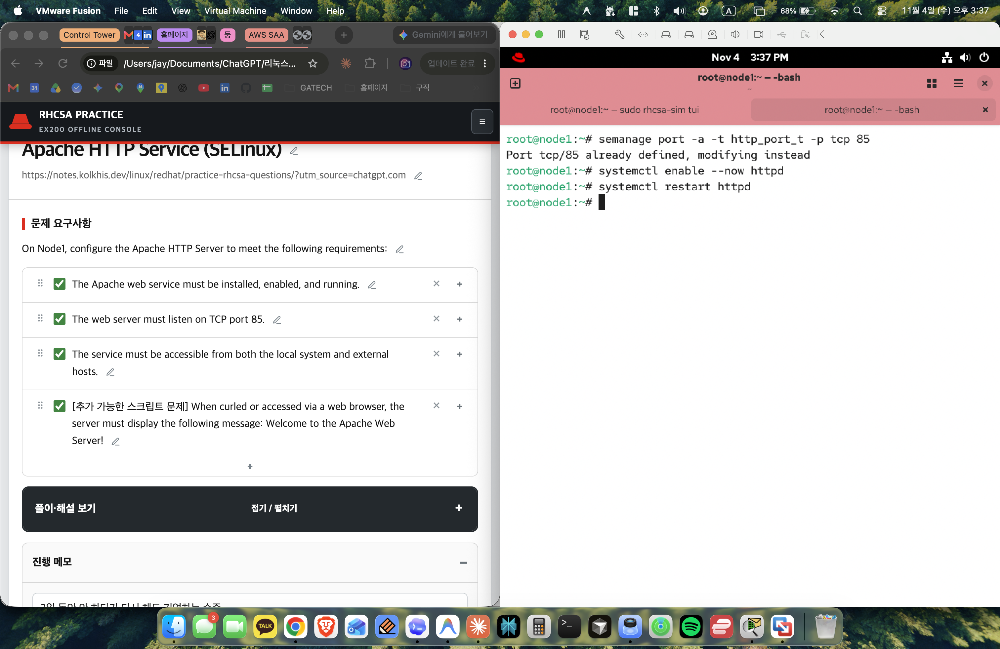
<p style="font-size: 14px; text-align: center; color: #666;">
  Figure 29: Enabling and restarting httpd service.
</p>

Enabled the service to start automatically at boot and restarted `httpd`:
```bash
systemctl enable --now httpd
systemctl restart httpd
```

---

### Step 7: Configuring Firewall for Port 85

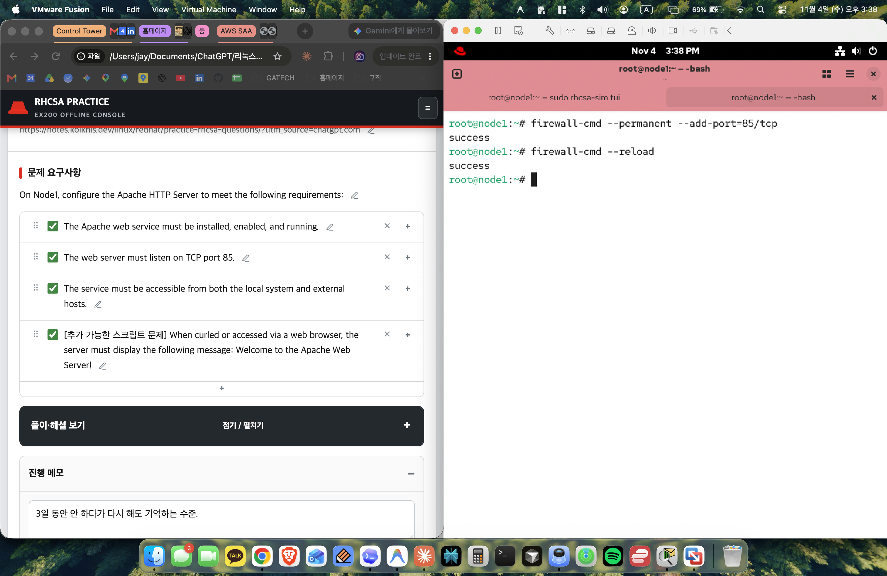
<p style="font-size: 14px; text-align: center; color: #666;">
  Figure 30: Allowing TCP port 85 in firewalld and reloading rules.
</p>

Opened TCP port 85 permanently in `firewalld` to allow external network access:
```bash
firewall-cmd --permanent --add-port=85/tcp
firewall-cmd --reload
```

---

### Step 8: Verifying Active Service Status

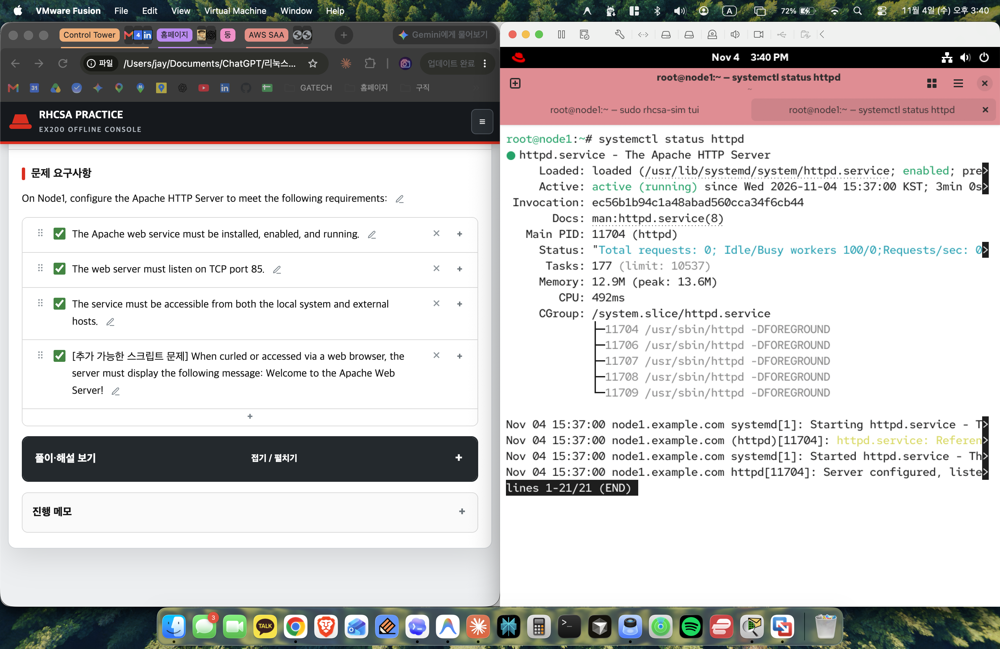
<p style="font-size: 14px; text-align: center; color: #666;">
  Figure 31: Verifying active (running) status of httpd.
</p>

Ran `systemctl status httpd` to verify that the service is `active (running)` and enabled at boot:
```bash
systemctl status httpd
```

</details>
