I set up this dual-node virtualization lab to practice hands-on Red Hat Enterprise Linux (RHEL 9) system administration in a realistic environment. To simulate real-world scenarios and RHCSA exam practice, I integrated a local simulation harness containing 25 practical tasks.

---

## Lab Environment

* **Hypervisor**: VMware Fusion running on macOS.
* **Nodes**: Two RHEL 9 virtual machines (`node1` and `node2`).
* **Network Interfaces on node1**:
  * `enp2s0`: Primary management network interface.
  * `rhcsa0`: Dedicated interface for practicing static network assignments.
* **Simulation Harness**: Local practice suite with a web interface at `http://localhost:8200` and automated CLI grading tools.

---

<details markdown="1">
<summary><strong>Task 1: Configure networking and set hostname</strong></summary>

```text
configure networking and set hostname

Configure the spare network interface rhcsa0 on this system with the
following static IPv4 settings, make it start automatically at boot, and
set the system hostname:

  IPv4 address : 172.25.250.11/24
  Gateway      : 172.25.250.254
  DNS server   : 172.25.250.254
  Hostname     : node1.lab.network17.com

A connection profile named rhcsa0, already bound to the rhcsa0 interface, is
present on this system -- configure that profile and keep it bound to rhcsa0.
rhcsa0 is a dedicated, isolated test interface; do NOT reconfigure the NIC you
are connected through (e.g. enp1s0), or you will lose access to this system.
```

---

## Step-by-Step Walkthrough

### Step 1: Virtual Machine Cluster Setup & Console Verification


<p style="font-size: 14px; text-align: center; color: #666;">
  Figure 1: Dual RHEL 9 virtual machines (node1 and node2) running side-by-side in VMware Fusion with active root terminal access.
</p>

Two independent RHEL 9 virtual machines (`node1` on the left, `node2` on the right) are running in VMware Fusion. Each node operates with its own virtual disk, network adapters, and dedicated resources. Logged in as `root` on both machines and ran a quick echo command (`This is node1` and `This is node2`) to confirm terminal responsiveness and ensure commands are directed to the correct node.

---

### Step 6: Checking Current Network Status


<p style="font-size: 14px; text-align: center; color: #666;">
  Figure 6: Checking network profiles and devices with nmcli.
</p>

On `node1`, checked current connections and devices:
```bash
nmcli connection show
nmcli device status
```
* `enp2s0`: Connected ethernet interface.
* `rhcsa0`: Dummy network interface profile.

---

### Step 7: Launching `nmtui`


<p style="font-size: 14px; text-align: center; color: #666;">
  Figure 7: Opening the NetworkManager Text User Interface (nmtui).
</p>

Launched `nmtui` in the terminal to configure network settings and hostname via the interactive menu.

---

### Step 8: `nmtui` Main Menu


<p style="font-size: 14px; text-align: center; color: #666;">
  Figure 8: nmtui main menu options.
</p>

The menu provides three options: **Edit a connection**, **Activate a connection**, and **Set system hostname**. Selected **Edit a connection** to start configuring network parameters.

---

### Step 9: Selecting Connection to Edit


<p style="font-size: 14px; text-align: center; color: #666;">
  Figure 9: List of available network connections in nmtui.
</p>

The connection list shows available Ethernet connections (`enp2s0` and `rhcsa0`). Selected `<Edit>` to configure connection details.

---

### Step 10: Entering Static IPv4 Settings


<p style="font-size: 14px; text-align: center; color: #666;">
  Figure 10: Entering manual IPv4 settings, gateway, and DNS servers.
</p>

Configured IPv4 settings to `<Manual>` and entered:
* **Addresses**: `172.25.250.11/24`
* **Gateway**: `172.25.250.254`
* **DNS servers**: `172.25.250.254`
* Verified that **Automatically connect** is checked.

---

### Step 11: Saving Connection Changes


<p style="font-size: 14px; text-align: center; color: #666;">
  Figure 11: Returning to the connection list after saving.
</p>

Selected `<OK>` to save the configuration changes and returned to the connection menu.

---

### Step 12: Setting System Hostname


<p style="font-size: 14px; text-align: center; color: #666;">
  Figure 12: Entering the hostname node1.lab.network17.com in nmtui.
</p>

Navigated back to the main menu, selected **Set system hostname**, and entered `node1.lab.network17.com`.

---

### Step 13: Hostname Confirmation


<p style="font-size: 14px; text-align: center; color: #666;">
  Figure 13: Confirmation popup confirming the hostname update.
</p>

Confirmed that the hostname was updated to `node1.lab.network17.com`. Selected `<OK>` and exited `nmtui`.

---

### Step 14: Verifying IP Address Configuration


<p style="font-size: 14px; text-align: center; color: #666;">
  Figure 14: Checking IP addresses with ip addr.
</p>

Ran `ip addr` in the terminal to inspect the active network configuration:
```bash
ip addr
```
Checked the assigned IP addresses on each network interface to verify the changes.

---

### Step 15: Verifying Routing Table


<p style="font-size: 14px; text-align: center; color: #666;">
  Figure 15: Inspecting the kernel routing table with ip route.
</p>

Ran `ip route` to check the default gateway and network routes:
```bash
ip route
```
Verified that the default route via `172.25.250.254` is in place.

---

### Step 16: Verifying Hostname


<p style="font-size: 14px; text-align: center; color: #666;">
  Figure 16: Checking the active system hostname.
</p>

Ran `hostname` to confirm the active hostname:
```bash
hostname
```
Output returned `node1.lab.network17.com`.

---

### Step 17: Verifying DNS Configuration


<p style="font-size: 14px; text-align: center; color: #666;">
  Figure 17: Checking /etc/resolv.conf for nameserver entries.
</p>

Verifying that DNS is properly configured.

---

### Step 18: Rebooting the System


<p style="font-size: 14px; text-align: center; color: #666;">
  Figure 18: Executing the reboot command.
</p>

Issued the `reboot` command to restart the system:
```bash
reboot
```

---

### Step 19: System Rebooting


<p style="font-size: 14px; text-align: center; color: #666;">
  Figure 19: RHEL 9 rebooting.
</p>

If the network configuration remains intact after rebooting, then it's a success!

</details>

---

<details markdown="1">
<summary><strong>Task 2: Configure package repositories</strong></summary>

```text
Configure the package repositories in /etc/yum.repos.d/app.repo. Define two
repositories — BaseOS and AppStream — both enabled with GPG check disabled,
pointing at the provided package source:

  BaseOS    -> file:///opt/rhcsa-repo/BaseOS
  AppStream -> file:///opt/rhcsa-repo/AppStream
```

---

## Step-by-Step Walkthrough

### Step 1: Checking System Credentials & Switching to Root


<p style="font-size: 14px; text-align: center; color: #666;">
  Figure 20: Checking root password in the exam configuration portal and switching to root on node1.
</p>

Checked the exam configuration information page (`http://localhost:8200/config`), which lists the host IP addresses and root password (`trootent`) for `node1.example.com`. Switched to `root` using `su - root`.

---

### Step 2: Reviewing Task 02 Prompt & Opening Repository File


<p style="font-size: 14px; text-align: center; color: #666;">
  Figure 21: Reviewing Task 02 requirements and opening /etc/yum.repos.d/app.repo with vi.
</p>

Reviewed the task requirements for Task 02: configure package repositories in `/etc/yum.repos.d/app.repo` with `BaseOS` and `AppStream` pointing to `file:///opt/rhcsa-repo/BaseOS` and `file:///opt/rhcsa-repo/AppStream`. Opened the file with `vi`:
```bash
vi /etc/yum.repos.d/app.repo
```

---

### Step 3: Defining Repository Stanzas in `app.repo`


<p style="font-size: 14px; text-align: center; color: #666;">
  Figure 22: Writing the repository definitions in /etc/yum.repos.d/app.repo and saving with :wq.
</p>

Defined both repository stanzas in `/etc/yum.repos.d/app.repo`:
```ini
[BaseOS]
name=BaseOS
baseurl=file:///opt/rhcsa-repo/BaseOS
enabled=1
gpgcheck=0

[AppStream]
name=BaseOS
baseurl=file:///opt/rhcsa-repo/AppStream
enabled=1
gpgcheck=0
```
Saved and exited the editor with `:wq`.

---

### Step 4: Cleaning Cache & Verifying Repositories


<p style="font-size: 14px; text-align: center; color: #666;">
  Figure 23: Cleaning YUM cache and verifying configured repositories with yum repolist -v.
</p>

Ran `yum clean all` to remove cached metadata, followed by `yum repolist -v` to verify that the local BaseOS and AppStream repositories loaded properly:
```bash
yum clean all
yum repolist -v
```
Confirmed that the repository metadata was loaded from `/opt/rhcsa-repo/`, and marked Task 02 as `Done` in the exam simulator.

</details>

---

<details markdown="1">
<summary><strong>Task 3: Configuring and Securing an Apache HTTP Service</strong></summary>

```text
On Node1, configure the Apache HTTP Server to meet the following requirements:

* The Apache web service must be installed, enabled, and running.
* The web server must listen on TCP port 85.
* The service must be accessible from both the local system and external hosts.
* When curled or accessed via a web browser, the server must display the following message:
  Welcome to the Apache Web Server!
```

---

## Step-by-Step Walkthrough

### Step 1: Checking Initial HTTP Service Status


<p style="font-size: 14px; text-align: center; color: #666;">
  Figure 24: Inspecting httpd service status with systemctl status httpd showing failed status.
</p>

Checked current `httpd` status. The service was in `failed` state due to `Permission denied` when trying to bind to a non-standard port under SELinux:
```bash
systemctl status httpd
```

---

### Step 2: Verifying Package Installation


<p style="font-size: 14px; text-align: center; color: #666;">
  Figure 25: Checking httpd package installation with dnf install -y httpd.
</p>

Ran `dnf install -y httpd` to ensure the Apache package is installed:
```bash
dnf install -y httpd
```
Confirmed that `httpd-2.4.63-13.el10.aarch64` is already installed.

---

### Step 3: Opening Apache Configuration


<p style="font-size: 14px; text-align: center; color: #666;">
  Figure 26: Opening /etc/httpd/conf/httpd.conf with vi.
</p>

Opened the primary Apache configuration file:
```bash
vi /etc/httpd/conf/httpd.conf
```

---

### Step 4: Configuring Listen Port 85


<p style="font-size: 14px; text-align: center; color: #666;">
  Figure 27: Adding Listen 85 directive in httpd.conf and saving with :wq.
</p>

Added the `Listen 85` directive in `/etc/httpd/conf/httpd.conf` and saved the file with `:wq`.

---

### Step 5: Allowing Port 85 in SELinux Policy


<p style="font-size: 14px; text-align: center; color: #666;">
  Figure 28: Adding TCP port 85 to http_port_t SELinux type with semanage port.
</p>

Configured SELinux to permit Apache to bind to non-standard TCP port 85:
```bash
semanage port -a -t http_port_t -p tcp 85
```

---

### Step 6: Enabling and Starting Apache Service


<p style="font-size: 14px; text-align: center; color: #666;">
  Figure 29: Enabling and restarting httpd service.
</p>

Enabled the service to start automatically at boot and restarted `httpd`:
```bash
systemctl enable --now httpd
systemctl restart httpd
```

---

### Step 7: Configuring Firewall for Port 85


<p style="font-size: 14px; text-align: center; color: #666;">
  Figure 30: Allowing TCP port 85 in firewalld and reloading rules.
</p>

Opened TCP port 85 permanently in `firewalld` to allow external network access:
```bash
firewall-cmd --permanent --add-port=85/tcp
firewall-cmd --reload
```

---

### Step 8: Verifying Active Service Status


<p style="font-size: 14px; text-align: center; color: #666;">
  Figure 31: Verifying active (running) status of httpd.
</p>

Ran `systemctl status httpd` to verify that the service is `active (running)` and enabled at boot:
```bash
systemctl status httpd
```

</details>

<details markdown="1">
<summary><strong>Task 4: Manage Users and Groups</strong></summary>

```text
Manage users and groups

Requirements:
- Create the group named "sysadms".
- Create users natasha and harry; they should be members of the supplementary group sysadms.
- Create a user sarah who should have a non-interactive shell and should not be a member of sysadms.
- Set passwords for all users as "trootent".
- Configure sudo so that all members of the sysadms group can execute all commands with the privileges of any user (including root) without entering a password.
- Configure sudo so that the user harry can execute the passwd command with the privileges of any user (including root) without entering a password.
- Configure sudo so that all members of the sysadms group can execute the useradd command with the privileges of any user (including root).
```

---

## Step-by-Step Walkthrough

### Step 1: Creating the sysadms Group

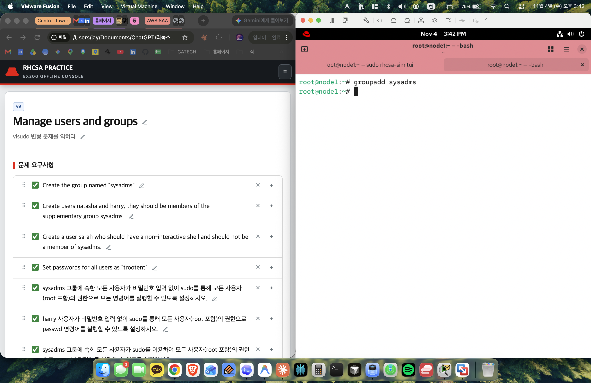
<p style="font-size: 14px; text-align: center; color: #666;">
  Figure 32: Creating the administrative group sysadms using groupadd.
</p>

Created the requested administrative group `sysadms`:
```bash
groupadd sysadms
```

---

### Step 2: Creating Users natasha and harry with Supplementary Group

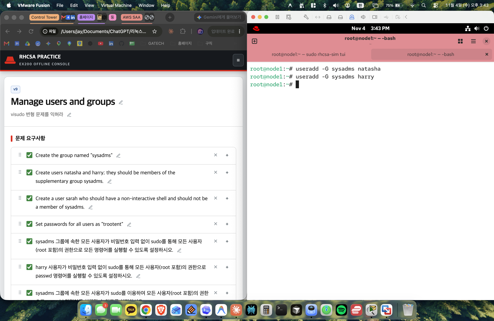
<p style="font-size: 14px; text-align: center; color: #666;">
  Figure 33: Creating users natasha and harry with supplementary group sysadms.
</p>

Created `natasha` and `harry`, assigning `sysadms` as their supplementary group:
```bash
useradd -G sysadms natasha
useradd -G sysadms harry
```

---

### Step 3: Configuring User sarah with Non-Interactive Shell

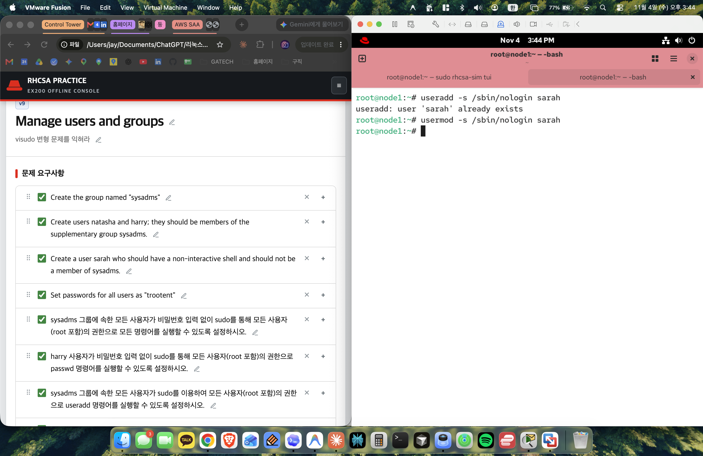
<p style="font-size: 14px; text-align: center; color: #666;">
  Figure 34: Setting non-interactive shell (/sbin/nologin) for user sarah.
</p>

Created or updated user `sarah` to have a non-interactive login shell (`/sbin/nologin`) and no membership in `sysadms`:
```bash
useradd -s /sbin/nologin sarah
usermod -s /sbin/nologin sarah
```

> User passwords for `natasha`, `harry`, and `sarah` are set to `trootent` as required:
> ```bash
> echo "trootent" | passwd --stdin natasha
> echo "trootent" | passwd --stdin harry
> echo "trootent" | passwd --stdin sarah
> ```

---

### Step 4: Accessing Sudoers Configuration with visudo

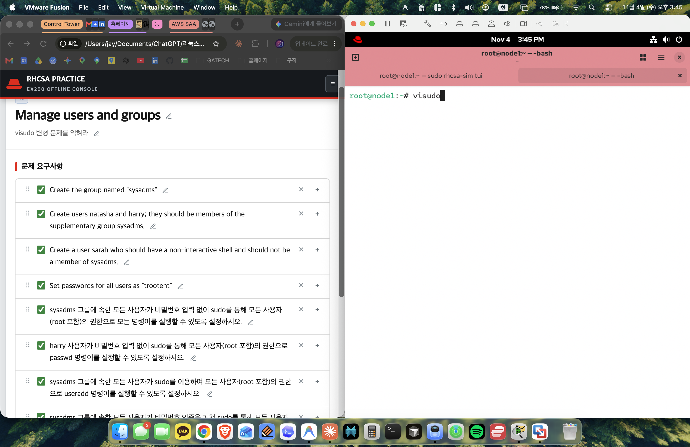
<p style="font-size: 14px; text-align: center; color: #666;">
  Figure 35: Opening sudoers configuration file safely using visudo.
</p>

Used `visudo` to safely edit the sudoers configuration with syntax validation:
```bash
visudo
```

---

### Step 5: Verifying Absolute Command Paths


<p style="font-size: 14px; text-align: center; color: #666;">
  Figure 36: Resolving absolute paths for passwd and useradd commands.
</p>

Checked the exact binary paths for commands specified in sudo rules:
```bash
which passwd
which useradd
```
Output confirmed paths:
- `/usr/bin/passwd`
- `/usr/sbin/useradd`

---

### Step 6: Configuring Sudo Rules in sudoers

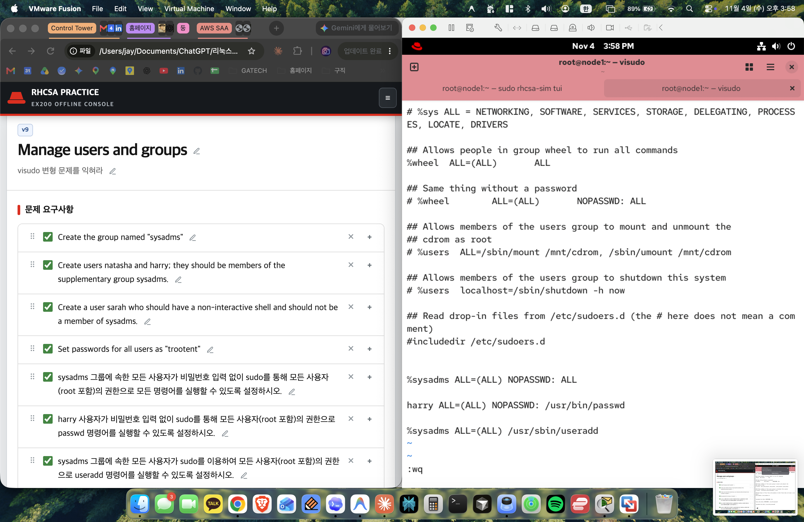
<p style="font-size: 14px; text-align: center; color: #666;">
  Figure 37: Adding sudoers permission rules for sysadms group and harry.
</p>

Appended the required sudo permission rules at the end of the sudoers configuration:
```text
%sysadms ALL=(ALL) NOPASSWD: ALL

harry ALL=(ALL) NOPASSWD: /usr/bin/passwd

%sysadms ALL=(ALL) /usr/sbin/useradd
```
Saved the configuration and exited using `:wq`.

---

### Step 7: Verifying Configuration Completion

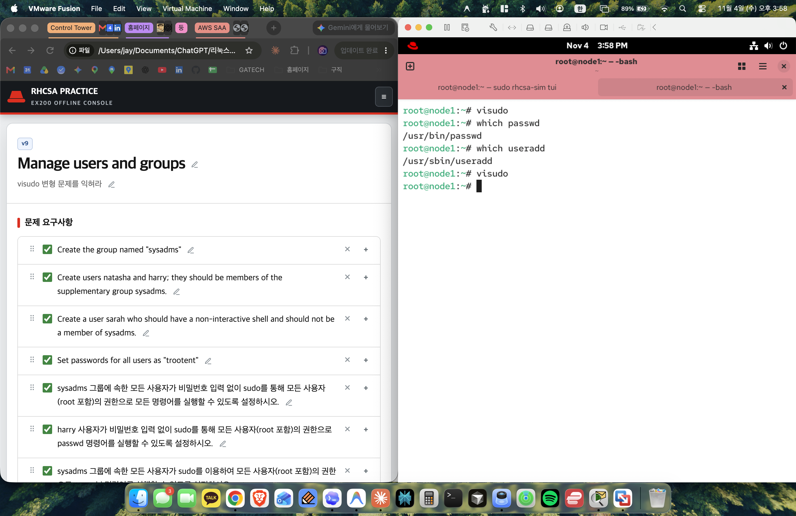
<p style="font-size: 14px; text-align: center; color: #666;">
  Figure 38: Completing sudoers rule modification and returning to the shell prompt.
</p>

`visudo` validated the syntax on save with no parse errors, returning cleanly to the root shell prompt:
```bash
visudo
```

</details>

<details markdown="1">
<summary><strong>Task 5: Crontab Configuration and Access Control</strong></summary>

```text
Crontab Type 1

Requirements:
- Schedule a job to run every day at 14:32:
  - User: natasha
  - Command: /bin/echo hiya
- Configure the system so that only the user tom is allowed to create cron jobs.
```

---

## Step-by-Step Walkthrough

### Step 1: Checking Crond Service Status

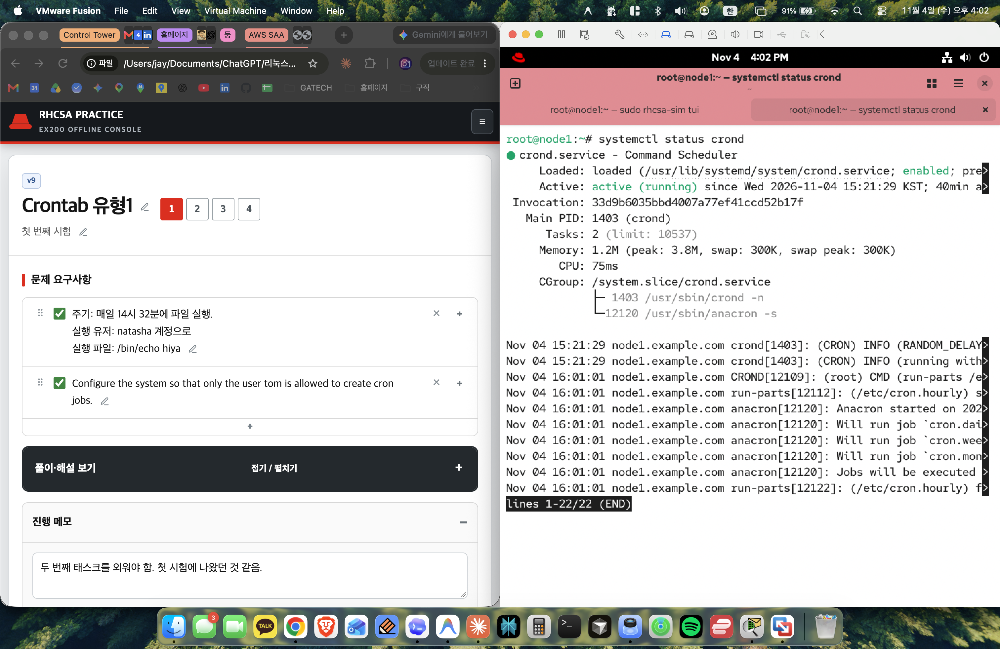
<p style="font-size: 14px; text-align: center; color: #666;">
  Figure 39: Verifying initial crond service status and configuration requirements.
</p>

Checked whether the cron daemon `crond` is active and running:
```bash
systemctl status crond
```
The service was active (running) and enabled on boot.

---

### Step 2: Accessing User Crontab for natasha

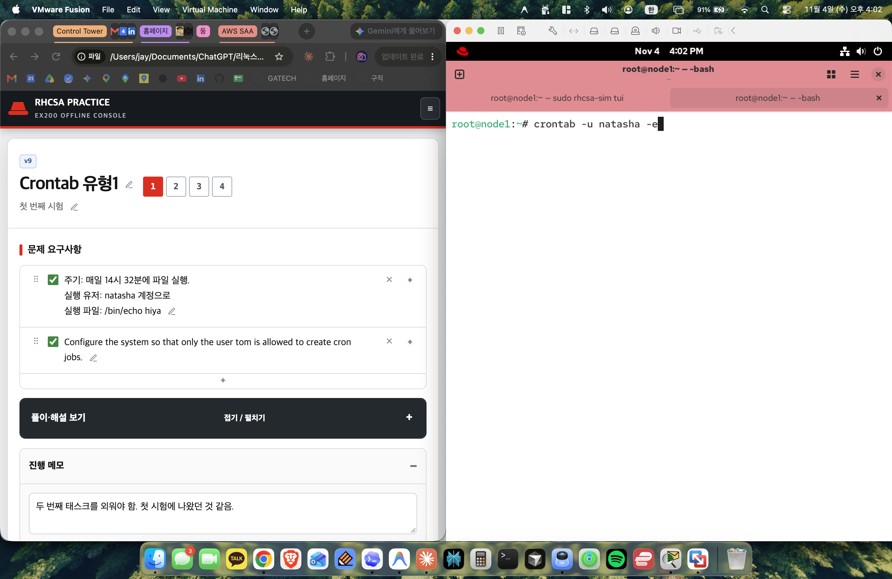
<p style="font-size: 14px; text-align: center; color: #666;">
  Figure 40: Opening crontab editor for user natasha using crontab -u natasha -e.
</p>

Opened `natasha`'s crontab using root privileges:
```bash
crontab -u natasha -e
```

---

### Step 3: Setting the Scheduled Task for natasha


<p style="font-size: 14px; text-align: center; color: #666;">
  Figure 41: Configuring daily schedule at 14:32 to run /bin/echo hiya.
</p>

Configured the required schedule (`minute: 32`, `hour: 14`, daily) and command:
```text
32 14 * * * /bin/echo hiya
```
Saved the file and exited `:wq`.

---

### Step 4: Configuring Cron Access Control

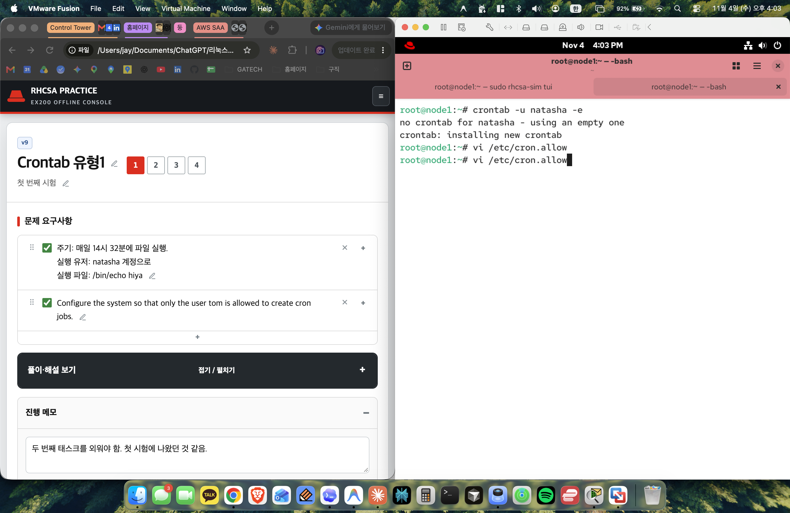
<p style="font-size: 14px; text-align: center; color: #666;">
  Figure 42: Confirming crontab installation and opening /etc/cron.allow.
</p>

After saving `natasha`'s cron job (`crontab: installing new crontab`), opened `/etc/cron.allow` to restrict cron access:
```bash
vi /etc/cron.allow
```

---

### Step 5: Restricting Cron Access to User tom


<p style="font-size: 14px; text-align: center; color: #666;">
  Figure 43: Adding user tom to /etc/cron.allow to restrict crontab creation.
</p>

Added `tom` to `/etc/cron.allow`:
```text
tom
```
When `/etc/cron.allow` exists, only users listed within this file are permitted to create cron jobs, satisfying the requirement that only `tom` is allowed to create cron jobs. Saved and exited with `:wq`.

---

### Step 6: Enabling and Verifying Crond Service

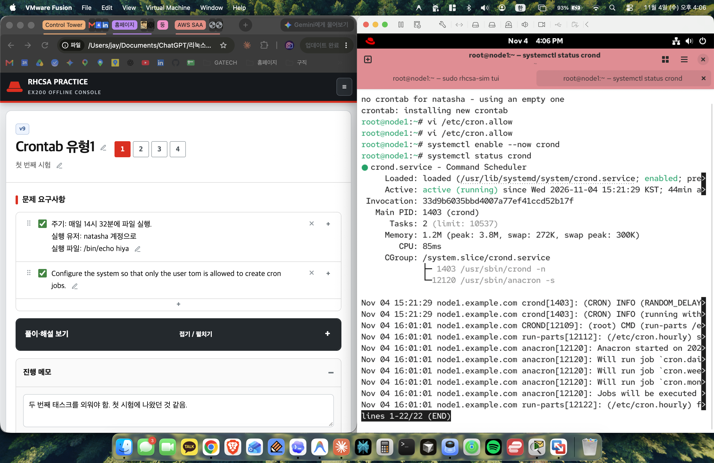
<p style="font-size: 14px; text-align: center; color: #666;">
  Figure 44: Enabling and verifying crond service status.
</p>

Ensured the daemon is enabled and running:
```bash
systemctl enable --now crond
systemctl status crond
```
Confirmed that `crond.service` is active (running) and loaded properly.

</details>

<details markdown="1">
<summary><strong>Task 6: Configure a Collaboration Directory</strong></summary>

```text
Collaborative Directory

Requirements:
- Create the directory "/home/manager".
- Group ownership of "/home/manager" should go to the "sysadms" group.
- The directory should have full permission for all members of the "sysadms" group, but not for other users except "root".
- The SGID (SETGID) bit must be set so that newly created files inherit group ownership from the directory.
```

---

## Step-by-Step Walkthrough

### Step 1: Creating the Directory and Setting Group Ownership

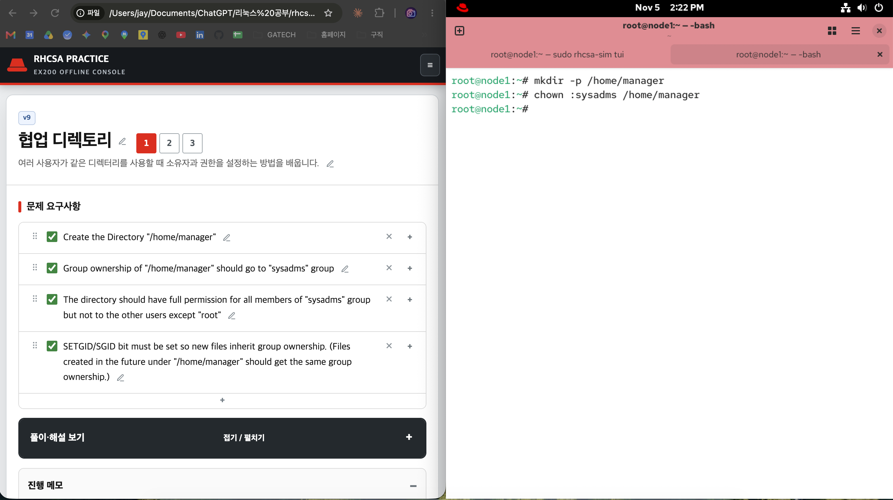
<p style="font-size: 14px; text-align: center; color: #666;">
  Figure 45: Creating the /home/manager directory and setting group ownership to sysadms.
</p>

Created the requested directory `/home/manager` and changed its group ownership to `sysadms`:
```bash
mkdir -p /home/manager
chown :sysadms /home/manager
```

---

### Step 2: Configuring Permissions with the SGID Bit

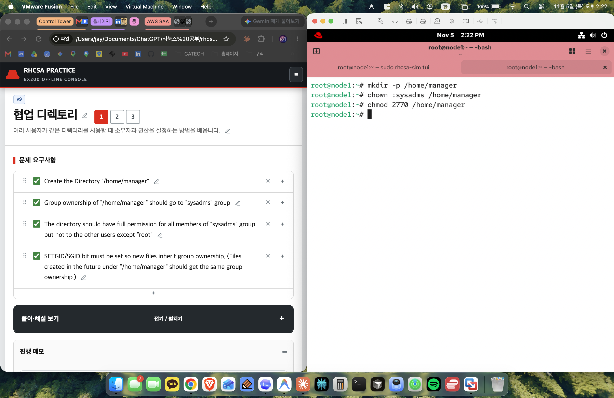
<p style="font-size: 14px; text-align: center; color: #666;">
  Figure 46: Applying SGID bit and 2770 permissions on /home/manager.
</p>

Configured directory permissions using numeric mode `2770`:
```bash
chmod 2770 /home/manager
```

- **Special permission (`2`)**: Sets the SGID (Set Group ID) bit (`chmod g+s`), ensuring that any files and subdirectories created inside `/home/manager` automatically inherit the `sysadms` group ownership rather than the primary group of the creating user.
- **Owner (`7`)**: Full `rwx` permissions for the directory owner (`root`).
- **Group (`7`)**: Full `rwx` permissions for members of `sysadms`.
- **Others (`0`)**: No permissions (`---`) for any other users on the system.

</details>

<details markdown="1">
<summary><strong>Task 7: Configure Time Synchronization with Chrony</strong></summary>

```text
Configure your system

Requirements:
- Configure this system to synchronise its time from the NTP server:
    ntp1.example.com
- Use the iburst option on the server line.
- Ensure the chronyd service is enabled and running.
```

---

## Step-by-Step Walkthrough

### Step 1: Checking Initial Time and NTP Status

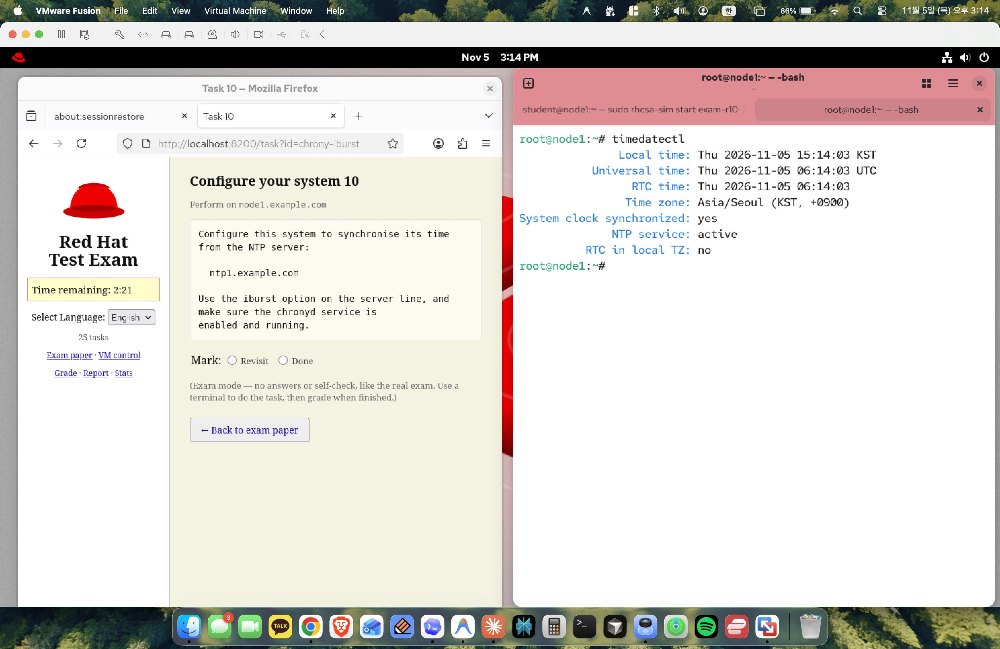
<p style="font-size: 14px; text-align: center; color: #666;">
  Figure 47: Checking current system time, timezone, and NTP service status using timedatectl.
</p>

Checked current time synchronization parameters on `node1`:
```bash
timedatectl
```
The system confirmed active NTP service and current timezone configuration.

---

### Step 2: Inspecting chronyd Service Status

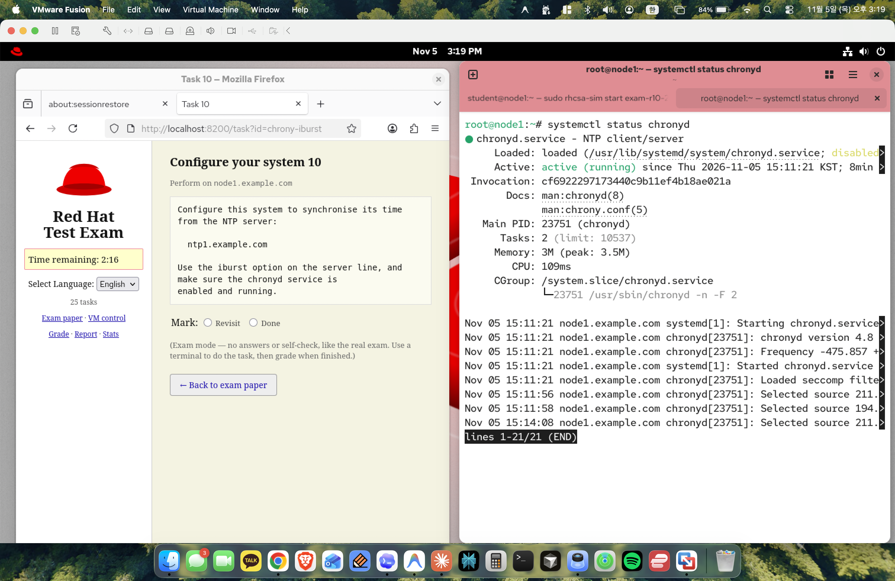
<p style="font-size: 14px; text-align: center; color: #666;">
  Figure 48: Inspecting chronyd service status showing active but disabled state.
</p>

Inspected the `chronyd` systemd service status:
```bash
systemctl status chronyd
```
While active and running, the service unit was marked as `disabled`, meaning it would not survive a reboot without explicit enablement.

---

### Step 3: Enabling the chronyd Service on Boot


<p style="font-size: 14px; text-align: center; color: #666;">
  Figure 49: Enabling chronyd to start automatically at system boot.
</p>

Enabled and ensured `chronyd` runs automatically upon boot:
```bash
systemctl enable --now chronyd
```
Systemd created the required symlink in `/etc/systemd/system/multi-user.target.wants/`.

---

### Step 4: Configuring the NTP Server in /etc/chrony.conf

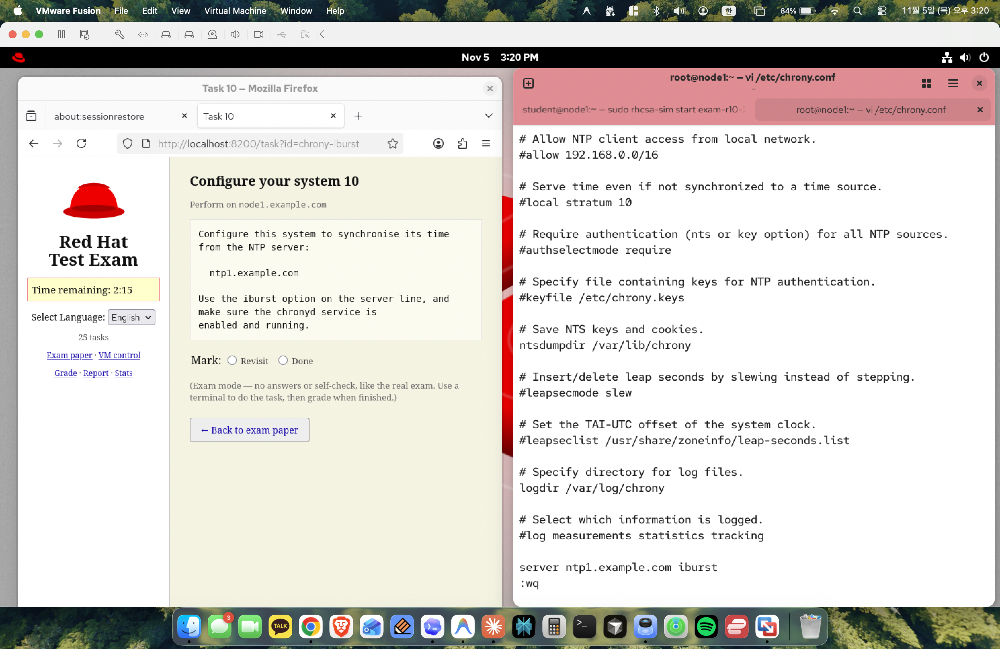
<p style="font-size: 14px; text-align: center; color: #666;">
  Figure 50: Adding the server directive with iburst in /etc/chrony.conf.
</p>

Opened `/etc/chrony.conf` and added the specified NTP server with the `iburst` option:
```bash
vi /etc/chrony.conf
```
Appended the following line to the configuration:
```text
server ntp1.example.com iburst
```
Saved and exited using `:wq`.

---

### Step 5: Restarting chronyd Service

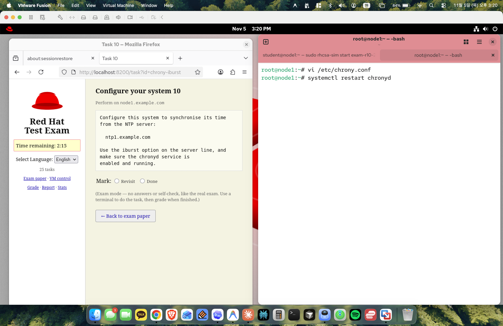
<p style="font-size: 14px; text-align: center; color: #666;">
  Figure 51: Restarting chronyd service to apply configuration changes.
</p>

Restarted the service to reload the updated NTP server configuration:
```bash
systemctl restart chronyd
```

---

### Step 6: Verifying Time Synchronization

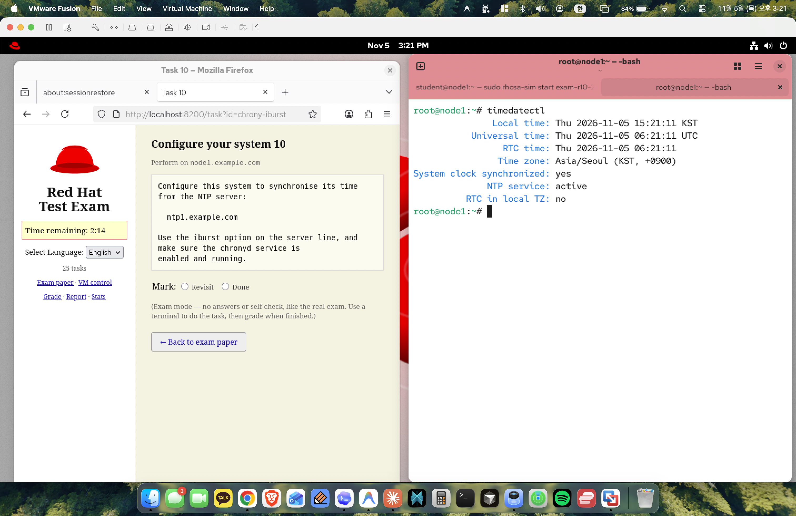
<p style="font-size: 14px; text-align: center; color: #666;">
  Figure 52: Verifying synchronized system clock and active NTP service.
</p>

Verified that time synchronization remains active and operational:
```bash
timedatectl
```
The output confirmed `System clock synchronized: yes` and `NTP service: active`.

</details>

<details markdown="1">
<summary><strong>Task 8: Configure AutoFS for On-Demand Network Mounts</strong></summary>

```text
Configure AutoFS

Requirements:
- Configure AutoFS to automatically mount the remote NFS share /rhome/remoteuser5 from node5.domain250.example.com to the local mount point /rhome/remoteuser5 on demand.
- The configuration must persist across system reboots.
```

---

## Step-by-Step Walkthrough

### Step 1: Installing AutoFS and NFS Utilities

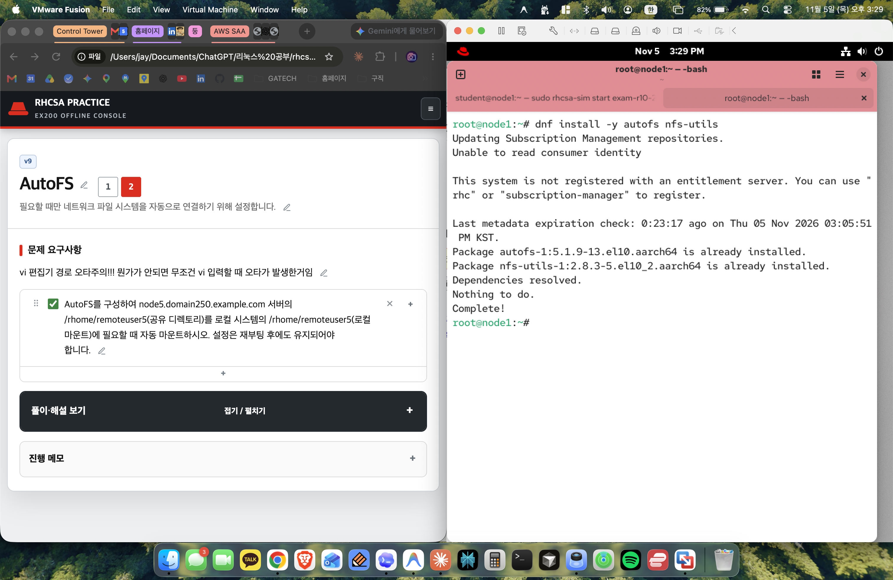
<p style="font-size: 14px; text-align: center; color: #666;">
  Figure 53: Checking and installing autofs and nfs-utils packages using dnf.
</p>

Installed the automounter daemon `autofs` and client NFS utilities `nfs-utils`:
```bash
dnf install -y autofs nfs-utils
```
Both packages were verified as installed and up-to-date on the system.

---

### Step 2: Configuring the Master Map File (/etc/auto.master)

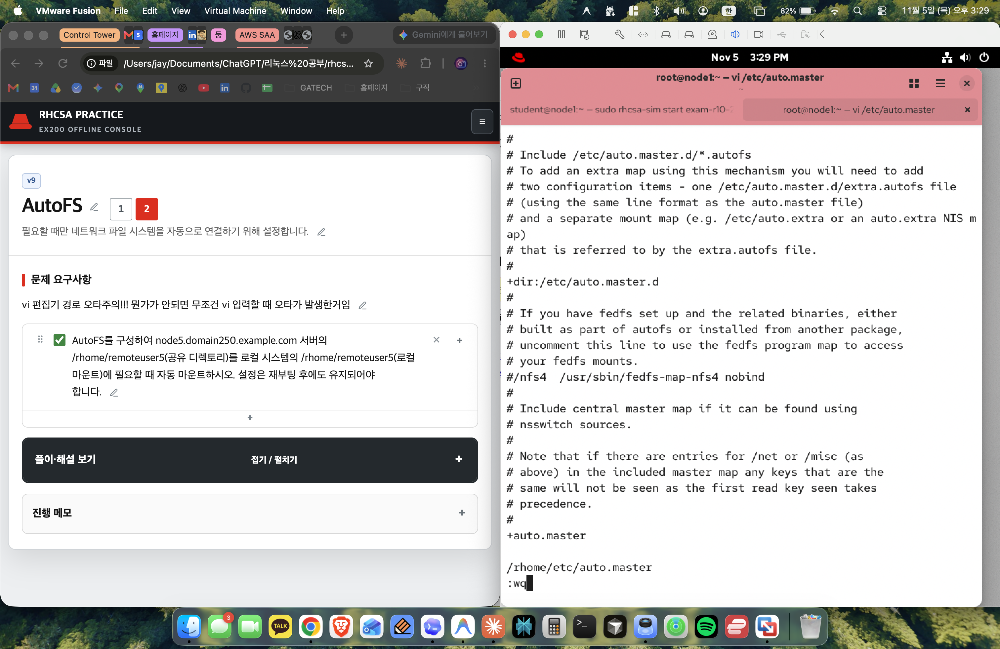
<p style="font-size: 14px; text-align: center; color: #666;">
  Figure 54: Configuring the master map in /etc/auto.master to define the base mount directory and secondary map.
</p>

Edited `/etc/auto.master` to register the base mount directory `/rhome` and specify its mapping configuration file `/etc/auto.rhome`:
```bash
vi /etc/auto.master
```
Appended the following entry to the master map:
```text
/rhome /etc/auto.rhome
```
Saved the configuration and exited using `:wq`.

---

### Step 3: Opening the Secondary Map File (/etc/auto.rhome)

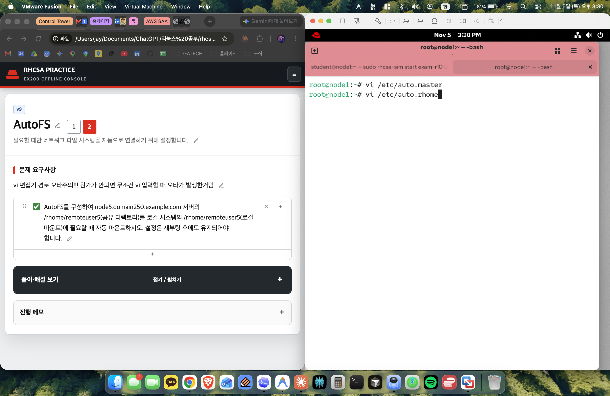
<p style="font-size: 14px; text-align: center; color: #666;">
  Figure 55: Creating and opening the AutoFS secondary map file /etc/auto.rhome with vi.
</p>

Opened `/etc/auto.rhome` with `vi` to configure the individual mount map definition:
```bash
vi /etc/auto.rhome
```

---

### Step 4: Configuring the Remote NFS Mount Map


<p style="font-size: 14px; text-align: center; color: #666;">
  Figure 56: Specifying the mount key, mount options, and remote NFS export path in /etc/auto.rhome.
</p>

Defined the target mount key, filesystem options, and source NFS share in `/etc/auto.rhome`:
```text
remoteuser5 -rw,sync node5.domain250.example.com:/rhome/remoteuser5
```

- **Key (`remoteuser5`)**: The subdirectory name created dynamically under `/rhome` upon access (`/rhome/remoteuser5`).
- **Options (`-rw,sync`)**: Mount options specifying read-write access and synchronous data writing.
- **Location (`node5.domain250.example.com:/rhome/remoteuser5`)**: The remote NFS server hostname and exported directory path.

Saved and exited using `:wq`.

---

### Step 5: Enabling and Restarting the AutoFS Service

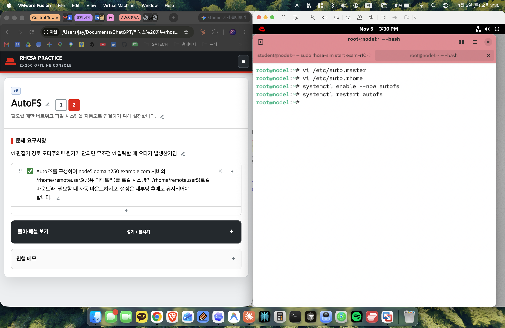
<p style="font-size: 14px; text-align: center; color: #666;">
  Figure 57: Enabling the autofs service to start at boot and restarting the daemon.
</p>

Enabled `autofs` to start automatically on system boot and restarted the service to apply the new maps immediately:
```bash
systemctl enable --now autofs
systemctl restart autofs
```
With AutoFS active, any command attempting to access `/rhome/remoteuser5` dynamically triggers the NFS mount from `node5.domain250.example.com`, unmounting automatically after an idle period.

</details>

<details markdown="1">
<summary><strong>Task 9: Locate and Copy Files Matching Ownership Criteria</strong></summary>

```text
Locate Files

Requirements:
- Find all files and directories created by or owned by user "natasha".
- Copy all identified files and directories into the /root/files directory.
```

---

## Step-by-Step Walkthrough

### Step 1: Creating the Destination Directory

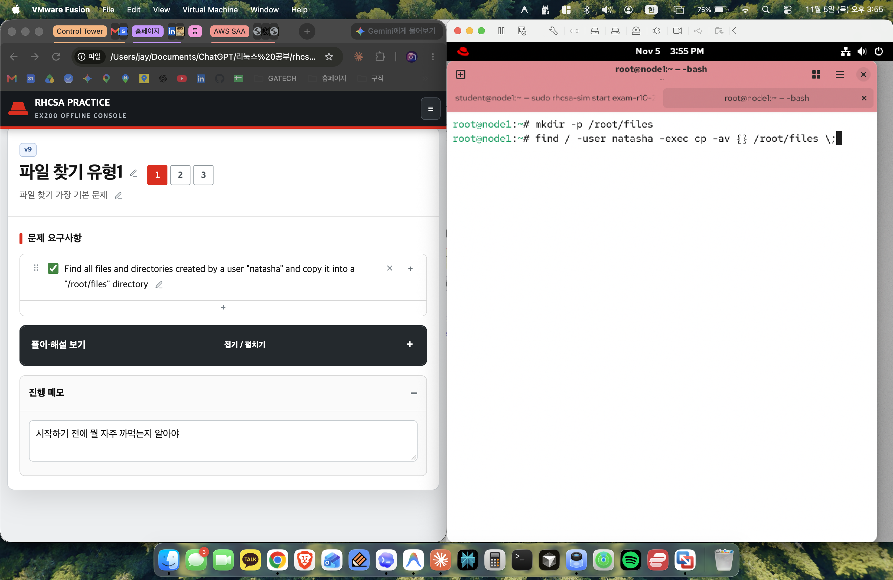
<p style="font-size: 14px; text-align: center; color: #666;">
  Figure 58: Creating the /root/files target directory and preparing the find command with -exec cp.
</p>

Created the destination directory `/root/files` to store all matching files and directories:
```bash
mkdir -p /root/files
```
The `-p` flag guarantees the directory is created if missing and avoids errors if it already exists.

---

### Step 2: Locating and Copying Matching Files and Directories

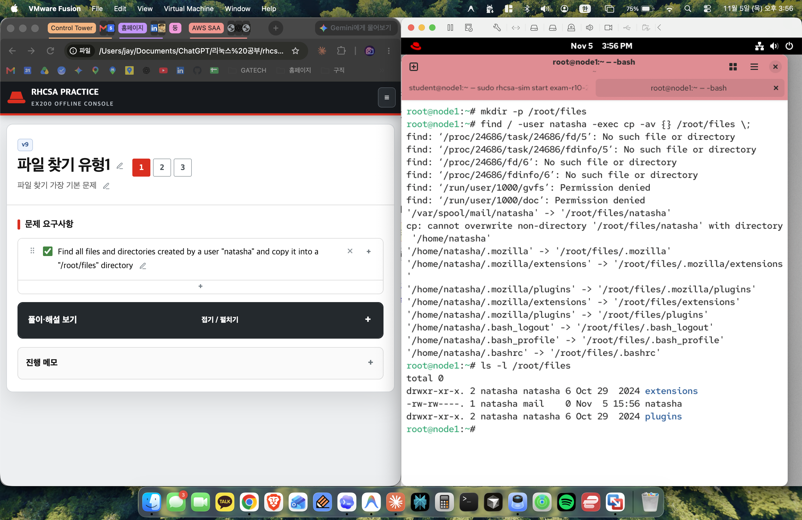
<p style="font-size: 14px; text-align: center; color: #666;">
  Figure 59: Executing the find command to copy matching files and verifying contents in /root/files.
</p>

Searched the entire filesystem hierarchy (`/`) for objects owned by user `natasha` and copied them into `/root/files`:
```bash
find / -user natasha -exec cp -av {} /root/files \;
```

- `/`: Searches the root filesystem recursively.
- `-user natasha`: Filters for files and directories owned by user `natasha`.
- `-exec cp -av {} /root/files \;`: Executes `cp` on each matched item. The `-a` (archive) flag preserves file permissions, ownership, and modification timestamps while recursively copying directories, `-v` outputs verbose logs of copied items, `{}` acts as the placeholder for each matched path, and `\;` terminates the `-exec` expression.

> [!NOTE]
> Transient warning messages from virtual filesystems such as `/proc` and `/run` are normal during system-wide searches as kernel processes and user runtime sessions dynamically generate and delete temporary descriptors.

---

### Step 3: Verifying Copied Files in the Destination Directory

Verified the contents inside `/root/files` using `ls -l`:
```bash
ls -l /root/files
```
The output confirmed that user `natasha`'s mail spool, directory structure, and configuration files were successfully copied into `/root/files`.

</details>

<details markdown="1">
<summary><strong>Task 10: Search and Extract Strings Matching a Specific Pattern</strong></summary>

```text
Find Matching Strings

Requirements:
- Find all lines containing the string "ich" in the /usr/share/dict/words file.
- Save all matching strings into the /root/lines file without altering the original order.
```

---

## Step-by-Step Walkthrough

### Step 1: Extracting Matching Strings Using grep

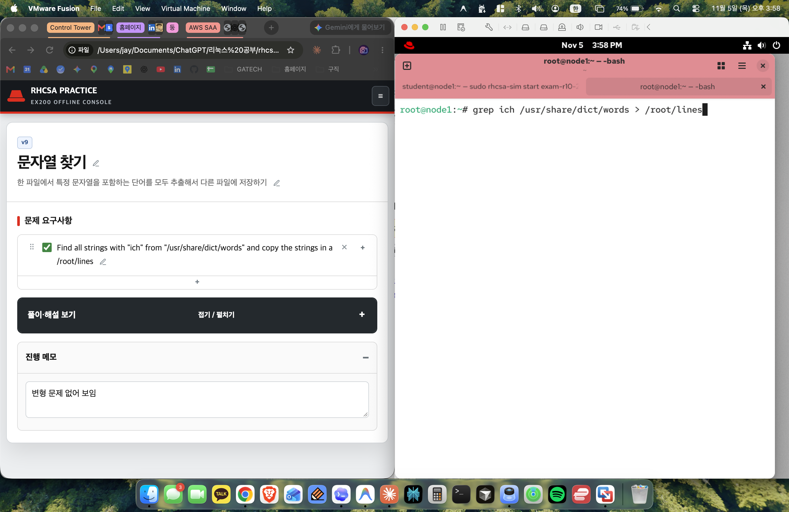
<p style="font-size: 14px; text-align: center; color: #666;">
  Figure 60: Executing grep to search for "ich" in /usr/share/dict/words and redirecting output to /root/lines.
</p>

Executed `grep` against the dictionary file to isolate every entry containing the substring `ich` and redirected standard output directly into `/root/lines`:
```bash
grep ich /usr/share/dict/words > /root/lines
```

- `grep`: Global regular expression print tool used to scan files for lines matching a designated pattern.
- `ich`: The target string pattern to search for across lines.
- `/usr/share/dict/words`: The source word list file provided in Red Hat Enterprise Linux.
- `> /root/lines`: Standard redirection operator that creates the target file `/root/lines` (or overwrites it if it exists) with matching lines in their original order.

---

### Step 2: Inspecting Extracted Content

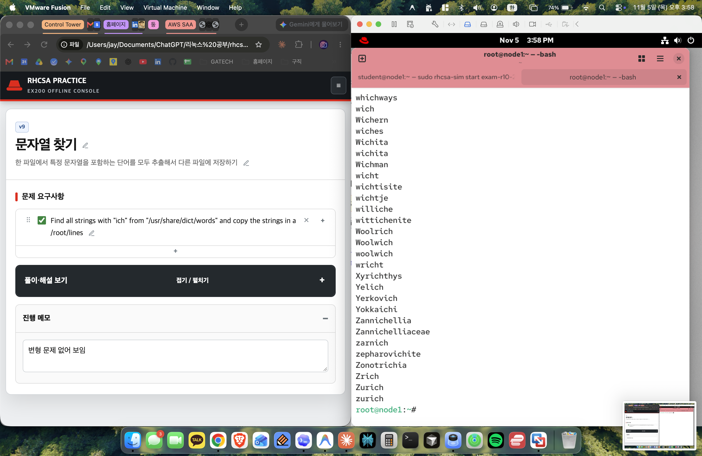
<p style="font-size: 14px; text-align: center; color: #666;">
  Figure 61: Inspecting the extracted lines in /root/lines using cat.
</p>

Viewed the output file to confirm proper pattern matching:
```bash
cat /root/lines
```

The output confirmed that each line contains the substring `ich` (e.g., `Whichways`, `wich`, `Wichern`, `wicht`, `Zurich`, `zurich`) while preserving line formatting and casing.

---

### Step 3: Verifying Line Count with wc

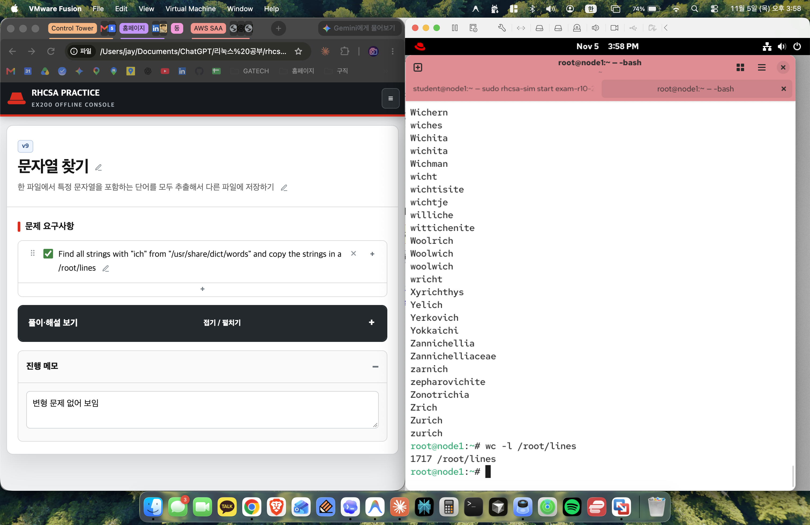
<p style="font-size: 14px; text-align: center; color: #666;">
  Figure 62: Verifying the total line count of matching strings with wc -l.
</p>

Verified the exact number of extracted lines:
```bash
wc -l /root/lines
```

- `wc -l`: Counts total newline characters in the specified file.
- The command confirmed `1717 /root/lines` entries, validating that all matching instances from the source dictionary were written out without truncation.

</details>

<details markdown="1">
<summary><strong>Task 11: Create and Compress Archive Files with tar</strong></summary>

```text
Archive and Compression

Requirements:
- Create a tar archive containing the contents of /usr/local.
- Compress the archive using bzip2 compression and store it at /root/backup.tar.bz2.
- (Alternative exam variant: Compress using gzip compression and store at /root/backup.tar.gz).
```

---

## Step-by-Step Walkthrough

### Step 1: Creating a bzip2-Compressed tar Archive

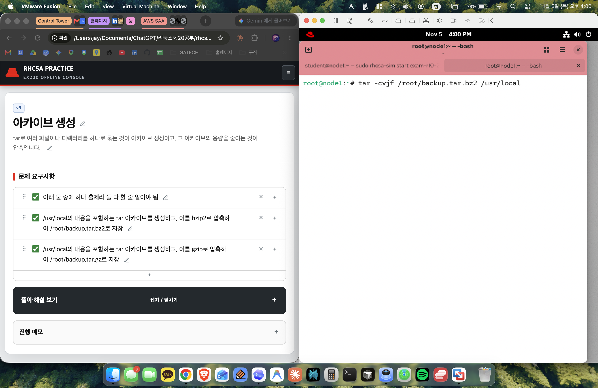
<p style="font-size: 14px; text-align: center; color: #666;">
  Figure 63: Creating a bzip2-compressed tar archive of /usr/local stored at /root/backup.tar.bz2.
</p>

Created a compressed tar archive of the `/usr/local` directory using bzip2 compression:
```bash
tar -cvjf /root/backup.tar.bz2 /usr/local
```

- `tar`: The standard archiving utility on Unix and Linux systems.
- `-c`: Creates a new archive file.
- `-v`: Enables verbose mode to display files and directories as they are processed into the archive.
- `-j`: Filters the archive through the `bzip2` compression algorithm (creating a `.tar.bz2` or `.tbz2` file).
- `-f /root/backup.tar.bz2`: Specifies the archive filename and absolute destination path.
- `/usr/local`: The source directory whose hierarchy and contents are recursively added to the archive.

---

### Step 2: Alternative Compression Formats and Verification Options

In RHCSA exam scenarios, compression requirements may alternate between `bzip2` and `gzip`:

#### Gzip Compression Variant
If the task requires gzip compression (`.tar.gz` or `.tgz`), use the `-z` option:
```bash
tar -cvzf /root/backup.tar.gz /usr/local
```

#### Archive Verification
To inspect the contents and verify the integrity of the created archive without extracting it to disk:
```bash
tar -tvf /root/backup.tar.bz2
```
- `-t`: Lists table of contents from the archive.

To check the file metadata, size, and destination path:
```bash
ls -lh /root/backup.tar.bz2
```

> [!TIP]
> Compression Option Quick Reference:
> - `gzip` (`.tar.gz` / `.tgz`): `-z`
> - `bzip2` (`.tar.bz2` / `.tbz2`): `-j`
> - `xz` (`.tar.xz` / `.txz`): `-J`

</details>

<details markdown="1">
<summary><strong>Task 12: User Account Creation with a Non-Interactive Shell</strong></summary>

```text
User Account Creation with a Specific UID and Non-Interactive Shell

Requirements:
- Create a user named "anna".
- Assign UID "2334" to user anna.
- Set the password for user anna to "123".
- Configure the user account so that anna has no access to an interactive shell (e.g., /sbin/nologin).
```

---

## Step-by-Step Walkthrough

### Step 1: Creating User anna with Specified UID and Restricted Shell

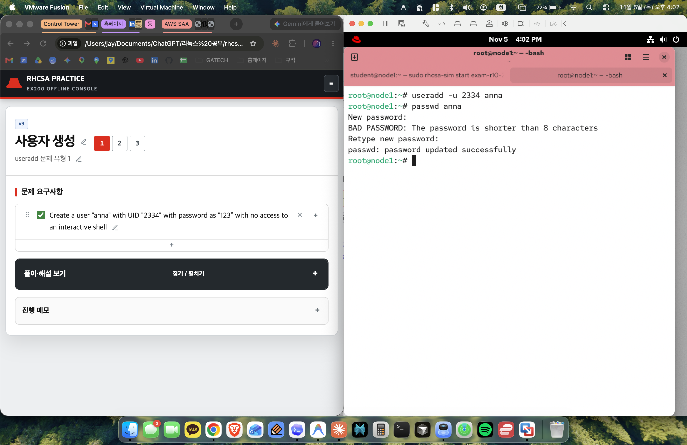
<p style="font-size: 14px; text-align: center; color: #666;">
  Figure 64: Creating user anna with UID 2334 and assigning the user password.
</p>

Created the requested account specifying the numerical User ID (UID) and restricting login shell access:
```bash
useradd -u 2334 -s /sbin/nologin anna
```

Alternatively, if the account was created initially without specifying the shell flag (`useradd -u 2334 anna`), update the shell property using `usermod`:
```bash
usermod -s /sbin/nologin anna
```

- `-u 2334`: Explicitly assigns the designated User Identifier (UID) `2334`.
- `-s /sbin/nologin`: Sets the default login shell to `/sbin/nologin`. This disallows direct interactive terminal or SSH login sessions while allowing system services, background jobs, or mail spools associated with the account to function normally.
- `anna`: The name of the newly provisioned user account.

---

### Step 2: Assigning the Account Password

Set the account password for `anna`:
```bash
passwd anna
```

- When running `passwd` interactively as `root`, enter the desired password (`123`) twice.
- Although PAM produces a policy advisory (`BAD PASSWORD: The password is shorter than 8 characters`), the `root` superuser has authority to bypass complexity and length restrictions, successfully updating the authentication token.
- In automated or non-interactive deployment environments, the password can also be assigned in a single pipeline:
  ```bash
  echo "123" | passwd --stdin anna
  ```

---

### Step 3: Verifying Account Attributes

Verified the user ID, primary group, and designated login shell:
```bash
id anna
grep anna /etc/passwd
```

- `id anna`: Confirms `uid=2334(anna) gid=2334(anna) groups=2334(anna)`.
- `grep anna /etc/passwd`: Outputs `anna:x:2334:2334::/home/anna:/sbin/nologin`, proving that the UID and restricted login shell are permanently stored in the local authentication database.

</details>

<details markdown="1">
<summary><strong>Task 13: Scheduled System Automation with Systemd Timers</strong></summary>

```text
Scheduled System Automation with Systemd Timers

Requirements:
- On ServerB (or the designated managed node), replace legacy cron-based scheduling with native Systemd Timers.
- Create an executable shell script at /usr/local/bin/notify.sh that prints "Time for Break!" to the system log using logger.
- Make the script executable.
- Create a systemd service unit /etc/systemd/system/notify.service that executes the script.
- Create a systemd timer unit /etc/systemd/system/notify.timer that triggers the service daily at 07:00:00.
- Ensure the timer is enabled and active across system reboots.
```

---

## Step-by-Step Walkthrough

### Step 1: Authoring the Notification Script

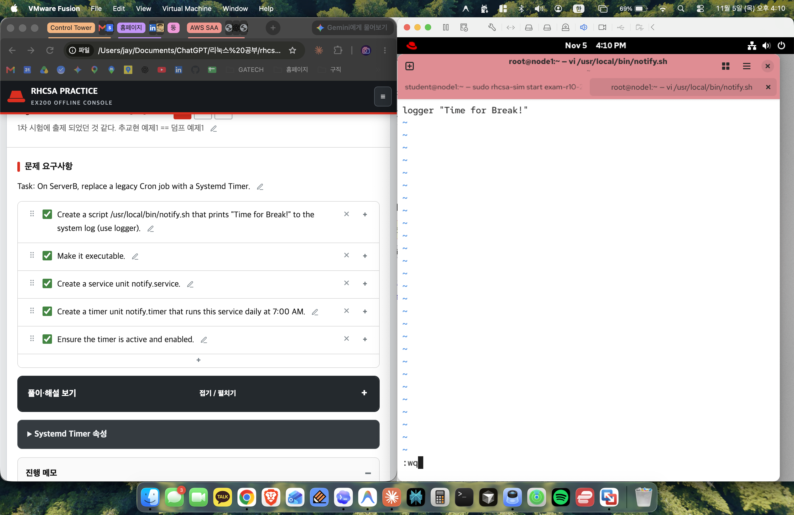
<p style="font-size: 14px; text-align: center; color: #666;">
  Figure 65: Creating /usr/local/bin/notify.sh with the logger command to output messages to the system log.
</p>

Created the script file `/usr/local/bin/notify.sh` using `vi`:
```bash
vi /usr/local/bin/notify.sh
```

Added the following shell command to log the required alert message:
```bash
logger "Time for Break!"
```

- `logger`: Provides a direct command-line interface to the system logging module (`systemd-journald` and `rsyslog`). Entries generated by `logger` are captured centrally and can be audited via `journalctl` or `/var/log/messages`.

---

### Step 2: Granting Execution Permissions


<p style="font-size: 14px; text-align: center; color: #666;">
  Figure 66: Making /usr/local/bin/notify.sh executable using chmod +x.
</p>

Granted execute permissions to the script file:
```bash
chmod +x /usr/local/bin/notify.sh
```

- `chmod +x`: Adds the execute bit for all user classes, allowing the systemd daemon to execute the script directly.
- The script can be tested interactively prior to timer setup:
  ```bash
  /usr/local/bin/notify.sh
  journalctl -t root -n 5
  ```

---

### Step 3: Configuring the Systemd Service Unit

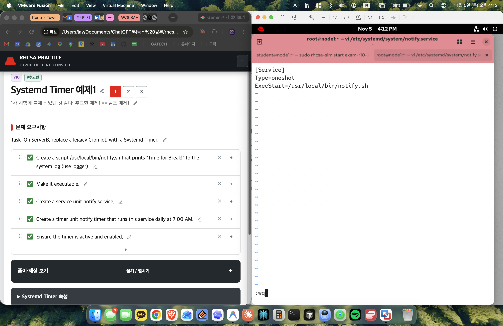
<p style="font-size: 14px; text-align: center; color: #666;">
  Figure 67: Defining the systemd service unit /etc/systemd/system/notify.service.
</p>

Created the systemd service unit file at `/etc/systemd/system/notify.service`:
```bash
vi /etc/systemd/system/notify.service
```

Configured the service unit definition:
```ini
[Unit]
Description=Notification Break Alert Service

[Service]
Type=oneshot
ExecStart=/usr/local/bin/notify.sh
```

- `[Unit]`: Contains generic metadata and unit descriptions.
- `[Service]`: Specifies execution settings for the process.
- `Type=oneshot`: Configures the service for short-lived commands or batch scripts that execute once and exit upon completion, rather than maintaining a long-running daemon process.
- `ExecStart=/usr/local/bin/notify.sh`: Absolute filesystem path to the executable command. Note that systemd mandates absolute paths for security and environment isolation.

---

### Step 4: Configuring the Systemd Timer Unit

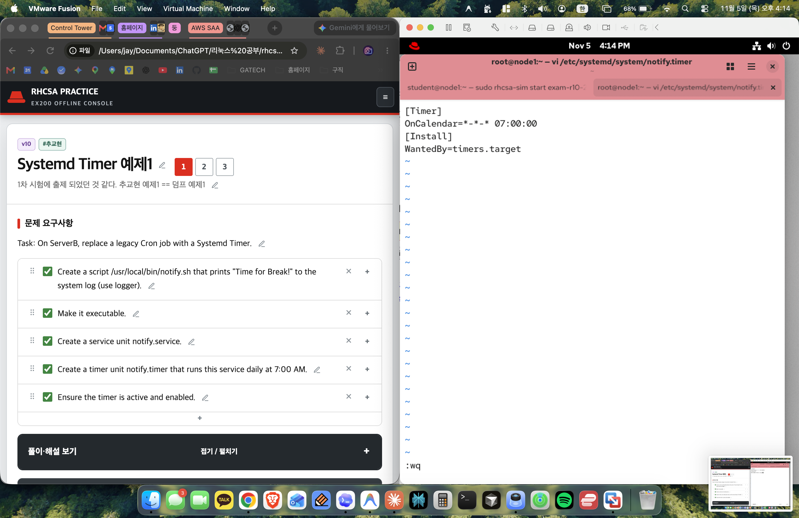
<p style="font-size: 14px; text-align: center; color: #666;">
  Figure 68: Defining the systemd timer unit /etc/systemd/system/notify.timer with daily execution at 07:00:00.
</p>

Created the corresponding timer unit file at `/etc/systemd/system/notify.timer`:
```bash
vi /etc/systemd/system/notify.timer
```

Configured the calendar-based timer schedule:
```ini
[Timer]
OnCalendar=*-*-* 07:00:00

[Install]
WantedBy=timers.target
```

- `[Timer]`: Specifies timer activation behavior. By default, a timer automatically activates the service sharing the same base name (`notify.timer` triggers `notify.service`).
- `OnCalendar=*-*-* 07:00:00`: Uses systemd calendar event syntax defining daily execution at 7:00 AM (`DayOfWeek Year-Month-Day Hour:Minute:Second`). Asterisks act as wildcards matching every day of any year and month.
- `[Install]`: Defines installation dependencies.
- `WantedBy=timers.target`: Ensures that when `systemctl enable` is executed, the timer unit starts automatically alongside standard system timers upon system boot.

---

### Step 5: Reloading Systemd and Activating the Timer

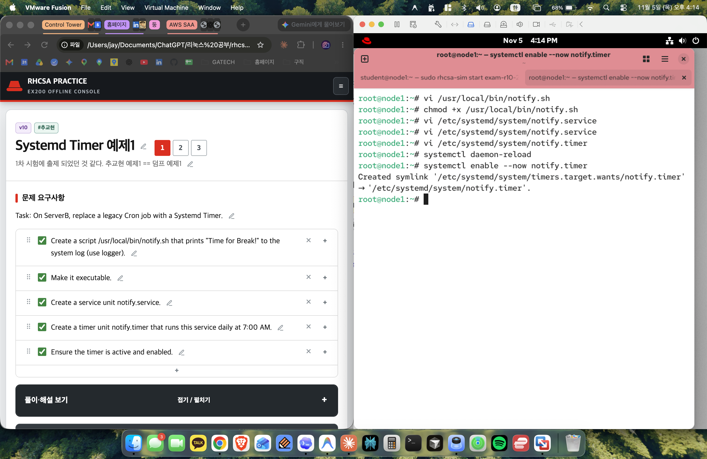
<p style="font-size: 14px; text-align: center; color: #666;">
  Figure 69: Reloading systemd manager configuration and activating notify.timer with enable --now.
</p>

Reloaded the systemd manager configuration and activated the timer unit immediately:
```bash
systemctl daemon-reload
systemctl enable --now notify.timer
```

- `systemctl daemon-reload`: Re-reads and scans all unit files in `/etc/systemd/system/`, updating systemd internal dependency graphs with newly added units.
- `systemctl enable --now notify.timer`:
  - `enable`: Generates the requisite symbolic link in `/etc/systemd/system/timers.target.wants/notify.timer` to activate the timer on subsequent system boots.
  - `--now`: Immediately starts the timer unit in the currently running session without requiring a reboot.

---

### Step 6: Verifying Timer Schedules and Execution

Verified the active timer list and schedule details:
```bash
systemctl list-timers --all
systemctl status notify.timer
```

- `systemctl list-timers`: Displays all configured timers, showing the next trigger time (`NEXT`), time remaining until execution (`LEFT`), previous trigger time (`LAST`), and associated service unit (`ACTIVATES: notify.service`).
- `systemctl status notify.timer`: Confirms `Active: active (waiting)` status and validates next scheduled trigger date and time.

> [!TIP]
> Key Advantages of Systemd Timers over Cron:
> - Centralized Logging: Timer executions and service output (stdout/stderr) are unified and searchable via `journalctl`.
> - Granular Dependencies: Services triggered by timers can declare dependencies on network availability, remote storage mounts, or other services before starting.
> - Resource Constraints: Easily assign memory, CPU quota, and cgroup execution limits directly in the companion service unit.

</details>

