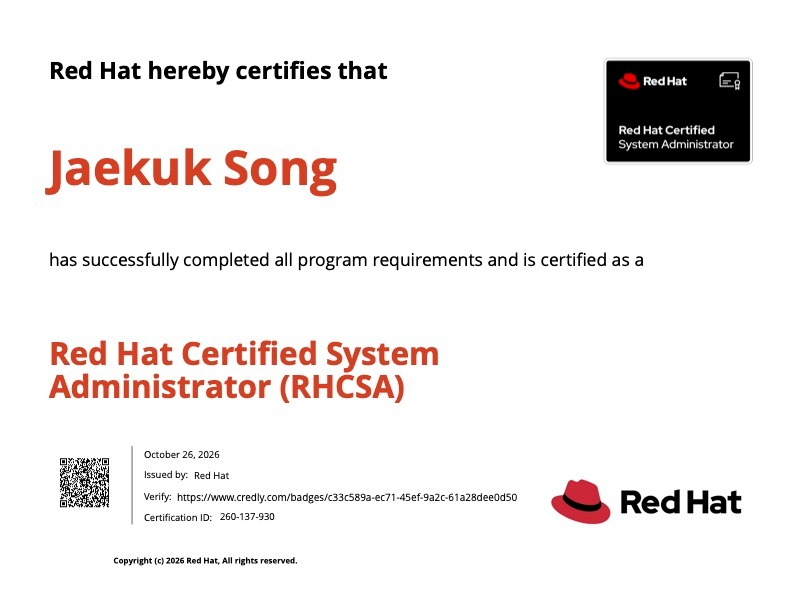

 Red Hat Certified System Administrator (RHCSA) Certificate 

## Study Resources I used
* Official Red Hat Enterprise Linux (RHEL 9) Documentation
* Sander van Vugt's RHCSA Video Courses & Study Materials
* Dual-node RHEL 9 home lab environment on VMware Fusion (`node1` & `node2`)
* Local RHCSA simulation harness with 25 practical tasks and CLI automated grading tools

## My progress and how I felt each week

**First Month**
I started by solidifying the Linux fundamentals: essential command-line tools, file system hierarchy, user and group management, permissions, and POSIX ACLs. I maintained the same discipline I had while preparing for the Security+ and CCNA exams, committing to consistent daily study even if only for 30 to 60 minutes.

**Second Month**
I moved into core enterprise administration topics on RHEL 9. I spent significant time configuring storage with LVM (Logical Volume Manager), managing systemd services and targets, configuring network connections using `nmcli`, and setting up firewall rules with `firewall-cmd`. I also focused heavily on SELinux (managing contexts, booleans, and port labels) and rootless container management using Podman.

**Third Month**
Since RHCSA is a 100% hands-on, performance-based exam, theoretical knowledge alone is not enough. I set up a dual-node virtualization lab in VMware Fusion and practiced extensively with a local simulation harness containing 25 practical tasks. I repeatedly practiced configuring services, auto-mounting NFS shares, and container units while timing myself to build speed, accuracy, and muscle memory.

**On Monday, October 26, 2026**
### I took the exam and passed on the first attempt!
The exam environment was completely practical. Every task required configuring real systems directly from the terminal. Because I had spent weeks drilling the tasks in my home lab and verifying configurations across reboots, I was able to approach each problem with confidence and complete all objectives within the allocated time.

> Tip: Unlike multiple-choice exams, the RHCSA exam is completely hands-on. Always reboot your systems before submitting to verify that all network configurations, mounts, and services persist across reboots.
{: .prompt-tip }

## Credential Details
* **Issued by:** Red Hat
* **Certification ID:** 260-137-930
* **Verification:** [Credly Badge](https://www.credly.com/badges/c33c589a-ec71-45ef-9a2c-61a28dee0d50)

## Final Thoughts
Preparing for the RHCSA certificate reinforced that practical, hands-on experience is the best teacher in systems administration. The daily consistency practiced across Security+, CCNA, and RHCSA helped combat the forgetting curve and turn complex command-line workflows into second nature. Building my own dual-node RHEL 9 lab environment and simulation harness was invaluable not only for passing the exam, but also for acquiring real-world troubleshooting skills.
