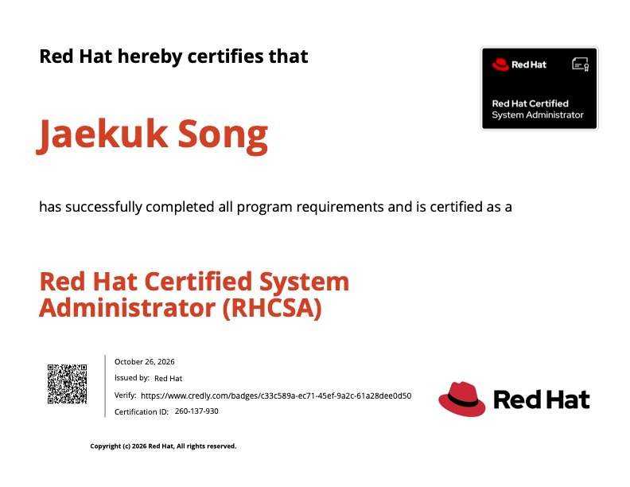

 Red Hat Certified System Administrator (RHCSA) Certificate 

## Study Resources I used
* Official Red Hat Enterprise Linux (RHEL 10) Documentation
* Sander van Vugt's RHCSA Video Courses & Study Materials
* Dual-node RHEL 10 home lab environment on VMware Fusion (`node1` & `node2`)
* Local RHCSA simulation harness with 25 practical tasks and CLI automated grading tools

## One Month of Focused Preparation

After earning my **CCNA on September 11, 2026**, I turned my focus to the RHCSA. I prepared in about one month, keeping the same study discipline I had built while preparing for Security+ and CCNA: consistent daily practice, even when I could only spend 30 to 60 minutes.

I began by reinforcing Linux fundamentals: essential command-line tools, the filesystem hierarchy, user and group management, permissions, and POSIX ACLs. I then concentrated on enterprise administration in RHEL 10, including LVM storage, `systemd` services and targets, network configuration with `nmcli`, firewall rules with `firewall-cmd`, SELinux contexts, booleans and port labels, and rootless containers with Podman.

Because RHCSA is a hands-on, performance-based exam, I built a dual-node virtualization lab in VMware Fusion and practiced with a local simulation harness containing 25 practical tasks. I repeatedly configured services, auto-mounted NFS shares, and container units under timed conditions to build speed, accuracy, and muscle memory.

After roughly a month of focused preparation, I began taking the exam. I passed on my second attempt on October 26, 2026.

**On Monday, October 26, 2026**
### I took the exam and passed on the second attempt!
Something I realized after taking the first attempt is that the RHCSA exam environment is structured in a way that makes it nearly impossible to pass on your first try if you are completely self-taught without attending an academy or bootcamp. Typically, we connect to nodes via `ssh <username>@<nodename>`, but in the actual exam environment, there are specific GUI buttons to switch between node1 and node2—with absolutely no explanation provided. There was a proctor chat in the bottom right corner, but they refused to reveal the existence of those interface controls, repeatedly replying with nothing more than "Read the instructions." However, there was no mention of them in the instructions either. Despite walking into the exam with 98% confidence, I failed the first attempt solely due to this unfamiliar interface hurdle. On my second attempt, knowing the environment, I passed with flying colors.

> Tip: Unlike multiple-choice exams, the RHCSA exam is completely hands-on. Always reboot your systems before submitting to verify that all network configurations, mounts, and services persist across reboots.
{: .prompt-tip }

## Credential Details
* **Issued by:** Red Hat
* **Certification ID:** 260-137-930
* **Verification:** [Credly Badge](https://www.credly.com/badges/c33c589a-ec71-45ef-9a2c-61a28dee0d50)

## Final Thoughts
Preparing for the RHCSA reinforced that practical, hands-on experience is essential in systems administration. After earning my CCNA on September 11, I used about a month of focused study and timed lab practice to build on my Linux fundamentals and prepare for the exam. The dual-node RHEL 10 lab and simulation harness helped turn administration workflows into repeatable skills that I can apply beyond the certification.
