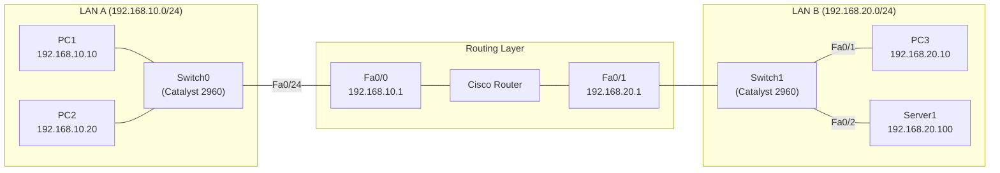
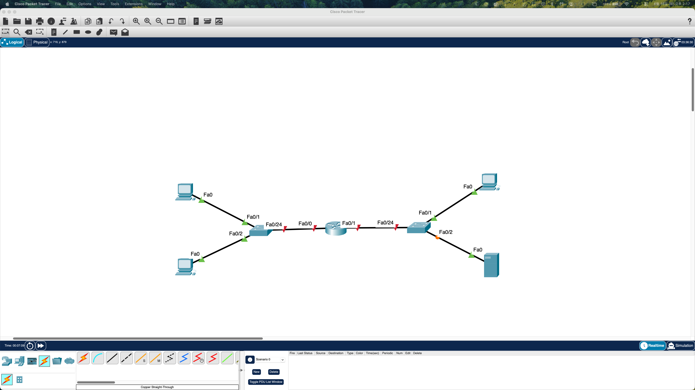
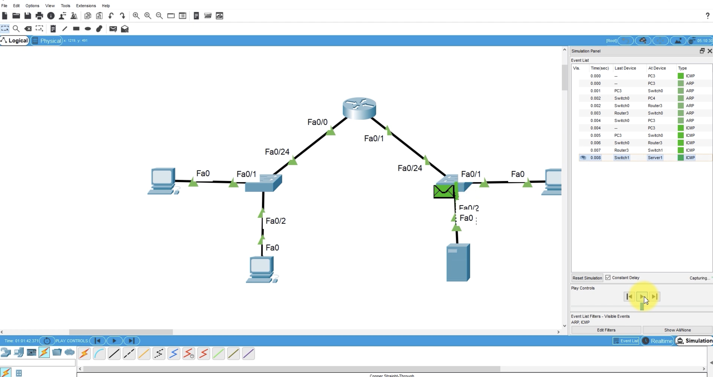
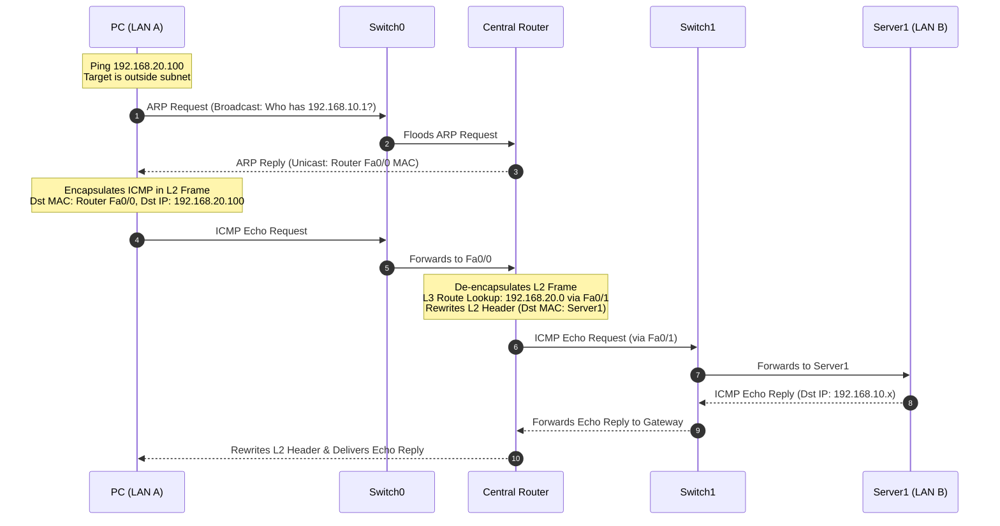
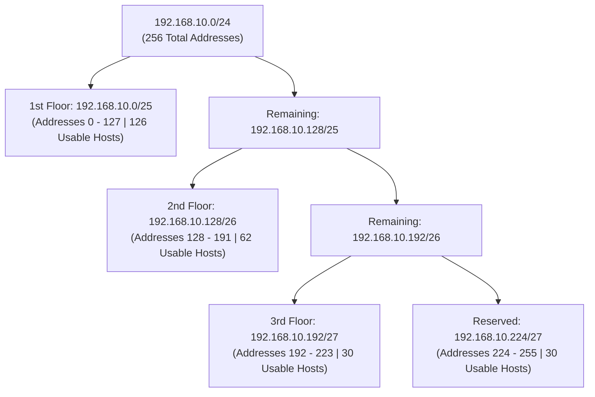

I built this network home lab environment using Cisco Packet Tracer to gain hands-on experience designing, configuring, and verifying multi-subnet enterprise network topologies. Building on my CCNA studies and network fundamentals, this project bridges theoretical concepts—such as the OSI model, L2 switching, L3 inter-subnet routing, and subnet design—with realistic implementation and packet-level verification.

This post walks through the complete lifecycle of the lab: from physical topology planning and Cisco IOS command-line configuration to protocol simulation (analyzing ARP and ICMP packet flow) and advanced subnet allocation using Variable Length Subnet Masking (VLSM).

---

## Lab Environment

* **Simulation Platform**: Cisco Packet Tracer
* **Network Infrastructure**:
  * **Central Gateway**: Cisco Modular Router connecting independent broadcast domains.
  * **Access Switches**: Two Cisco Catalyst 2960 Layer 2 switches (`Switch0` and `Switch1`).
  * **End Systems**: Three client workstations (`PC1`, `PC2`, `PC3`) and one departmental server (`Server1`).
* **Topology Scope**: Two distinct Local Area Networks (LAN A and LAN B) interconnected via dedicated router FastEthernet interfaces.

---

## Network Architecture & Addressing Table

The lab divides the network into two primary subnets: LAN A (`192.168.10.0/24`) representing the local office workstations, and LAN B (`192.168.20.0/24`) hosting user endpoints and a shared resource server.

| Device | Interface | IP Address | Subnet Mask | Default Gateway | Function / Description |
|---|---|---|---|---|---|
| **Router** | `Fa0/0` | `192.168.10.1` | `255.255.255.0` | N/A | LAN A Default Gateway |
| **Router** | `Fa0/1` | `192.168.20.1` | `255.255.255.0` | N/A | LAN B Default Gateway |
| **Switch0** | `Fa0/24` | N/A | N/A | N/A | Trunk / Uplink to Router `Fa0/0` |
| **Switch0** | `Fa0/1` | N/A | N/A | N/A | Access port connected to `PC1` |
| **Switch0** | `Fa0/2` | N/A | N/A | N/A | Access port connected to `PC2` |
| **Switch1** | `Fa0/24` | N/A | N/A | N/A | Trunk / Uplink to Router `Fa0/1` |
| **Switch1** | `Fa0/1` | N/A | N/A | N/A | Access port connected to `PC3` |
| **Switch1** | `Fa0/2` | N/A | N/A | N/A | Access port connected to `Server1` |
| **PC1** | `Fa0` | `192.168.10.10` | `255.255.255.0` | `192.168.10.1` | Client Workstation (LAN A) |
| **PC2** | `Fa0` | `192.168.10.20` | `255.255.255.0` | `192.168.10.1` | Client Workstation (LAN A) |
| **PC3** | `Fa0` | `192.168.20.10` | `255.255.255.0` | `192.168.20.1` | Client Workstation (LAN B) |
| **Server1** | `Fa0` | `192.168.20.100` | `255.255.255.0` | `192.168.20.1` | Application Server (LAN B) |



---

## Step-by-Step Walkthrough

### Step 1: Topology Design and Physical Cabling


<p style="font-size: 14px; text-align: center; color: #666;">
  Figure 1: Complete multi-subnet network topology deployed in Cisco Packet Tracer.
</p>

The network layout was assembled by placing two Catalyst 2960 switches, a central router, three client PCs, and one server on the workspace:
* **Host-to-Switch Connections**: Wired using Copper Straight-Through cables from each host's FastEthernet interface to switch access ports (`Fa0/1`, `Fa0/2`).
* **Switch-to-Router Uplinks**: Connected from port `Fa0/24` of each switch to router interfaces `FastEthernet 0/0` and `FastEthernet 0/1`.
* **Link Status Indicators**: Initially, the links connected to the router showed red triangles, indicating that router interfaces are administratively shut down by default in Cisco IOS until explicitly brought up.

---

### Step 2: Router Interface Configuration and Activation

To enable communication between the two broadcast domains, each router interface must be assigned an IP address matching its respective subnet gateway and enabled with `no shutdown`.

```text
Router> enable
Router# configure terminal
Enter configuration commands, one per line. End with CNTL/Z.

! Configure LAN A Gateway Interface
Router(config)# interface FastEthernet 0/0
Router(config-if)# description Gateway for LAN A (192.168.10.0/24)
Router(config-if)# ip address 192.168.10.1 255.255.255.0
Router(config-if)# no shutdown
Router(config-if)# exit

! Configure LAN B Gateway Interface
Router(config)# interface FastEthernet 0/1
Router(config-if)# description Gateway for LAN B (192.168.20.0/24)
Router(config-if)# ip address 192.168.20.1 255.255.255.0
Router(config-if)# no shutdown
Router(config-if)# exit

Router(config)# end
Router# copy running-config startup-config
Destination filename [startup-config]? 
Building configuration...
[OK]
```

Executing `no shutdown` transitions the interface state from `administratively down` to `up`, bringing both Layer 1 (physical carrier) and Layer 2 (data link line protocol) into an active state. Once the interfaces came up, the link indicators in Packet Tracer turned green.

---

### Step 3: Layer 2 Switch Forwarding Mechanics

Switches forward traffic within the local area network using Layer 2 MAC addresses. As frames enter the switch, it dynamically populates its Content Addressable Memory (CAM) table through three key operations:

1. **Learning**: Inspects the source MAC address of incoming frames and records the associated ingress port into the MAC address table.
2. **Forwarding / Filtering**: Looks up the destination MAC address in the table. If found, the frame is forwarded solely out of the matched physical port.
3. **Flooding**: If the destination MAC address is not yet learned (unknown unicast) or is a broadcast frame (`FF:FF:FF:FF:FF:FF`), the switch forwards the frame out of all ports except the receiving port.

```text
Switch0# show mac address-table
          Mac Address Table
-------------------------------------------

Vlan    Mac Address       Type        Ports
----    -----------       --------    -----
   1    0001.42a1.1101    DYNAMIC     Fa0/1
   1    0001.42a1.1102    DYNAMIC     Fa0/2
   1    00d0.ba76.5401    DYNAMIC     Fa0/24
Total Mac Addresses for this criterion: 3
```

This table confirms that `Switch0` has mapped `PC1` to `Fa0/1`, `PC2` to `Fa0/2`, and the router gateway to the uplink port `Fa0/24`.

---

### Step 4: Host Addressing and Default Gateway Assignment

Hosts within each subnet require an IP address, subnet mask, and a default gateway:
* When a host initiates traffic to an IP address within its own subnet (e.g., `192.168.10.10` to `192.168.10.20`), the bitwise AND calculation between its IP and subnet mask indicates a local destination, and it resolves the target host's MAC directly via local ARP.
* When the destination IP falls outside the local subnet (e.g., `192.168.10.10` attempting to reach `192.168.20.100`), the host identifies that the packet must leave the broadcast domain and directs the frame to its **Default Gateway** (`192.168.10.1`).

If the default gateway is misconfigured or omitted, hosts can communicate with immediate neighbors on the same switch, but all inter-subnet and external traffic will immediately drop.

---

### Step 5: Protocol Simulation and Packet Flow Analysis


<p style="font-size: 14px; text-align: center; color: #666;">
  Figure 2: Packet Tracer simulation mode tracing real-time ARP address resolution and ICMP Echo traffic across the router.
</p>

Using Packet Tracer's **Simulation Mode**, I stepped through the event pipeline for an ICMP Echo packet traversing from LAN A across the router to `Server1` in LAN B:



#### Detailed Hop-by-Hop Breakdown

1. **Initial ARP Resolution**:
   - The transmitting host generates an ICMP packet for `192.168.20.100`. Because the IP is non-local, the host queries its ARP cache for the default gateway (`192.168.10.1`).
   - Finding no entry, the host buffers the ICMP packet and transmits an **ARP Request** with broadcast destination MAC `FF:FF:FF:FF:FF:FF`.
   - `Switch0` floods the frame. The router receives the request and returns an **ARP Reply** containing its `Fa0/0` MAC address.

2. **L2 Encapsulation for Hop 1**:
   - The host updates its ARP table and constructs an Ethernet II frame:
     - **Source MAC**: Host MAC | **Destination MAC**: Router `Fa0/0` MAC
     - **Source IP**: `192.168.10.x` | **Destination IP**: `192.168.20.100`

3. **Router De-encapsulation and L3 Routing Decision**:
   - The router receives the frame on `Fa0/0`, validates the destination MAC, strips the Layer 2 header, and examines the Layer 3 destination IP (`192.168.20.100`).
   - It performs a routing table lookup (`show ip route`) and finds directly connected network `192.168.20.0/24` on interface `FastEthernet 0/1`.

4. **L2 Header Rewriting for Hop 2**:
   - The router looks up `Server1`'s MAC address via ARP on LAN B.
   - It encapsulates the original IP payload into a brand new Layer 2 frame:
     - **Source MAC**: Router `Fa0/1` MAC
     - **Destination MAC**: `Server1` MAC
     - **Source IP**: `192.168.10.x` *(Unchanged)*
     - **Destination IP**: `192.168.20.100` *(Unchanged)*
   
> **Core Architectural Insight**: Layer 2 MAC addresses change at every router hop as frames are rebuilt for each physical link, but the end-to-end Layer 3 IP header remains preserved.

---

### Step 6: VLAN Segmentation and 802.1Q Trunking Architecture

In a production environment, physical switches are partitioned into multiple Virtual Local Area Networks (VLANs) to isolate broadcast domains and enhance departmental security:

```text
One VLAN = One Broadcast Domain = One Logical Subnet
```

#### Port Modes: Access vs. Trunk

* **Access Port**: Carries untagged traffic dedicated to a single VLAN. Used for endpoints like client PCs and local printers.
* **Trunk Port**: Multiplexes traffic across multiple VLANs over a single physical cable using **IEEE 802.1Q** tagging, which inserts a 4-byte tag (including a 12-bit VLAN ID) into the Ethernet frame header.

```text
Switch(config)# interface FastEthernet 0/24
Switch(config-if)# switchport mode trunk
Switch(config-if)# switchport trunk allowed vlan 10,20,99
```

With 802.1Q trunking, inter-VLAN routing can be accomplished using a **Router-on-a-Stick (ROAS)** design, creating sub-interfaces on a single physical router port:

```text
Router(config)# interface FastEthernet 0/0.10
Router(config-subif)# encapsulation dot1Q 10
Router(config-subif)# ip address 192.168.10.1 255.255.255.0

Router(config)# interface FastEthernet 0/0.20
Router(config-subif)# encapsulation dot1Q 20
Router(config-subif)# ip address 192.168.20.1 255.255.255.0
```

---

### Step 7: Subnetting and Address Space Design (VLSM)

Subnetting divides large address spaces into right-sized subnets to prevent IP address exhaustion and contain broadcast traffic.

To illustrate realistic address planning, consider an organization allocated a single Class C block (`192.168.10.0/24`, 256 total addresses) with varying departmental requirements:
* **1st Floor (Sales)**: Requires 100 hosts
* **2nd Floor (Engineering)**: Requires 50 hosts
* **3rd Floor (Executive / Server)**: Requires 30 hosts

Applying **Variable Length Subnet Masking (VLSM)** allocates the largest requirement first:

1. **1st Floor (100 hosts)**: Requires 7 host bits ($2^7 = 128 \ge 100$). Prefix: `/25` (Mask: `255.255.255.128`).
2. **2nd Floor (50 hosts)**: Requires 6 host bits ($2^6 = 64 \ge 50$). Prefix: `/26` (Mask: `255.255.255.192`).
3. **3rd Floor (30 hosts)**: Requires 5 host bits ($2^5 = 32 \ge 30$). Prefix: `/27` (Mask: `255.255.255.224`).
4. **Remaining Space**: Unallocated `/27` block reserved for future expansion or point-to-point router links.

| Area / Subnet | Host Need | Prefix | Subnet Mask | Network Address | Usable Host Range | Broadcast Address |
|---|---|---|---|---|---|---|
| **1st Floor** | 100 | `/25` | `255.255.255.128` | `192.168.10.0` | `192.168.10.1 - 192.168.10.126` | `192.168.10.127` |
| **2nd Floor** | 50 | `/26` | `255.255.255.192` | `192.168.10.128` | `192.168.10.129 - 192.168.10.190` | `192.168.10.191` |
| **3rd Floor** | 30 | `/27` | `255.255.255.224` | `192.168.10.192` | `192.168.10.193 - 192.168.10.222` | `192.168.10.223` |
| **Reserved** | 30 | `/27` | `255.255.255.224` | `192.168.10.224` | `192.168.10.225 - 192.168.10.254` | `192.168.10.255` |



---

### Step 8: Network Verification and Diagnostics

Once all configurations were applied, I ran diagnostic verification commands on the router and hosts to validate route convergence and link health.

#### Checking Router Interface Status

```text
Router# show ip interface brief
Interface              IP-Address      OK? Method Status                Protocol
FastEthernet0/0        192.168.10.1    YES manual up                    up      
FastEthernet0/1        192.168.20.1    YES manual up                    up      
```
Both interfaces report `Status: up` (Layer 1 physical link operational) and `Protocol: up` (Layer 2 data link framing active).

#### Inspecting the Kernel Routing Table

```text
Router# show ip route
Codes: C - connected, S - static, R - RIP, M - mobile, B - BGP
       D - EIGRP, EX - EIGRP external, O - OSPF, IA - OSPF inter area 

Gateway of last resort is not set

C    192.168.10.0/24 is directly connected, FastEthernet0/0
C    192.168.20.0/24 is directly connected, FastEthernet0/1
```

The router displays both subnets as directly connected (`C`), confirming routes exist to switch packets between `192.168.10.0/24` and `192.168.20.0/24`.

#### End-to-End Ping Verification

From `PC1` (`192.168.10.10`), tested end-to-end connectivity to `Server1` (`192.168.20.100`):

```text
PC> ping 192.168.20.100

Pinging 192.168.20.100 with 32 bytes of data:

Reply from 192.168.20.100: bytes=32 time=12ms TTL=127
Reply from 192.168.20.100: bytes=32 time=9ms TTL=127
Reply from 192.168.20.100: bytes=32 time=8ms TTL=127
Reply from 192.168.20.100: bytes=32 time=8ms TTL=127

Ping statistics for 192.168.20.100:
    Packets: Sent = 4, Received = 4, Lost = 0 (0% loss),
Approximate round trip times in milli-seconds:
    Minimum = 8ms, Maximum = 12ms, Average = 9ms
```

Zero packet loss confirmed that switching, routing, ARP resolution, and default gateways are functioning properly.

---

## Key Takeaways

1. **L2 vs. L3 Addressing Roles**: Layer 2 MAC addresses are hop-by-hop physical identifiers rewritten at every routing boundary, whereas Layer 3 IP addresses represent the persistent end-to-end logical path.
2. **Default Gateway Significance**: A host relies entirely on its default gateway when communicating outside its local prefix. Without it, inter-subnet routing fails even if the physical links are healthy.
3. **Packet Simulation Clarity**: Using Packet Tracer's simulation mode provides concrete visibility into the initial ARP broadcast delay (often causing the first ping packet to time out) and subsequent ICMP forwarding.
4. **Structured VLSM Planning**: Designing subnets by allocating the largest host blocks first ensures zero address waste and clean binary boundaries for routing table summarization.
