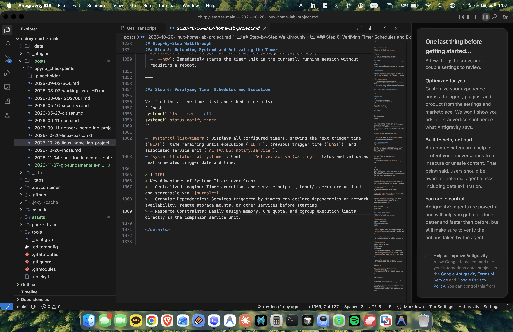
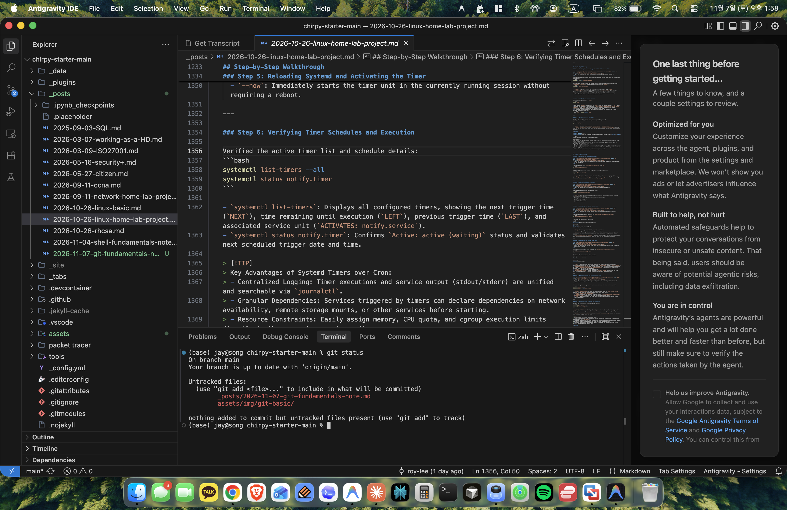
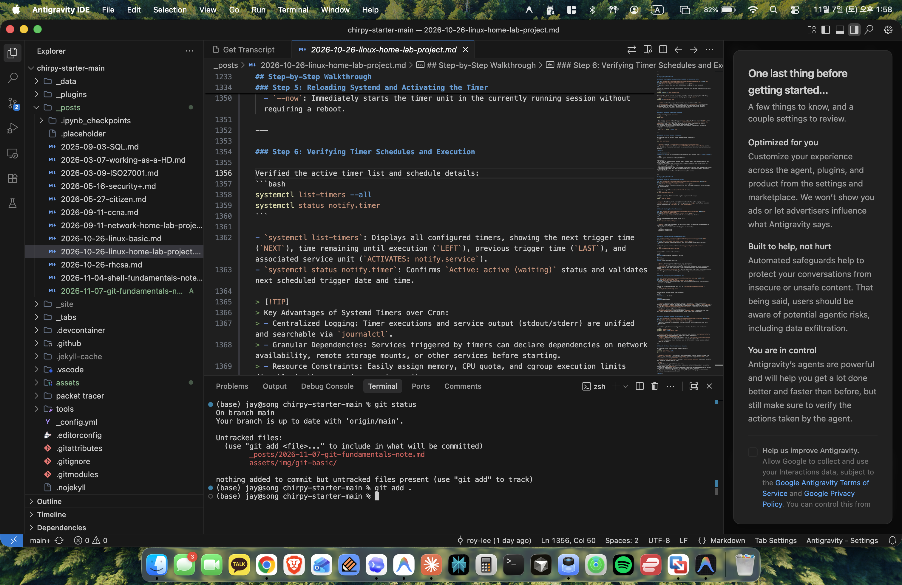
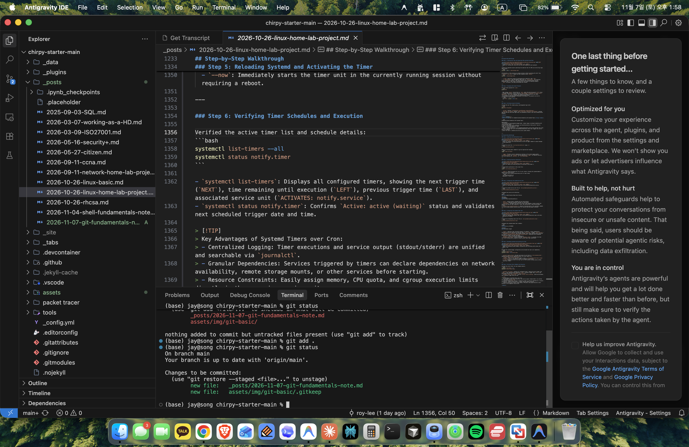
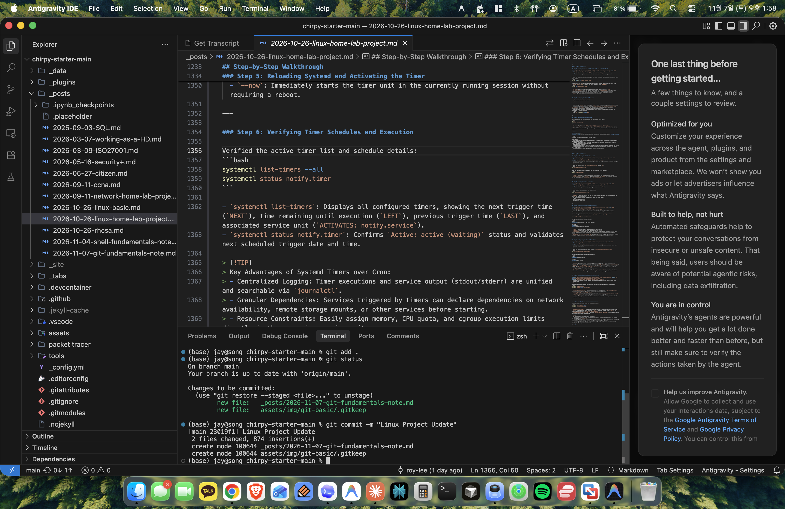
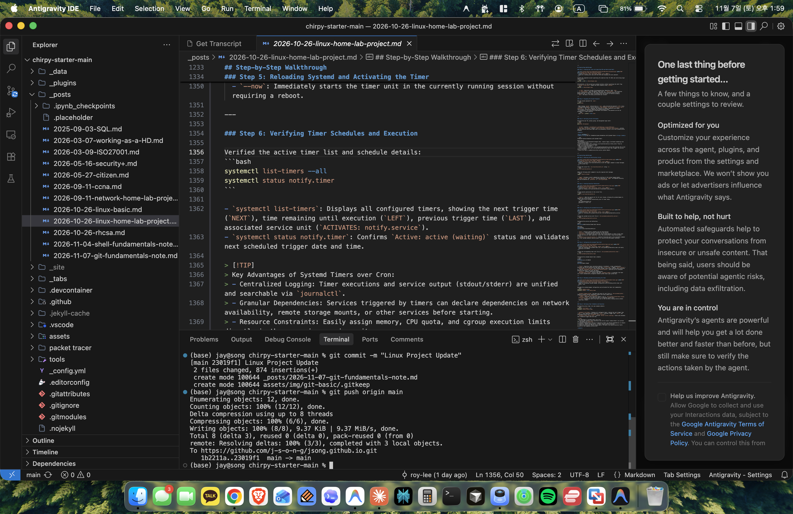

<p style="font-size: 14px; text-align: center; color: #666;">
  Git Distributed Version Control System
</p>

I created this note as a practical reference documenting the core Git commands and workflows I actively use to build, maintain, and publish the very site you are viewing right now on [jaekuk.com](https://jaekuk.com).

While managing this Jekyll-based blog and deploying it through GitHub Pages, I rely on Git daily to draft write-ups, stage articles and assets, handle branch updates, and push changes directly from my terminal. This guide compiles those essential hands-on workflows alongside foundational Git concepts—from repository initialization and the three-tree architecture (Working Directory, Staging Area, and Local Repository) to `.gitignore` rules, commit history navigation, undo operations (`reset` vs. `revert`), and remote GitHub collaboration—illustrated with real terminal outputs and screenshots captured from my workspace.

<details markdown="1">
<summary><strong>Note 1: Environment Setup and Initializing a Git Repository</strong></summary>

> **Quick Summary:** Configuring global author identity and initializing an empty local folder into a tracked Git repository.

## 1. Git Overview and Command-Line Interface (CLI)

**Git** is a distributed version control system (VCS) designed to record changes to files over time so specific versions can be recalled later. Unlike cloud hosting services such as GitHub, Git is a command-line tool that operates entirely locally on your operating system.

When working with Git, commands fall into two distinct categories:
- **Git Commands**: Commands starting with `git` that interact with the version control engine (e.g., `git init`, `git status`, `git commit`).
- **System / Shell Commands**: Operating system utilities used for file and directory navigation (e.g., `cd`, `ls`, `mkdir`, `touch`).

```bash
# Verify Git installation and version
git --version
```

```text
git version 2.39.5 (Apple Git-154)
```

---

## 2. Configuring User Identity

Before recording commits, Git requires an author identity (name and email address). This information is permanently embedded into every commit history you generate.

The `--global` flag writes these configuration settings to your user profile (`~/.gitconfig`), making them available across all repositories on your system.

```bash
# Set global author name and email
git config --global user.name "Jay Song"
git config --global user.email "jay@example.com"

# Verify global configuration settings
git config --list --global
```

```text
user.name=Jay Song
user.email=jay@example.com
```

### Key Concepts
- `user.name`: Identifies the author of commits in project logs.
- `user.email`: Connects local commits to hosting platforms like GitHub.
- `--global`: Applies settings to all repositories for the current OS user. Omitting `--global` applies the configuration only to the current repository (`.git/config`).

---

## 3. Creating and Initializing a Repository

A Git repository begins with a directory on your filesystem. Initializing a repository creates a hidden `.git/` folder, which stores all revision logs, commit object databases, and branch pointers.

```bash
# Create a new practice directory and enter it
mkdir git-practice
cd git-practice

# Initialize the directory as a Git repository
git init
```

```text
Initialized empty Git repository in /Users/jay/git-practice/.git/
```

```bash
# Inspect hidden directories
ls -la
```

```text
total 0
drwxr-xr-x   3 jay  staff    96 Nov  7 14:00 .
drwxr-xr-x  10 jay  staff   320 Nov  7 13:58 ..
drwxr-xr-x   9 jay  staff   288 Nov  7 14:00 .git
```

### Breakdown
- `mkdir git-practice`: Creates the root project directory.
- `git init`: Transforms an ordinary folder into an active Git repository.
- `.git`: The internal metadata store. Deleting this folder removes the entire version history and leaves only unversioned working files.

</details>

<details markdown="1">
<summary><strong>Note 2: Git Architecture and File Tracking Workflow</strong></summary>

> **Quick Summary:** Managing the end-to-end lifecycle of file modifications across the Working Directory, Staging Area, and Local Repository.

## 1. The Three Architecture Areas

Git tracks files across three primary logical areas:

```text
+---------------------+         +---------------------+         +---------------------+
|  Working Directory  |  git    |    Staging Area     |  git    |   Git Repository    |
|   (Unstaged files)  |  add    |   (Index/Cache)     | commit  |    (Commit History) |
|                     | ------> |                     | ------> |                     |
|  Untracked / Edit   |         | Staged for commit   |         | Permanent snapshot  |
+---------------------+         +---------------------+         +---------------------+
```

1. **Working Directory**: The actual files on disk that you view and edit in your text editor.
2. **Staging Area (Index)**: A preparation buffer that collects snapshots of changes destined for the next commit.
3. **Git Repository (Local)**: The permanent database (`.git/`) where finalized snapshots are saved with unique cryptographic commit hashes.

---

## 2. File Status Lifecycle

Files inside the Working Directory exist in one of several states:
- **Untracked**: A file created on the filesystem that Git is not yet recording.
- **Unmodified**: A file tracked by Git that has not changed since the last commit.
- **Modified**: A tracked file whose contents have been modified since the last commit.
- **Staged**: A modified or newly created file marked for inclusion in the upcoming commit.

In code editors and IDEs, untracked files are highlighted in green and labeled with a `U` indicator in the file tree:



<p style="font-size: 14px; text-align: center; color: #666;">
  Identifying newly created, untracked files marked with 'U' in the code editor's file explorer
</p>

Checking the repository status from the terminal with `git status` lists newly created items in red under the **Untracked files** header:

```bash
# Inspect working tree status
git status
```

```text
On branch main
Your branch is up to date with 'origin/main'.

Untracked files:
  (use "git add <file>..." to include in what will be committed)
	_posts/2026-11-07-git-fundamentals-note.md
	assets/img/git-basic/

nothing added to commit but untracked files present (use "git add" to track)
```



<p style="font-size: 14px; text-align: center; color: #666;">
  Inspecting the working directory with git status to verify untracked files before staging
</p>

---

## 3. Staging and Committing Changes

Moving changes into permanent history requires a two-step process: **staging** with `git add`, followed by **committing** with `git commit`.

```bash
# Add all untracked and modified files to the staging area
git add .
```



<p style="font-size: 14px; text-align: center; color: #666;">
  Adding all modified and untracked files to the staging area (index) using git add .
</p>

After staging, running `git status` confirms that the files have moved into the Staging Area, displayed in green under `Changes to be committed`:

```bash
# Verify staged status in the index
git status
```

```text
On branch main
Your branch is up to date with 'origin/main'.

Changes to be committed:
  (use "git restore --staged <file>..." to unstage)
	new file:   _posts/2026-11-07-git-fundamentals-note.md
	new file:   assets/img/git-basic/.gitkeep
```



<p style="font-size: 14px; text-align: center; color: #666;">
  Confirming staged changes marked in green under 'Changes to be committed' via git status
</p>

Once the staging area contains the desired files, execute `git commit -m` to create a permanent snapshot in the local repository:

```bash
# Record snapshot to local repository with a descriptive message
git commit -m "Linux Project Update"
```

```text
[main 23019f1] Linux Project Update
 2 files changed, 874 insertions(+)
 create mode 100644 _posts/2026-11-07-git-fundamentals-note.md
 create mode 100644 assets/img/git-basic/.gitkeep
```



<p style="font-size: 14px; text-align: center; color: #666;">
  Recording staged changes into the local repository with git commit -m to create an immutable snapshot
</p>

### Breakdown
- `git add <file>` / `git add .`: Copies file snapshots from the Working Directory into the Staging Area.
- `git commit -m "<message>"`: Permanently stores staged files as an immutable commit record.
- `git log`: Displays sequential commit history in reverse chronological order.

</details>

<details markdown="1">
<summary><strong>Note 3: Excluding Files with .gitignore</strong></summary>

> **Quick Summary:** Defining pattern rules in `.gitignore` to prevent sensitive files, build artifacts, and system caches from being tracked.

## 1. Why Ignore Files?

In typical software projects, many files should never be committed into source control, including:
- Operating system cache files (e.g., `.DS_Store`, `Thumbs.db`).
- Temporary files and runtime logs (e.g., `*.log`, `*.tmp`).
- Sensitive secrets and credential files (e.g., `.env`, `api_keys.json`).
- Compiled binaries and package dependencies (e.g., `node_modules/`, `target/`).

The `.gitignore` file specifies patterns that tell Git to ignore unversioned files entirely, preventing them from appearing in `git status`.

---

## 2. Creating and Configuring `.gitignore`

The file must be named exactly `.gitignore` and placed in the project root directory.

```bash
# Create .gitignore file
touch .gitignore

# Create sample files to test ignoring behavior
touch app.log
touch secret.env
touch notes.txt
```

Add ignore patterns to `.gitignore`:

```text
# Ignore temporary log files
*.log

# Ignore environment credentials
secret.env

# Ignore system files
.DS_Store
```

```bash
# Check repository status
git status
```

```text
On branch main
Untracked files:
  (use "git add <file>..." to include in what will be committed)
	.gitignore
	notes.txt

nothing added to commit but untracked files present (use "git add" to track)
```

Notice that `app.log` and `secret.env` do not appear in the untracked files list because Git matched them against patterns in `.gitignore`.

```bash
# Stage and commit the .gitignore file
git add .gitignore
git commit -m "chore: add .gitignore file"
```

```text
[main b4e12da] chore: add .gitignore file
 1 file changed, 7 insertions(+)
 create mode 100644 .gitignore
```

### Common `.gitignore` Pattern Syntax
- `*.log`: Ignores all files ending with `.log`.
- `logs/`: Ignores the entire `logs` directory and all contents within it.
- `temp/*.txt`: Ignores `.txt` files directly under `temp/`, but not subdirectories.
- `!important.log`: Negates an earlier pattern, forcing Git to track `important.log` even if `*.log` is ignored.

</details>

<details markdown="1">
<summary><strong>Note 4: Inspecting and Navigating Commit History</strong></summary>

> **Quick Summary:** Reviewing commit logs, inspecting cryptographic checksums, analyzing line diffs, and traversing historical states.

## 1. Anatomy of a Commit

Running `git log` displays the full metadata associated with each commit:

```bash
git log
```

```text
commit c29e46a78d06b5f9227c34b17e44a4918e95071a (HEAD -> main)
Author: Jay Song <jay@example.com>
Date:   Sat Nov 7 14:15:30 2026 +0900

    feat: complete section 2 draft

commit b4e12daf961e68c9288102a017bca886027a4128
Author: Jay Song <jay@example.com>
Date:   Sat Nov 7 14:10:02 2026 +0900

    chore: add .gitignore file

commit 8f31b0ae178051e94474325a7d74db191a7e289c
Author: Jay Song <jay@example.com>
Date:   Sat Nov 7 14:05:12 2026 +0900

    docs: add initial curriculum draft
```

### Components
- **Commit Hash (SHA-1)**: A 40-character hexadecimal checksum uniquely identifying the commit (e.g., `c29e46a...`). The first 7 characters usually suffice as a short identifier.
- **HEAD Pointer**: A reference pointing to the currently checked-out commit and branch (`HEAD -> main`).
- **Author Information**: The identity set via `git config`.
- **Timestamp**: Date and time when the snapshot was recorded.
- **Commit Message**: A descriptive explanation of what changed.

---

## 2. Advanced `git log` Options

Standard `git log` output can become verbose on larger projects. Several flags make history easier to navigate:

```bash
# View concise single-line format
git log --oneline
```

```text
c29e46a (HEAD -> main) feat: complete section 2 draft
b4e12da chore: add .gitignore file
8f31b0a docs: add initial curriculum draft
```

```bash
# View patch diffs showing line-by-line modifications
git log -p -1
```

```text
commit c29e46a78d06b5f9227c34b17e44a4918e95071a (HEAD -> main)
Author: Jay Song <jay@example.com>
Date:   Sat Nov 7 14:15:30 2026 +0900

    feat: complete section 2 draft

diff --git a/curriculum.txt b/curriculum.txt
index e69de29..4b825dc 100644
--- a/curriculum.txt
+++ b/curriculum.txt
@@ -1 +1,2 @@
 1. Git Fundamentals
+2. Branching and Merging
```

### Useful Log Flags
- `--oneline`: Formats each commit into a single line showing short hash and subject.
- `-p` / `--patch`: Displays the exact textual diff introduced by each commit.
- `-n <count>`: Limits log output to the specified number of recent commits.
- `--graph`: Draws an ASCII graph showing branch merges and diverge points.

---

## 3. Navigating Historical Commits and `git reflog`

Git allows traveling backward to examine historical project states by checking out a commit hash.

```bash
# Check out a previous commit
git checkout 8f31b0a
```

```text
Note: switching to '8f31b0a'.

You are in 'detached HEAD' state. You can look around, make experimental
changes and commit them, and you can discard any commits you make in this
state without impacting any branches by switching back to a branch.

HEAD is now at 8f31b0a docs: add initial curriculum draft
```

In a **detached HEAD** state, `HEAD` points directly to a commit hash rather than a named branch pointer. To safely return to the latest commit on the active branch:

```bash
# Return to the main branch
git checkout main
```

```text
Previous HEAD position was 8f31b0a docs: add initial curriculum draft
Switched to branch 'main'
```

If a commit pointer is lost or mistakenly detached, `git reflog` provides a safety net by recording every update made to `HEAD`:

```bash
# Inspect HEAD movement history
git reflog
```

```text
c29e46a (HEAD -> main) HEAD@{0}: checkout: moving from 8f31b0a to main
8f31b0a HEAD@{1}: checkout: moving from main to 8f31b0a
c29e46a (HEAD -> main) HEAD@{2}: commit: feat: complete section 2 draft
b4e12da HEAD@{3}: commit: chore: add .gitignore file
8f31b0a HEAD@{4}: commit (initial): docs: add initial curriculum draft
```

</details>

<details markdown="1">
<summary><strong>Note 5: Handling Mistakes and Undoing Changes (Reset vs. Revert)</strong></summary>

> **Quick Summary:** Safely correcting mistakes by unstaging files, moving commit pointers (`reset`), or applying inverse commits (`revert`).

## 1. Unstaging Files (`git reset`)

If files were added to the Staging Area by mistake, they can be un-staged without losing any edits in the Working Directory:

```bash
# Add file to staging accidentally
echo "Temporary notes" >> temp_notes.txt
git add temp_notes.txt

# Verify it is staged
git status
```

```text
Changes to be committed:
  (use "git rm --cached <file>..." to unstage)
	new file:   temp_notes.txt
```

```bash
# Unstage the file
git reset HEAD temp_notes.txt
```

```text
# Output confirms file was un-staged but remains in working directory
git status
```

```text
Untracked files:
  (use "git add <file>..." to include in what will be committed)
	temp_notes.txt
```

---

## 2. Undoing Commits with `git reset`

When a commit was recorded prematurely or contains errors, `git reset` rolls back commit history. The command provides three distinct modes:

```text
git reset [--soft | --mixed | --hard] <commit-hash>
```

| Mode | Working Directory | Staging Area (Index) | Commit Pointer (HEAD) |
| :--- | :--- | :--- | :--- |
| **`--soft`** | **Preserved** (Unchanged) | **Preserved** (Keeps staged files) | Moved to target commit |
| **`--mixed`** *(default)* | **Preserved** (Unchanged) | **Reset** (Unstages files) | Moved to target commit |
| **`--hard`** | **Discarded** (Overwritten!) | **Discarded** (Reset) | Moved to target commit |

```bash
# Example: Soft reset to keep changes staged for editing commit message
git reset --soft HEAD~1

# Example: Mixed reset (default) to unstage changes while keeping files intact
git reset --mixed HEAD~1

# Example: Hard reset to completely discard unwanted changes (destructive!)
git reset --hard HEAD~1
```

> [!WARNING]
> `git reset --hard` completely overwrites uncommitted modifications in your Working Directory. Use this option only when you intend to discard all recent code changes permanently.

---

## 3. Safely Reversing Commits with `git revert`

While `git reset` rewrites history by moving the branch pointer backward, **`git revert`** undoes the changes of an existing commit by creating an entirely new commit that applies the inverse diff.

```bash
# Revert a specific commit by hash
git revert c29e46a --no-edit
```

```text
[main d14a82f] Revert "feat: complete section 2 draft"
 1 file changed, 1 deletion(-)
```

```bash
# Inspect history after revert
git log --oneline -3
```

```text
d14a82f (HEAD -> main) Revert "feat: complete section 2 draft"
c29e46a feat: complete section 2 draft
b4e12da chore: add .gitignore file
```

### When to Use `reset` vs. `revert`
- **Use `git reset`**: When working locally on personal branches before code has been pushed to a remote repository.
- **Use `git revert`**: When changes have already been pushed to a shared remote repository (e.g., `main`), ensuring collaborator branches are not broken by rewritten history.

</details>

<details markdown="1">
<summary><strong>Note 6: Branch Management and Merging Workflows</strong></summary>

> **Quick Summary:** Developing features in isolated branch sandboxes and integrating tested updates via fast-forward or 3-way merges.

## 1. What is a Git Branch?

A **branch** represents an independent line of development. Internally, a branch is simply a lightweight, movable pointer to a specific commit.

By default, Git initializes projects with a primary branch named `main` (or `master`). Working on branches allows developers to build features, fix bugs, or experiment in isolation without affecting the stable production codebase.

```text
main:        (commit A) ---> (commit B) -----------> (Merge commit M)
                                  \                     ^
feature:                           ---> (commit C) ----/
```

---

## 2. Creating and Switching Branches

```bash
# List local branches (* denotes current active branch)
git branch
```

```text
* main
```

```bash
# Create a new branch named 'feature/curriculum-update'
git branch feature/curriculum-update

# Switch to the new branch
git checkout feature/curriculum-update
```

```text
Switched to branch 'feature/curriculum-update'
```

Alternatively, use the combined shortcut command to create and switch branches in a single step:

```bash
# Modern syntax: create and switch
git checkout -b feature/curriculum-update
# Or using git switch:
git switch -c feature/curriculum-update
```

---

## 3. Working on an Isolated Branch

```bash
# Make modifications within the feature branch
echo "3. Remote Repository Integration" >> curriculum.txt

# Stage and commit
git add curriculum.txt
git commit -m "feat: add remote repository module to curriculum"
```

```text
[feature/curriculum-update a75de31] feat: add remote repository module to curriculum
 1 file changed, 1 insertion(+)
```

```bash
# Verify branch pointer positions
git log --oneline -2
```

```text
a75de31 (HEAD -> feature/curriculum-update) feat: add remote repository module to curriculum
d14a82f (main) Revert "feat: complete section 2 draft"
```

Notice that `HEAD` points to `feature/curriculum-update`, while `main` remains at the previous commit.

---

## 4. Merging Branches and Handling Conflicts

Once feature development is verified, the changes can be integrated into the primary branch using `git merge`.

```bash
# Switch back to the receiving branch
git checkout main
```

```text
Switched to branch 'main'
```

```bash
# Merge feature branch changes into main
git merge feature/curriculum-update
```

```text
Updating d14a82f..a75de31
Fast-forward
 curriculum.txt | 1 +
 1 file changed, 1 insertion(+)
```

### Fast-Forward vs. 3-Way Merge
- **Fast-Forward Merge**: Occurs when the target branch has not received any new commits since the feature branch diverged. Git simply moves the pointer forward.
- **3-Way Merge**: Occurs when both branches have new commits. Git synthesizes a new "merge commit" containing two parent references.

### Deleting Completed Branches
Once changes are safely merged into `main`, the feature branch can be deleted:

```bash
# Delete merged branch
git branch -d feature/curriculum-update
```

```text
Deleted branch feature/curriculum-update (was a75de31).
```

</details>

<details markdown="1">
<summary><strong>Note 7: Remote Repositories and GitHub Collaboration</strong></summary>

> **Quick Summary:** Connecting local repositories to cloud remotes on GitHub to publish commits and collaborate across distributed teams.

## 1. Local vs. Remote Repositories

While a local repository lives exclusively on your machine, a **remote repository** is hosted on an external server or web platform such as GitHub, GitLab, or Bitbucket.

Hosting code on a remote repository enables:
- Offsite backup and synchronization across multiple workstations.
- Collaborative code review and merge validation via Pull Requests (PRs).
- Integration with Continuous Integration / Continuous Deployment (CI/CD) pipelines.

```text
+-----------------------+              git push             +------------------------+
| Local Repository      | --------------------------------> | Remote Repository      |
| (Developer machine)   |                                   | (GitHub cloud hosting) |
|                       | <-------------------------------- |                        |
+-----------------------+      git fetch / git pull         +------------------------+
```

---

## 2. Connecting a Remote Repository (`git remote`)

After creating a new empty repository on GitHub, configure the remote address on your local repository:

```bash
# Check existing remotes (initially empty)
git remote -v

# Link local repository to remote URL with alias 'origin'
git remote add origin https://github.com/your-username/git-practice.git

# Verify registered remotes
git remote -v
```

```text
origin  https://github.com/your-username/git-practice.git (fetch)
origin  https://github.com/your-username/git-practice.git (push)
```

### Breakdown
- `git remote add <name> <url>`: Adds a remote connection reference.
- `origin`: The standard default alias assigned to the primary remote server.
- `-v` (`--verbose`): Displays the full fetch and push URLs associated with each remote alias.

---

## 3. Pushing Changes (`git push`)

To upload local commit history to the remote repository, use `git push`. The `-u` (or `--set-upstream`) flag links the local branch to the remote branch, allowing subsequent pushes and pulls to be executed without specifying parameters.

```bash
# Push commits and establish upstream tracking
git push origin main
```

```text
Enumerating objects: 12, done.
Counting objects: 100% (12/12), done.
Delta compression using up to 8 threads
Compressing objects: 100% (8/8), done.
Writing objects: 100% (8/8), 9.37 KiB | 9.37 MiB/s, done.
Total 8 (delta 3), reused 0 (delta 0), pack-reused 0 (from 0)
remote: Resolving deltas: 100% (3/3), completed with 3 local objects.
To https://github.com/j-s-o-n-g/jsong.github.io.git
   1b2211a..23019f1  main -> main
```



<p style="font-size: 14px; text-align: center; color: #666;">
  Uploading local commits to the remote GitHub repository branch using git push origin main
</p>

Once upstream tracking is configured, subsequent sync commands require only:

```bash
# Routine push of new local commits
git push
```

---

## 4. Pulling Changes (`git pull`) and Cloning Repositories

When working with collaborators or updating code from another workstation, retrieve new commits from the remote repository using `git pull`:

```bash
# Fetch and integrate remote updates into the current branch
git pull origin main
```

```text
remote: Enumerating objects: 4, done.
remote: Counting objects: 100% (4/4), done.
remote: Compressing objects: 100% (2/2), done.
remote: Total 3 (delta 1), reused 3 (delta 1)
Unpacking objects: 100% (3/3), 642 bytes | 642.00 KiB/s, done.
From https://github.com/your-username/git-practice
 * branch            main     -> FETCH_HEAD
Updating a75de31..3f109bc
Fast-forward
 README.md | 2 ++
 1 file changed, 2 insertions(+)
 create mode 100644 README.md
```

### Git Fetch vs. Git Pull
- **`git fetch`**: Downloads remote objects and refs without altering your local working directory or current branch pointer.
- **`git pull`**: Performs a `git fetch` immediately followed by an automated `git merge` into the current branch.

### Cloning an Existing Remote Repository
To set up a complete working copy of an existing GitHub repository on a new machine:

```bash
# Clone remote repository to local machine
git clone https://github.com/your-username/git-practice.git
cd git-practice
```

```text
Cloning into 'git-practice'...
remote: Enumerating objects: 15, done.
remote: Counting objects: 100% (15/15), done.
remote: Compressing objects: 100% (10/10), done.
remote: Total 15 (delta 3), reused 12 (delta 2)
Receiving objects: 100% (15/15), 1.78 KiB | 1.78 MiB/s, done.
Resolving deltas: 100% (3/3), done.
```

</details>
