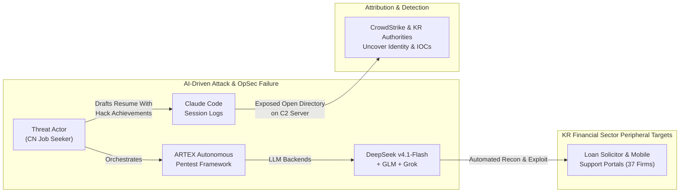

### Quick-Reference Incident & Patch Matrix (Newest First)

| Date | Region | Target / Advisory | Severity / Scale | Actionable Remediation Summary |
|---|---|---|---|---|
| **2026-11-18** | 🇰🇷 KR | **Financial Services Commission (FSC) Regulation Reform** | 37 Financial Firms / 470K Records | Mandatory bi-annual vulnerability assessments & full peripheral IT asset inventory |
| **2026-11-17** | 🇺🇸 US / Global | **OpenJDK `Java4Shell` (`CVE-2026-114938`) & US Patch Outages** | **CVSS 9.2 (Critical)** | Apply Oracle Nov 2026 CPU patches; enforce canary/staged rollouts to prevent network outages |
| **2026-11-12** | 🇰🇷 KR | **Kyungil University Faculty Groupware (`gw.kiu.ac.kr`) Breach** | ~600 Faculty / 1 GB+ Leaked (`KimJEN`) | Restrict external groupware access via VPN, force password resets, and audit DB/config exports |
| **2026-11-12** | 🌐 Global / 🇰🇷 KR | **Synology DSM Auth API & SCGI Flaws (DDoS / RCE / Ransomware)** | **CVSS 9.8 (Critical)** | Upgrade to DSM `7.4.1-90080-1+` / `7.3.2-86009-5+`; disable port forwarding (`5000`/`5001`) |
| **2026-11-09** | 🇰🇷 KR | **Financial Security Institute (FSI / 금융보안원) Breach** | 48 Financial Firms / 650+ Records | Eliminate SMS MFA fallback bypasses, enforce static IP allowlists, and audit regulator accounts |
| **2026-11-03** | 🇪🇺 EU | **European Cold-Chain OT Sabotage (Freezers Set to +50°C)** | 700+ Supermarkets / 11+ Countries | Air-gap or VPN-gate industrial OT controllers, change default passwords, set thermal alarms |
| **2026-10-30** | 🌐 Global / 🇰🇷 KR | **Linux Kernel TCP/IPv4 UAF (`CVE-2026-98432`)** | **CVSS 9.8 (Critical)** | Patch kernel (`apt`/`dnf update`) and **perform a mandatory system reboot** (`uname -r`) |
| **2026-10-26** | 🇺🇸 US | **UNM Health System & Access Dental Ransomware Attacks** | Level-1 Trauma Diverted / 340K+ SSNs | Deploy immutable offline backups, isolate clinical VLANs, and monitor BYOVD EDR tampering |
| **2026-10-21** | 🌐 Global / 🇺🇸 US | **PHP Core RCE `PHP2Shell` (`CVE-2026-109618` / `109619`)** | **CVSS 9.2 (Critical)** | Upgrade to PHP `8.2.35+`, `8.3.36+`, `8.4.27+`, `8.5.12+` and restart `php-fpm` / web servers |
| **2026-10-08** | 🇰🇷 KR | **Massive AI-Driven Financial Sector Cyber Attack (`ARTEX`)** | 16→37 Firms (Shinhan, KB, Hana, etc.) | Audit external/peripheral web portals, block IOCs, and defend against autonomous LLM scanners |
| **2026-10-06** | 🇰🇷 KR | **Toss Bank 1-Year Log Audit & Toss Payments Merchant Key Leak** | 14 Blocked Probes / 2,671 Users | Retain & audit ≥1 year of access logs; rotate merchant PG API keys & require receipt MFA |

---

## Reverse-Chronological Threat & Remediation Log

<details markdown="1">
<summary><strong>[2026-11-18 | 🇰🇷 KR] Financial Authorities Mandate Bi-Annual Vulnerability Assessments After 37-Firm Breach Wave</strong></summary>

* **Incident & Policy Context:** Following the cascading cyber attacks that began in late September 2026, official parliamentary and Financial Services Commission (FSC) tallies confirmed that **37 financial institutions (40 incidents)** suffered breaches, exposing approximately **470,000 customer and employee records** along with ~1 billion KRW in hot-wallet and account losses. Investigation revealed an average detection gap of **3.9 days (up to 15 days)** between initial intrusion and detection.
* **Key Findings:** Most intrusions bypassed hardened core banking mainframes and instead compromised **peripheral external systems**—such as loan-solicitor lookup portals, mobile employee support systems, and unauthenticated test pages.
* **Solution / Remediation:**
  1. **Full IT Asset Inventory:** Identify and register 100% of external-facing and third-party peripheral web servers, test endpoints, and partner portals.
  2. **Bi-Annual Vulnerability Audits:** Under the amended *Electronic Financial Supervision Regulations*, financial institutions with assets $\ge 2$ trillion KRW must increase comprehensive vulnerability assessments from once a year to **twice a year (semi-annually)**, explicitly covering non-core peripheral systems.
  3. **Real-Time IOC Sharing:** Automate threat intelligence and attacker IP (IOC) ingestion across sector-wide SIEM/SOAR pipelines within 24 hours.

</details>

<details markdown="1">
<summary><strong>[2026-11-17 | 🇺🇸 US / Global] OpenJDK Java4Shell Vulnerability (CVE-2026-114938) &amp; US Infrastructure Patch Outages</strong></summary>

* **Threat Overview:** On November 17, 2026, a critical memory corruption and remote code execution (RCE) vulnerability dubbed **`Java4Shell` (`CVE-2026-114938`, CVSS 9.2 Critical)** was disclosed in OpenJDK's Base64 decoding and CPU intrinsic acceleration routines. Like October's `PHP2Shell`, AI-assisted vulnerability discovery accelerated both detection and exploit generation.
* **US Operational Impact ("Patch Fatigue" Outages):** In mid-November, a cascade of high-profile US infrastructure disruptions hit **Microsoft (Outlook/Teams)**, the **Federal Aviation Administration (FAA)**, **United Airlines**, **JPMorgan Chase**, and the **National Security Agency's classified internal network (`NSANet`)**. US officials (including the State Department and intelligence agencies) confirmed that the `NSANet` outage and concurrent disruptions were caused not by direct enemy sabotage, but by **emergency patching overload** as agencies rushed to deploy critical `PHP2Shell` and runtime security updates across complex legacy systems without adequate staging.
* **Solution / Remediation:**
  1. **Update Java Runtimes:** Immediately apply the **Oracle November 2026 Critical Patch Update (CPU)** or vendor-supplied OpenJDK security builds patching `CVE-2026-114938`.
  2. **Restart JVM Processes:** Restart all running Java application servers (Tomcat, Spring Boot, Kafka, Elasticsearch, etc.) so patched JVM shared libraries load into memory.
  3. **Canary & Staged Patch Deployment:** To prevent self-inflicted operational outages (`NSANet` lesson), validate emergency patches in isolated staging/canary rings and maintain instant rollback snapshots before enterprise-wide reboot waves.

</details>

<details markdown="1">
<summary><strong>[2026-11-12 | 🇰🇷 KR] Kyungil University Faculty Electronic Information System (gw.kiu.ac.kr) Breached</strong></summary>

* **Incident Overview:** Around 8:00 PM on November 12, 2026, **Kyungil University (경일대학교)** detected an external intrusion into its in-house faculty and staff electronic document/groupware system (`gw.kiu.ac.kr`), affecting approximately **600 professors and staff members**.
* **Threat Actor & Leak Details:** A threat actor operating under the handle **`KimJEN`** posted a thread titled *"108GB kiu.ac.kr data sharing"* on an underground hacking forum and leaked three compressed archives on Telegram totaling ~1 GB: `kiu_ac_kr_mail.zip` (~984.5 MB), `kiu_ac_kr_config.zip` (~1.2 MB), and `db.zip` (~17 MB). The same actor simultaneously claimed attacks against 31 South Korean universities (including regional university research administration systems) ahead of the national college entrance season.
* **Solution / Remediation:**
  1. **Isolate Groupware From Public Internet:** Immediately block direct public WAN access to internal electronic document and groupware portals (`gw.*`), requiring **SSL-VPN + Multi-Factor Authentication (MFA)** for off-campus faculty access.
  2. **Mandatory Credential & Session Reset:** Force-expire all active session tokens, reset passwords for all faculty/staff accounts, and rotate database/application configuration secrets exposed in `config.zip`.
  3. **Audit In-House Web Applications:** Conduct source-code and SQL injection/file-upload audits on custom-built university administrative portals, which often lack commercial WAF coverage.

</details>

<details markdown="1">
<summary><strong>[2026-11-12 | 🌐 Global / 🇰🇷 KR] Synology NAS DDoS, RCE &amp; Ransomware Wave (CVE-2026-76954 / 13684 / 13639)</strong></summary>

* **Threat Overview:** KISA (KrCERT/CC) and Synology issued urgent critical advisories regarding multiple **CVSS 9.8 (Critical)** vulnerabilities in Synology **DiskStation Manager (DSM)**:
  * **`CVE-2026-76954` (CVSS 9.8, disclosed Nov 12):** SQL Injection in the DSM Authentication API allowing unauthenticated remote attackers to read/write arbitrary files, execute code, or trigger **Denial-of-Service (DoS / DDoS)** conditions.
  * **`CVE-2026-13684` & `CVE-2026-13639` (CVSS 9.8, KISA advisory Oct 29–30):** Improper output encoding in DSM SCGI and insufficient entropy in login logic, actively chained in the wild with **C3RB3R ransomware** (`.L0CK3D` file extension encryption) targeting internet-exposed NAS appliances.
* **Solution / Remediation:**
  1. **Upgrade DSM Immediately:** Navigate to **Control Panel > Update & Restore** and update to the patched versions or higher:
     * **DSM 7.4:** Upgrade to `7.4.1-90080-1` or higher
     * **DSM 7.3:** Upgrade to `7.3.2-86009-5` or higher
     * **DSM 7.2.2:** Upgrade to `7.2.2-72806-10` or higher
     * **DSM 7.2.1:** Upgrade to `7.2.1-69057-13` or higher
  2. **Update DSM Packages:** Update **Web Station, Synology Calendar, and Mail Station** via Package Center to patch bundled PHP vulnerabilities.
  3. **Eliminate Public Port Forwarding:** Disable direct router port forwarding for DSM management ports (`5000` HTTP / `5001` HTTPS). Access the NAS exclusively through **Tailscale** or a **WireGuard/OpenVPN** tunnel, disable the default `admin` account, and enable **2FA + Auto Block**.

</details>

<details markdown="1">
<summary><strong>[2026-11-09 | 🇰🇷 KR] South Korea's Frontline Cyber Watchdog—Financial Security Institute (FSI / 금융보안원)—Breached</strong></summary>

* **Incident Overview:** On November 9, 2026, the **Financial Security Institute (금융보안원, FSI)**—the very agency responsible for 24/7 security monitoring and incident response across South Korea's financial sector—suffered a targeted intrusion into its **"Ongoing Information Security Assessment Support System" (정보보호 상시 평가 지원 시스템)**.
* **Attack Vector & Impact:**
  * **SMS Fallback Bypass:** Attackers exploited a temporary backup login path left open for users experiencing SMS two-factor authentication delivery issues.
  * **Regulator Impersonation & IP Rotation:** The threat actors rotated across **246 IP addresses** (over 100 active proxy nodes) and compromised/impersonated an account belonging to a **Financial Supervisory Service (FSS / 금융감독원)** official to access multi-institution compliance files.
  * **Data Leaked:** Approximately **650 records across 48 financial institutions** were exfiltrated, including ~200 administrative compliance forms (containing ~300 names/dates of birth) and ~350 system user profiles.
* **Solution / Remediation:**
  1. **Eliminate Emergency Auth Backdoors:** Permanently remove legacy or fallback authentication endpoints that bypass primary MFA enforcement.
  2. **Enforce Strict Static IP Allowlisting:** Prohibit dynamic/unverified IP connections to regulatory and compliance submission portals; bind privileged regulator accounts (such as FSS auditors) to dedicated static IP ranges and hardware FIDO2 keys.
  3. **Zero-Trust Privilege Segregation:** Restrict cross-organization read permissions so a single compromised auditor or supervisor account cannot bulk-download assessment files across dozens of member institutions.

</details>

<details markdown="1">
<summary><strong>[2026-11-03 | 🇪🇺 EU] European Cold-Chain OT Cyber Sabotage: Supermarket Freezers Hacked to +50°C</strong></summary>

* **Incident Overview:** Starting in mid-October in France (**700+ supermarket locations**) and escalating through early November 2026 across **at least 11 European countries** (including Belgium, Luxembourg, Sweden, Germany, Italy, and the UK), attackers executed a coordinated Operational Technology (OT) sabotage campaign against commercial refrigeration and cold-chain control systems.
* **Physical & Critical Infrastructure Impact:**
  * **Temperature Manipulation to +50°C (up to 80–110°C):** Hackers penetrated internet-exposed industrial temperature controllers and abused defrost/heating cycles, driving sub-zero freezers up to **50°C (122°F)** and higher.
  * **Massive Spoilage & Medical Threat:** Tons of meat, dairy, and frozen goods spoiled within hours, while overheating triggered store fires and sprinkler malfunctions. Even more critically, **blood plasma cryo-storage units at the French National Blood Service (EFS)** were targeted.
  * **Attribution & Motive:** Rather than demanding ransom, the attacks aimed at pure supply-chain disruption and societal chaos (attributed by French authorities to IRGC-linked cyber units). South Korea's Ministry of Science and ICT (MSIT) subsequently ordered an emergency inspection of domestic cold-chain facilities.
* **Solution / Remediation:**
  1. **Disconnect OT/ICS Controllers From the Public Internet:** Never expose HVAC,BMS, or refrigeration PLC/SCADA web interfaces directly to public IPv4 space (Shodan-discoverable ports); mandate **VPN with MFA** for remote maintenance vendors.
  2. **Rotate Default Manufacturer Credentials:** Immediately replace factory default passwords on all industrial IoT/OT controllers and apply vendor firmware updates.
  3. **Independent Hardware Thermal Cutoffs & Out-of-Band Alerts:** Install out-of-band physical temperature sensors and hardware relays that trigger immediate SMS/SOC alerts and block dangerous heating setpoints regardless of software commands.

</details>

<details markdown="1">
<summary><strong>[2026-10-30 | 🌐 Global / 🇰🇷 KR] Linux Kernel Critical Vulnerability (CVE-2026-98432, CVSS 9.8) — Mandatory Reboot Required</strong></summary>

* **Vulnerability Overview:** A critical **CVSS 9.8** Use-After-Free (UAF) vulnerability (**`CVE-2026-98432`**) was identified in the Linux kernel's IPv4 TCP networking stack (3-way handshake SYN race condition, affecting Linux kernel `4.4+`). Security researchers demonstrated that frontier AI models could autonomously chain this flaw against Multipath TCP (MPTCP) listeners to achieve **zero-click remote `root` code execution** without crashing the target kernel—allowing silent, unlimited retries.
* **Why a Reboot Is Mandatory:** Updating packages via `apt` or `dnf` only writes the new kernel image (`vmlinuz`) to `/boot` on disk. **The vulnerable kernel code remains resident in active RAM** until the operating system is fully rebooted (or hot-patched via `kpatch`/`Canonical Livepatch`).
* **Solution / Remediation (Update & Mandatory Reboot):**

```bash
# 1. Check current running kernel version in memory
uname -r

# 2. Apply latest security kernel packages
# For Ubuntu / Debian:
sudo apt update && sudo apt full-upgrade -y

# For RHEL / Rocky Linux / AlmaLinux / Amazon Linux:
sudo dnf update "kernel*" -y

# 3. MANDATORY: Reboot the host to load the patched kernel into RAM
sudo systemctl reboot

# 4. Verify after reboot that the new kernel version is active
uname -r
```

</details>

<details markdown="1">
<summary><strong>[2026-10-26 | 🇺🇸 US] US Healthcare Ransomware Surge: UNM Health Trauma Center &amp; Access Dental Breaches</strong></summary>

* **Incident Overview:** Late October and November 2026 saw a historic surge in cyber attacks against US healthcare infrastructure:
  * **University of New Mexico Health (UNM Health — Oct 26):** A cyber attack forced New Mexico's only **Level-1 trauma center** to divert incoming ambulances, cancel elective surgeries, and shut down clinical network operations before emergency containment restored core services the following day.
  * **Access Dental Management (`WorldLeaks` Extortion):** Intruders exfiltrated sensitive records—including Social Security Numbers (SSNs) and clinical data—affecting **340,000 to 450,000+ patients**.
* **Solution / Remediation:**
  1. **Immutable Offline Backups (3-2-1-1-0 Rule):** Maintain air-gapped or object-locked immutable backups of Electronic Health Record (EHR) databases tested weekly for rapid bare-metal restoration.
  2. **Clinical Network Micro-Segmentation:** Isolate life-critical medical devices, ambulance dispatch consoles, and imaging VLANs from general corporate IT and email networks.
  3. **Defend Against BYOVD (Bring Your Own Vulnerable Driver):** Enable Microsoft Vulnerable Driver Blocklist and HVCI (Memory Integrity) to prevent ransomware payloads from disabling endpoint EDR agents.

</details>

<details markdown="1">
<summary><strong>[2026-10-21 | 🌐 Global / 🇺🇸 US / 🇰🇷 KR] PHP Critical RCE PHP2Shell (CVE-2026-109618 &amp; CVE-2026-109619)</strong></summary>

* **Vulnerability Overview:** Disclosed on October 21, 2026, and immediately added to the **US CISA Known Exploited Vulnerabilities (KEV)** catalog and KISA alerts, **`PHP2Shell`** comprises two critical flaws (**CVSS 9.2 Critical**):
  * **`CVE-2026-109618`:** Out-of-Memory (OOM) exception handling flaw leading to memory corruption and pre-auth RCE.
  * **`CVE-2026-109619`:** Use-After-Free (UAF) memory corruption allowing unauthenticated remote attackers to plant web shells and take over web servers across Apache `mod_php`, `php-fpm`, `php-cgi`, FrankenPHP, and LiteSpeed.
* **Solution / Remediation:**
  1. **Upgrade to Patched PHP Releases Immediately:**
     * **PHP 8.2 branch:** Upgrade to **`8.2.35`** or higher
     * **PHP 8.3 branch:** Upgrade to **`8.3.36`** or higher
     * **PHP 8.4 branch:** Upgrade to **`8.4.27`** or higher
     * **PHP 8.5 branch:** Upgrade to **`8.5.12`** or higher
     * *(Note: PHP 8.1 and older are End-of-Life; migrate to a supported branch or apply OS vendor backports immediately.)*
  2. **Restart Web & PHP Worker Processes:**

```bash
# Restart PHP-FPM and web server daemons to flush vulnerable worker processes from RAM
sudo systemctl restart php-fpm nginx
# Or on Apache systems:
sudo systemctl restart apache2
```

  3. **Temporary Workaround (If Immediate Upgrade Is Blocked):** Set `session.upload_progress.enabled = Off` (and `fatal_error_backtraces = Off` on PHP 8.5) in `php.ini` until the binary upgrade is completed.

</details>

<details markdown="1">
<summary><strong>[2026-10-08 | 🇰🇷 KR] Massive AI-Driven Financial Sector Cyber Attack (ARTEX + DeepSeek + Claude Code Exposure)</strong></summary>

* **Incident Timeline & Scope:**
  * **Sep 27 – Sep 30, 2026 (Initial Intrusions Confirmed):** Coordinated anomalous traffic and data exfiltration hit major South Korean commercial banks—starting with **KB Kookmin Bank (Sep 27)**, **Shinhan Bank (Sep 28–30, ~25,000 loan-solicitor service records)**, and **Hana Bank (Sep 30)**—before spreading to **BNK Busan Bank, Hyundai Capital, Yegaram Savings Bank, KDB Capital, DB Savings Bank, DaeShin Securities, Mirae Asset, and Bithumb** (16 institutions initially confirmed by Oct 14; later expanding to 37 firms).
  * **Oct 7–8, 2026 (CrowdStrike & Security Industry Attribution):** Global security firm **CrowdStrike** and domestic researchers analyzed the attacker's exposed command-and-control (C2) infrastructure, uncovering a landmark case of **AI-orchestrated cybercrime**.
* **How the Attacker Was Caught (The AI Resume OpSec Blunder):**
  * **Autonomous AI Exploitation Stack:** The attacker deployed **`ARTEX`**, an open-source AI autonomous penetration-testing framework, wired primarily to Chinese LLM **`DeepSeek` (`v4.1-Flash`)** alongside **Zhipu AI (`GLM`)** and **xAI (`Grok`)** to automatically scan and exploit peripheral financial web portals.
  * **Exposed `Claude Code` Session Logs:** The perpetrator carelessly left an open directory listing on their attack server containing active **`Claude Code`** session logs and configuration files.
  * **Job-Seeker Resume Prompt:** Inside those logs, the attacker—identified as a **Chinese national in his early-to-mid 20s (Guangdong/Shanghai region job seeker & South China University of Technology alumnus)**—had prompted Claude Code to **draft a cybersecurity researcher resume** that explicitly boasted about successfully hacking South Korean financial institutions. The logs also captured prompts asking the AI *"where stolen Korean financial data is traded"* and *"how to find Korean Telegram data-broker channels."*



* **Solution / Remediation:**
  1. **Decommission & Harden Peripheral Portals:** Eliminate unauthenticated test pages and legacy outsourced portals (loan-solicitor lookup tools, partner web apps); place all external business support systems behind enterprise WAF and zero-trust identity proxies.
  2. **Deploy Behavioral Bot & AI-Scanner Mitigation:** Since AI frameworks like `ARTEX` chain rapid reconnaissance with automated payload mutation, enforce strict rate limiting, behavioral anomaly detection, and automated IP reputation blocking at the edge.
  3. **Strict Data Masking & API Governance:** Prevent API responses on partner portals from returning full unmasked PII (names, resident numbers, phone numbers) in bulk queries.

</details>

<details markdown="1">
<summary><strong>[2026-09-09 ~ 2026-10-06 | 🇰🇷 KR] Toss Security Audit: 1-Year Prior Reconnaissance Logs &amp; Toss Payments Merchant Key Leak</strong></summary>

* **Incident Context (Why "Toss 1 Year Ago" Made Headlines During the Audit):**
  * **Long-Term Dormant IP Reconnaissance (~1 Year of Logs Audited):** Following the late-September bank breaches, financial authorities shared attacker IP Indicators of Compromise (IOCs) across all financial firms. When **Toss Bank** audited its historical connection logs stretching back to the beginning of the year (**up to 1 year of log retention scrutinized during the October National Assembly audit**), it discovered that two US-based attacker IPs used in the Shinhan Bank breach had already probed Toss Bank's internal servers **3 times in January and 11 times in July–August**. While Toss Bank's firewall blocked all 14 attempts with zero data loss, lawmakers highlighted that attackers conduct reconnaissance up to **a year in advance**, exposing the danger of short (3-month) log retention windows and lack of mandatory real-time IOC sharing.
  * **Toss Payments Merchant API Key Exposure (Sep 9 & Oct 6 National Assembly Audit):** Separately, on September 9, 2026, an attacker exploited an exposed payment integration key (`연동키`) on a **Toss Payments** merchant website to query **4,131 payment receipts (2,671 customers: names, masked card numbers, approval numbers)**. During the October 6 parliamentary audit, lawmakers criticized Toss Payments because its Fraud Detection System (FDS) failed to alert on the bulk receipt scraping.
* **Solution / Remediation:**
  1. **Mandate $\ge 1$-Year Security Log Retention & Retroactive Threat Hunting:** Retain firewall, SSH, and web access logs for at least **12 months** to detect slow, low-and-slow APT reconnaissance that precedes major campaigns by months or a year.
  2. **Enforce Additional Verification on Receipt/Transaction Lookups:** Never allow payment receipt URLs or merchant API keys alone to return customer PII; require secondary verification (buyer name, exact payment amount, or email/SMS challenge) as implemented by Toss Payments post-audit.
  3. **FDS Rate-Limiting on Partner APIs:** Configure automated anomaly detection (FDS) to trigger immediate API key revocation whenever a merchant integration key performs abnormal bulk receipt lookups.

</details>
