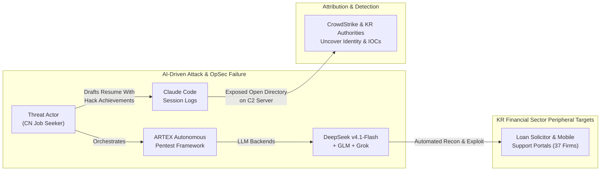

<details markdown="1">
<summary><strong>[2026-11-20 | 🇰🇷 KR] Kurly Data Breach Exposes 10,701 Records (Including RRNs &amp; Bank Accounts) &amp; Korean SaaS Spillovers</strong></summary>

* **Incident Overview:** Between November 19 and November 21, 2026, BoanNews and DailySecu reported major corporate personal-data breaches and supply-chain spillovers across South Korea:
  * **Kurly (`컬리`) Internal System Intrusion (Occurred Nov 17 / Reported Nov 18 / Disclosed Nov 20–21):** External attackers used stolen credentials to compromise internal business systems, exposing **10,701 records**—**10,699 "Kurly Curator"** affiliate marketing participants and **2** regular customer member IDs. While regular customer passwords, payment methods, and home addresses were unaffected, leaked Curator data included names, IDs, phone numbers, email addresses, SNS handles, and—for a subset of participants—**Resident Registration Numbers (RRNs / `주민등록번호`) and bank account numbers**. Kurly CEO Kim Seul-ah issued an apology and announced 50,000–150,000 KRW compensation plus full reimbursement for verified secondary financial harm.
  * **Voiceloop `JAMAKE` &amp; Douzone Bizon (`더존비즈온`) Spillovers (Reported Nov 19–20):** BoanNews also highlighted an unauthorized admin-panel intrusion at AI captioning/translation platform **JAMAKE (`자메이크`)** affecting **53,199 accounts** (with attacker permissions reaching ~9,000 linked YouTube channels before tokens were rotated), alongside expanded secondary disclosures from the **Douzone Bizon** (`Smart A 10` / `APO` backup) supply-chain compromise affecting **Korea Electronic Certification (`한국전자인증`)** and additional client organizations.
* **Solution / Remediation:**
  1. **Enforce Phishing-Resistant MFA &amp; Credential Hygiene on Internal Ops Portals:** Require hardware FIDO2/WebAuthn MFA for all internal back-office, affiliate/partner management, and VPN accounts, and rotate any static API/OAuth integration keys immediately upon anomaly detection.
  2. **Restrict &amp; Tokenize Settlement PII (RRNs &amp; Bank Accounts):** Segregate creator/affiliate tax and payout information (RRNs, bank accounts) into an isolated, encrypted payout vault rather than general marketing or operational CRM databases.
  3. **Lock Admin Consoles to Private Networks:** Restrict administrative interfaces (such as SaaS management panels and ERP/backup portals) exclusively to corporate VPN/zero-trust IP allowlists and enforce mandatory IP-anomaly session revocation.

</details>

<details markdown="1">
<summary><strong>[2026-11-20 | 🇺🇸 US / 🇰🇷 KR / 🌐 Global] VMware vCenter Zero-Day (CVE-2026-123890) &amp; CISA KEV Nov 20 Emergency Wave (Cisco Expressway, SAP NetWeaver)</strong></summary>

* **Advisory Overview:** On November 20, 2026, both **US CISA** (updating the KEV catalog with an aggressive **November 23, 2026** federal deadline and mandatory forensic triage) and **KISA (KrCERT/CC)** issued emergency warnings for actively exploited enterprise infrastructure flaws:
  * **`CVE-2026-123890` (VMware vCenter Server, CVSS 9.8 Critical — VMSA-2026-0009):** An unauthenticated authentication bypass in the VMware Directory Service (`vmdird`) caused by Secure Remote Password (SRP-6a) session key disclosure over DCE/RPC, granting full `administrator@vsphere.local` control. Google Threat Intelligence Group and Mandiant confirmed active **zero-day exploitation since early September 2026** by China-nexus espionage group **Armory Castle (UNC5221)** using a custom Golang tool (**`BONESAW`**) to steal `data.mdb` and create rogue SSO admins.
  * **`CVE-2026-76466` (Cisco Expressway Series, CVSS 9.8 Critical):** Use of hard-coded credentials, persistent cookies, and insufficient client-certificate validation over RPC in the database service, allowing unauthenticated remote `root` code execution.
  * **`CVE-2025-42884` (SAP NetWeaver Enterprise Portal):** Improper query-logic neutralization / JNDI injection allowing unauthenticated remote actors to manipulate JNDI lookups and access unauthorized data. *(CISA also formally added `CVE-2026-129448` Apache Roller to the Nov 20 KEV batch.)*
* **Solution / Remediation:**
  1. **Apply Vendor Patches Immediately (No Workarounds Available):**
     * **VMware vCenter:** Upgrade to **`9.1.1.0200+`**, **`9.0.2.0200+`**, or **`8.0 U3m+`** (plus companion Cloud Foundation / SDDC Manager / VMware Tools updates per VMSA-2026-0009). **No functional workarounds exist.**
     * **Cisco Expressway-C / E:** Upgrade to Cisco's fixed software releases (**`X15.5.20` / `15SU5+`**) and verify TLS Verify Mode clustering hardening. **No workarounds exist.**
     * **SAP NetWeaver:** Apply **SAP Security Notes `3660969` / `3642398`** via Software Update Manager (SUM).
  2. **Execute Mandatory vCenter Zero-Day Compromise Triage:** Because `CVE-2026-123890` was exploited for over two months pre-patch, audit vCenter for unexpected local/SSO admins (e.g., `sps-` prefixes), transient VAMI SSH toggles (`/rest/appliance/access/ssh`), unauthorized access to ports `2012`/`5480`, and rogue ESXi root SSH keys; rotate all SSO/service credentials and replace **vCenter SAML signing certificates**.

</details>

<details markdown="1">
<summary><strong>[2026-11-20 | 🇺🇸 US / 🌐 Global] Third-Party Vendor Breaches Hit JPMorgan Chase, Visa &amp; Mastercard (n0n Extortion Group)</strong></summary>

* **Incident Overview:** On November 19–20, 2026, **JPMorgan Chase, Visa, and Mastercard** confirmed customer-data exposures after extortion/ransomware group **`n0n`** (active since September 2026) published stolen vendor datasets on its dark-web leak site following a 48-hour ransom deadline.
* **Scope &amp; Confirmed Impact:** All three firms confirmed their **core internal banking and payment-processing networks were untouched**, with no credit card numbers, login credentials, or customer funds compromised. Instead, the leaks stemmed from **third-party service providers and subcontractors**:
  * **JPMorgan Chase:** Attackers accessed outside marketing-vendor records containing ~**16,000 email addresses** (some tied to high-net-worth/invitation-only Reserve card programs), names, and phone numbers. *(JPMorgan explicitly confirmed this breach was unrelated to an earlier-week technical transaction glitch.)*
  * **Visa:** Confirmed an incident involving a third-party service provider in the Asia-Pacific region, with core payment data unaffected.
  * **Mastercard:** Confirmed exposure of a limited number of email addresses and non-payment data from a small subset of cardholders in a specific card-benefit/loyalty program.
* **Solution / Remediation:**
  1. **Enforce Data Minimization With Marketing &amp; Loyalty Vendors:** Purge non-essential customer PII (and high-net-worth tier tags) from external marketing/benefit contractors; transmit only tokenized customer identifiers where possible.
  2. **Targeted Anti-Phishing &amp; VIP Account Protection:** Issue proactive spear-phishing/vishing advisories to exposed cardholders (especially high-net-worth segments) and enforce out-of-band verification for account-tier or contact-detail changes.
  3. **Continuous Third-Party Attack Surface Monitoring:** Audit sub-processors for exposed file-transfer, S3, and remote-access endpoints and enforce mandatory 24-hour vendor breach telemetry sharing.

</details>

<details markdown="1">
<summary><strong>[2026-11-20 | 🇪🇺 EU / 🇬🇧 UK] European Commission Confirms ARTEX AI-Driven Cyberattack &amp; UK NCSC Thwarts Cold-Chain OT Sabotage</strong></summary>

* **Incident Overview:** On November 19–20, 2026, two major European institutional and critical-infrastructure security disclosures emerged:
  * **European Commission AI-Assisted Cyberattack (Confirmed Nov 19):** Following investigative reporting, the European Commission confirmed it suffered a targeted cyber campaign (initially detected October 22) powered by the open-source autonomous AI pentesting framework **`ARTEX`**. To contain the intrusion, the Commission took core internal administrative platforms offline for over a week—including HR/payroll portal **Sysper**, medical reimbursement system **MyPMO**, and internal translation services—prompting CERT-EU warnings and Corporate Management Board crisis briefings while investigators assess potential staff PII exposure.
  * **UK NCSC Covert Cold-Chain OT Defense Operation (Revealed Nov 20):** Following the continental European supermarket refrigeration sabotage wave, UK disclosures revealed that the **National Cyber Security Centre (NCSC)**, Defra, FSA, and retail operators ran an urgent covert operation after researchers discovered critical authentication flaws in **Resource Data Management (RDM)** refrigeration controllers widely used across UK supermarkets, warehouses, and stadiums. Teams worked through weekends to pull thousands of RDM controllers off the public internet, place them behind VPNs (or disconnect them manually), and deploy firmware patches—successfully preventing supply-chain spoilage.
* **Solution / Remediation:**
  1. **Inventory &amp; Air-Gap Commercial OT/Telemetry Controllers:** Immediately scan external IP space (Shodan/Censys) for exposed refrigeration, HVAC, and building-management controllers (e.g., RDM, Danfoss, Coolworld); place all units behind authenticated VPNs or private cellular APNs and apply vendor firmware updates.
  2. **Deploy AI-Speed Behavioral Edge Defenses:** Because autonomous frameworks like `ARTEX` chain rapid discovery and exploitation within hours, enforce strict WAF rate limiting, automated scanner-behavior blocking, and zero-trust authentication on all internal HR/administrative portals.
  3. **Maintain Manual OT Fallback Procedures:** Establish manual temperature-monitoring and physical override SOPs for critical food and medical cold-chain facilities in case telemetry networks must be severed during an emergency.

</details>

<details markdown="1">
<summary><strong>[2026-11-19 | 🌐 Global / 🇰🇷 KR] PHP Critical Security Wave (CVE-2026-129289 / phpAfterShell) &amp; F5 BIG-IP Data-Plane RCE (CVE-2026-121805)</strong></summary>

* **Advisory Overview:** On November 19–20, 2026, **KISA (KrCERT/CC)**, the PHP Group, and F5 issued urgent security updates for critical web-stack and network-appliance vulnerabilities:
  * **PHP Security Releases (`8.2.36`, `8.3.37`, `8.4.28`, `8.5.13` — Nov 19):** Addressed 17–18 vulnerabilities, including multiple **CVSS 9.2 Critical** flaws: **`CVE-2026-129289`** (PHP-FPM FastCGI request smuggling leading to unauthenticated RCE when `fastcgi_keep_conn on` or `mod_proxy_fcgi` connection reuse is enabled and `php://input` is partially unread), **`CVE-2026-126714`** (*`phpAfterShell`* session file overwrite to arbitrary deserialization RCE), **`CVE-2026-115560`** (session serializer mismatch RCE), plus Use-After-Free RCEs **`CVE-2026-129496`**, **`CVE-2026-129481`**, **`CVE-2026-129474`**, and PHP-FPM LPE **`CVE-2026-129291`**.
  * **F5 BIG-IP Data-Plane Buffer Overflows (Nov 19–20):** F5 patched five critical stack-based buffer overflow flaws in BIG-IP APM and iRules—led by **`CVE-2026-121805`** in the iRules `PEM::subscriber` command—enabling unauthenticated remote attackers to crash the Traffic Management Microkernel (TMM) for DoS or achieve RCE. Because this is a **data-plane** vulnerability, management-interface ACLs do not mitigate it.
* **Solution / Remediation:**
  1. **Upgrade PHP &amp; Rebuild Containers:** Update immediately to **PHP `8.2.36`, `8.3.37`, `8.4.28`, or `8.5.13+`** (or vendor-backported OS packages), **restart `php-fpm` and Nginx/Apache workers**, and rebuild/redeploy Docker base images. Audit web-server configs to disable unnecessary FastCGI persistent connection reuse (`fastcgi_keep_conn`) and avoid runtime `ini_set()` session serializer changes.
  2. **Apply F5 MyF5 Engineering Hotfixes:** Audit virtual servers for iRules using `PEM::subscriber` and apply the fixed engineering hotfixes (**`BIGIP-21.1.0.4.0.19.3-ENG+`**, **`17.5.1.11.0.61.12-ENG+`**, **`17.1.3.7.0.21.4-ENG+`**, or BIG-IP Next **`BNK-2.4.2-EHF1+`**, **`2.3.4-EHF1+`**, **`2.2.5-EHF1+`**).

</details>

<details markdown="1">
<summary><strong>[2026-11-19 | 🌐 Global / 🇰🇷 KR / 🇺🇸 US] NGINX2Root: Five Critical RCE Flaws (CVE-2026-123007 et al.) &amp; Kernel Escalation Chain</strong></summary>

* **Threat Overview:** On November 18–19, 2026, F5/NGINX issued an out-of-band security advisory and patches for five critical remote code execution (RCE) vulnerabilities collectively dubbed **`NGINX2Root`** (**CVSS v4.0: 9.2 Critical** / CVSS v3.x: 8.1 High), discovered by Theori's Xint research team (combining manual research with AI-assisted static analysis).
* **Affected Components &amp; CVEs:** Affecting NGINX Open Source **`1.9.5` through `1.31.8`** and corresponding NGINX Plus releases:
  * **`CVE-2026-123007`** *(Lead HTTP/2 Flaw)*: Integer underflow and heap-based buffer overflow in `ngx_http_v2_module` flow-control accounting during stream cancellations.
  * **`CVE-2026-123633` &amp; `CVE-2026-121810`:** Use-After-Free (UAF) flaws triggered during HTTP/2 or HTTP/3 (QUIC) connection draining alongside upstream proxy connections.
  * **`CVE-2026-123634` &amp; `CVE-2026-113425`:** UAF flaws in the DNS resolver/mirror configuration path and Mail Proxy (`auth_http`) disconnect handling.
  * **Full Root Chain:** Researchers demonstrated chaining `CVE-2026-123007` with a separate unpatched **Linux kernel SCTP local privilege escalation (LPE)** flaw (affecting kernels `4.15+`) to escalate from the NGINX worker process to `root`.
* **Solution / Remediation:**
  1. **Upgrade NGINX Immediately &amp; Restart Binaries:** Update to NGINX Stable **`1.30.7+`** or Mainline **`1.31.9+`** (or vendor-backported packages). Reloading configuration (`nginx -s reload`) alone is **insufficient**; perform a full binary restart/process replacement.
  2. **Temporary Mitigation:** If immediate binary patching is blocked, remove `http2` from `listen` directives and test/reload (`nginx -t && nginx -s reload`) to mitigate the primary HTTP/2 attack surface.
  3. **Harden Against Kernel SCTP Chaining:** Unload and blacklist the `sctp` kernel module if unused on web hosts, and monitor Linux distribution advisories for the companion kernel SCTP patch.

</details>

<details markdown="1">
<summary><strong>[2026-11-18 | 🇺🇸 US] CISA KEV Emergency Wave: REDCap, Apache Axis, Synology DSM, Puppet &amp; LiteLLM Under Active Exploitation</strong></summary>

* **Advisory Overview:** On November 17–18, 2026, US CISA added five actively exploited vulnerabilities to the **Known Exploited Vulnerabilities (KEV)** catalog under **Binding Operational Directive (BOD) 26-04**, imposing aggressive **3-day federal remediation deadlines (November 21, 2026)** and mandatory forensic triage for internet-exposed assets on three critical flaws:
  * **`CVE-2026-90817` (Vanderbilt University REDCap `13.3.0+`, CVSS 9.8, added Nov 18, due Nov 21):** Unauthenticated code injection / RCE via survey passthrough routing and data import logic.
  * **`CVE-2026-90436` (Apache Axis 1.x EoL, CVSS 9.8, added Nov 18, due Nov 21):** Unauthenticated RCE via unsafe reflection when deserializing crafted SOAP fault messages.
  * **`CVE-2024-10441` (Synology DSM &amp; BeeStation OS, CVSS 9.8, added Nov 18, due Nov 21):** Improper output escaping RCE in the system plugin daemon, actively abused in NAS ransomware campaigns.
  * **`CVE-2026-115731` (Perforce Puppet Enterprise / Core, CVSS 9.4, added Nov 17):** Deserialization of untrusted data in Puppet Server report processing (`PUT` requests using a CA-signed agent cert).
  * **`CVE-2026-40217` (BerriAI LiteLLM, CVSS 5.9, added Nov 18, due Dec 2):** Sandbox escape RCE in the `/guardrails/test_custom_code` endpoint via Python bytecode manipulation.
* **Solution / Remediation:**
  1. **Apply Vendor Patches Immediately:**
     * **REDCap:** Apply Vanderbilt's latest security hotfixes/releases patching survey parsing and data imports.
     * **Synology DSM / BSM:** Upgrade to **`7.2.2-72806-1+`**, **`7.2.1-69057-6+`**, **`7.2-64570-4+`**, or **BeeStation OS `1.1-65374+`** (or latest supported DSM 7.3/7.4 builds).
     * **Perforce Puppet:** Upgrade Puppet Enterprise to **`2026.0.1`**, **`2025.12.1`**, or **`2023.8.13+`** (Puppet Core **`9.1.3`** / **`8.22.2+`**), and enforce **`autosign = false`** to block unauthorized CA certificate issuance.
     * **BerriAI LiteLLM:** Upgrade to **`v1.83.14-stable`** or later.
  2. **Decommission EoL Apache Axis 1.x:** Because Apache Axis 1.x is **End-of-Life** with no upstream patch, immediately isolate, disable, or replace legacy SOAP endpoints bundling Axis 1.x.
  3. **Execute Forensic Triage:** Inspect logs and host artifacts on any internet-exposed instances of the above products for indicators of prior compromise before returning them to production.

</details>

<details markdown="1">
<summary><strong>[2026-11-18 | 🌐 Global / 🇺🇸 US] Apache Roller Critical Unauthenticated RCE (CVE-2026-129448) Actively Exploited</strong></summary>

* **Threat Overview:** On November 18, 2026, security advisories confirmed active in-the-wild exploitation of **`CVE-2026-129448` (CVSS 9.8 Critical)**, an unauthenticated insecure deserialization vulnerability in **Apache Roller** (affecting versions `4.0.0` through `6.1.4`, with `CVE-2026-82384` covering `6.1.5`).
* **Root Cause:** The Roller XML-RPC endpoint accepts and deserializes vendor extension types **before** authenticating the requester or checking whether XML-RPC is disabled in the administrative UI.
* **Solution / Remediation:**
  1. **Upgrade Apache Roller:** Immediately upgrade to **Apache Roller `6.1.6` or `6.1.7+`**.
  2. **Server-Side Mitigation (Do Not Rely on Admin UI Toggle):** Turning off XML-RPC in the UI does **not** block exploitation. If immediate upgrade is blocked, set `enabledForExtensions` to `false` in `WEB-INF/web.xml`, remove the `/roller-services/xmlrpc` servlet mapping, and restart the Roller server.

</details>

<details markdown="1">
<summary><strong>[2026-11-18 | 🇰🇷 KR] Cascading Breaches Hit Korean Universities &amp; Outsourced SaaS Vendors (Jeonju, Yeungnam, Dong-Eui, MetaM &amp; Accesso)</strong></summary>

* **Incident Overview:** Between November 16 and November 18, 2026, BoanNews and DailySecu reported a rapid wave of breaches targeting South Korean university auxiliary portals and third-party outsourced customer systems:
  * **Jeonju University (`AHA` Online Liberal Arts Platform — reported Nov 18, occurred Nov 16 / detected Nov 17):** External intrusion leaked approximately **180,000 personal records**—including **~25,000 Resident Registration Numbers (RRNs)**—affecting current students, alumni, lifelong-education enrollees, and current/retired staff.
  * **Yeungnam University (Library e-Book &amp; Career Portals — disclosed Nov 17, occurred Nov 16):** Intrusion exposed student IDs, names, affiliations, and email addresses.
  * **Dong-Eui University (Research Grant Management System — disclosed Nov 17, occurred Nov 14):** Compromise leaked **530** faculty/staff records (employee ID, name, department, title, birth date).
  * **Outsourced Vendor Breaches — MetaM &amp; Accesso (disclosed Nov 16–17):** Compromises at contact-center vendor **MetaM (메타엠)** (occurred Nov 12, affecting Mega MGC Coffee, Coinone, and partner workflows) and ticketing provider **Accesso (액세소)** (occurred Nov 14, affecting **LEGOLAND Korea** and **SEA LIFE Busan Aquarium** season-pass holders) exposed customer phone numbers, names, addresses, emails, and pass barcodes.
* **Solution / Remediation:**
  1. **Eliminate Unnecessary RRN Storage:** Audit legacy university e-learning and administrative databases to purge retained Resident Registration Numbers (`주민등록번호`) and enforce strong encryption/tokenization.
  2. **Lock Down Auxiliary &amp; Research Portals:** Isolate university groupware, research grant (`RERP`), and LMS subdomains behind **MFA/2FA** and campus VPN/IP restrictions.
  3. **Enforce Outsourced Processor Security &amp; SLAs:** Require third-party call-center and ticketing SaaS vendors to implement least-privilege API scoping, WAF protection, and contractual **$\le 24$-hour breach notification SLAs**.

</details>

<details markdown="1">
<summary><strong>[2026-11-18 | 🇺🇸 US / Global] Software Supply Chain Attacks: Microsoft <code>agent-framework</code> PyPI Compromise &amp; Optimizely Web Injection</strong></summary>

* **Incident Overview:** Two major software supply chain compromises struck cloud developer and enterprise web ecosystems between November 16 and November 18, 2026:
  * **Microsoft `agent-framework` PyPI Compromise (Nov 17–18):** Attackers hijacked the official `agent-framework` PyPI package and published poisoned versions **`1.26.1` and `1.26.2`**. The packages dropped Python startup hooks (`agent_framework_meta.pth` and `af_runtime_diag.pth`) that executed **automatically on every Python interpreter startup**—even without importing `agent-framework`—to exfiltrate environment variables, Azure/AWS/OpenAI/Hugging Face credentials, and GitHub Actions / Azure DevOps OIDC tokens.
  * **Optimizely Web Experimentation Supply Chain Attack (Nov 16–17):** Attackers exploited a vulnerability in Optimizely's account-signup workflow to inject malicious JavaScript into CDN-hosted Optimizely snippets across **178 major organizations** (including CNN, BBC, Fox News, Zoom, Salesforce, HSBC, IKEA, and GitLab), serving payment card skimmers, crypto-wallet hijackers, cookie/screenshot stealers, and iOS exploit kits (*Coruna* and *DarkSword*).
* **Solution / Remediation:**
  1. **Respond to `agent-framework` `1.26.1` / `1.26.2`:** Treat any workstation, container, or CI/CD runner that installed those versions as **fully compromised**. Immediately rotate all cloud, AI API, PyPI/NPM, GitHub PAT, and OIDC tokens; inspect `site-packages` for `agent_framework_meta.pth`, `agent_framework_meta/`, `af_runtime_diag.pth`, and `af_runtime_diag.py`; wipe/reprovision CI runners; and pin `1.26.0` or verified post-quarantine releases.
  2. **Harden Against Third-Party Script Injection (Optimizely):** Verify local/CDN caches of Optimizely snippets are purged, enforce strict **Content Security Policy (`script-src`)** rules (eliminating broad wildcards and `unsafe-inline` where feasible), and deploy continuous client-side script integrity monitoring.

</details>

<details markdown="1">
<summary><strong>[2026-11-18 | 🇰🇷 KR] Financial Authorities Mandate Bi-Annual Vulnerability Assessments After 37-Firm Breach Wave</strong></summary>

* **Incident & Policy Context:** Following the cascading cyber attacks that began in late September 2026, official parliamentary and Financial Services Commission (FSC) tallies confirmed that **37 financial institutions (40 incidents)** suffered breaches, exposing approximately **470,000 customer and employee records** along with ~1 billion KRW in hot-wallet and account losses. Investigation revealed an average detection gap of **3.9 days (up to 15 days)** between initial intrusion and detection.
* **Key Findings:** Most intrusions bypassed hardened core banking mainframes and instead compromised **peripheral external systems**—such as loan-solicitor lookup portals, mobile employee support systems, and unauthenticated test pages.
* **Solution / Remediation:**
  1. **Full IT Asset Inventory:** Identify and register 100% of external-facing and third-party peripheral web servers, test endpoints, and partner portals.
  2. **Bi-Annual Vulnerability Audits:** Under the amended *Electronic Financial Supervision Regulations*, financial institutions with assets $\ge 2$ trillion KRW must increase comprehensive vulnerability assessments from once a year to **twice a year (semi-annually)**, explicitly covering non-core peripheral systems.
  3. **Real-Time IOC Sharing:** Automate threat intelligence and attacker IP (IOC) ingestion across sector-wide SIEM/SOAR pipelines within 24 hours.

</details>

<details markdown="1">
<summary><strong>[2026-11-17 | 🇪🇺 EU] Equinor Internal IT Cyberattack &amp; Wellington IT Irish Credit Union Breach</strong></summary>

* **Incident Overview:** Two major European infrastructure and financial-sector security disclosures surfaced on November 16–17, 2026:
  * **Equinor Energy Cyberattack (Norway, Nov 17):** State-owned energy giant **Equinor**—one of Europe's largest oil and natural gas suppliers—disclosed an active cyberattack affecting internal IT and corporate administrative/email systems while coordinating with Norway's **National Security Authority (NSM)** (which recently elevated Norway's national cyber threat level to **Level 4/5 High**) and **Havtil**. Equinor confirmed that oil/gas extraction and Operational Technology (OT) systems remained unaffected, with no malware spread or confirmed data exfiltration.
  * **Wellington IT / Irish Credit Unions (Disclosed Nov 16–17):** Belfast-based banking software supplier **Wellington IT** notified regulators and **40–43 Irish credit unions** that an automated script exploited an infrastructure vulnerability (Oct 2–4) to access saved payee/beneficiary records (names, IBANs, BICs, payment references). While account balances and login credentials were not exposed, Ireland's DPC and Central Bank scrutinized the delayed disclosure and warned of heightened **BEC/impersonation phishing** risks.
* **Solution / Remediation:**
  1. **Enforce Strict IT–OT Segmentation:** Maintain hardened firewalls, unidirectional gateways, and separate identity domains between corporate IT/email and energy OT/SCADA production networks.
  2. **Out-of-Band Beneficiary Verification:** Require out-of-band (voice/app) confirmation for any IBAN/payee changes and deploy member-facing anti-phishing alerts after third-party supplier compromises.
  3. **Hardware-Backed MFA on Corporate Identity:** Enforce FIDO2/WebAuthn MFA and conditional access policies across corporate email and administrative portals.

</details>

<details markdown="1">
<summary><strong>[2026-11-17 | 🌐 Global / 🇰🇷 KR] Apache HTTP Server <code>mod_http2</code> RCE (CVE-2026-119618) Active Exploitation Warning</strong></summary>

* **Advisory Overview:** On November 17, 2026, BoanNews and Singapore's Cyber Security Agency (CSA) issued urgent active-exploitation warnings regarding **`CVE-2026-119618` (CVSS v3.1: 9.8 Critical)** following the public release of proof-of-concept (PoC) exploit code.
* **Technical Impact:** A race condition (`CWE-362`) in the `assign_headers()` function of Apache HTTP Server's **`mod_http2`** module (affecting Apache HTTP Server **`2.4.55` through `2.4.70`** and standalone `mod_h2` `2.0.8`–`2.0.42`) triggers heap memory corruption and unauthenticated remote code execution (RCE) on servers with HTTP/2 (`h2` or `h2c`) enabled.
* **Solution / Remediation:**
  1. **Upgrade Apache HTTP Server:** Update immediately to **Apache HTTP Server `2.4.71`** or higher (or apply OS vendor backported `httpd`/`apache2` security packages) and restart the web server daemon.
  2. **Temporary Mitigation:** If immediate patching is not possible, disable HTTP/2 by removing `h2` and `h2c` from the `Protocols` directive in `httpd.conf` / `apache2.conf` and restarting Apache.

</details>

<details markdown="1">
<summary><strong>[2026-11-17 | 🇺🇸 US / Global] OpenJDK Java4Shell Vulnerability (CVE-2026-114938) &amp; US Infrastructure Patch Outages</strong></summary>

* **Threat Overview:** On November 17, 2026, a critical memory corruption and remote code execution (RCE) vulnerability dubbed **`Java4Shell` (`CVE-2026-114938`, CVSS 9.2 Critical)** was disclosed in OpenJDK's Base64 decoding and CPU intrinsic acceleration routines. Like October's `PHP2Shell`, AI-assisted vulnerability discovery accelerated both detection and exploit generation.
* **US Operational Impact ("Patch Fatigue" Outages):** In mid-November, a cascade of high-profile US infrastructure disruptions hit **Microsoft (Outlook/Teams)**, the **Federal Aviation Administration (FAA)**, **United Airlines**, **JPMorgan Chase**, and the **National Security Agency's classified internal network (`NSANet`)**. US officials (including the State Department and intelligence agencies) confirmed that the `NSANet` outage and concurrent disruptions were caused not by direct enemy sabotage, but by **emergency patching overload** as agencies rushed to deploy critical `PHP2Shell` and runtime security updates across complex legacy systems without adequate staging.
* **Solution / Remediation:**
  1. **Update Java Runtimes:** Immediately apply the **Oracle November 2026 Critical Patch Update (CPU)** or vendor-supplied OpenJDK security builds patching `CVE-2026-114938`.
  2. **Restart JVM Processes:** Restart all running Java application servers (Tomcat, Spring Boot, Kafka, Elasticsearch, etc.) so patched JVM shared libraries load into memory.
  3. **Canary & Staged Patch Deployment:** To prevent self-inflicted operational outages (`NSANet` lesson), validate emergency patches in isolated staging/canary rings and maintain instant rollback snapshots before enterprise-wide reboot waves.

</details>

<details markdown="1">
<summary><strong>[2026-11-12 | 🇰🇷 KR] Kyungil University Faculty Electronic Information System (gw.kiu.ac.kr) Breached</strong></summary>

* **Incident Overview:** Around 8:00 PM on November 12, 2026, **Kyungil University (경일대학교)** detected an external intrusion into its in-house faculty and staff electronic document/groupware system (`gw.kiu.ac.kr`), affecting approximately **600 professors and staff members**.
* **Threat Actor & Leak Details:** A threat actor operating under the handle **`KimJEN`** posted a thread titled *"108GB kiu.ac.kr data sharing"* on an underground hacking forum and leaked three compressed archives on Telegram totaling ~1 GB: `kiu_ac_kr_mail.zip` (~984.5 MB), `kiu_ac_kr_config.zip` (~1.2 MB), and `db.zip` (~17 MB). The same actor simultaneously claimed attacks against 31 South Korean universities (including regional university research administration systems) ahead of the national college entrance season.
* **Solution / Remediation:**
  1. **Isolate Groupware From Public Internet:** Immediately block direct public WAN access to internal electronic document and groupware portals (`gw.*`), requiring **SSL-VPN + Multi-Factor Authentication (MFA)** for off-campus faculty access.
  2. **Mandatory Credential & Session Reset:** Force-expire all active session tokens, reset passwords for all faculty/staff accounts, and rotate database/application configuration secrets exposed in `config.zip`.
  3. **Audit In-House Web Applications:** Conduct source-code and SQL injection/file-upload audits on custom-built university administrative portals, which often lack commercial WAF coverage.

</details>

<details markdown="1">
<summary><strong>[2026-11-12 | 🌐 Global / 🇰🇷 KR] Synology NAS DDoS, RCE &amp; Ransomware Wave (CVE-2026-76954 / 13684 / 13639)</strong></summary>

* **Threat Overview:** KISA (KrCERT/CC) and Synology issued urgent critical advisories regarding multiple **CVSS 9.8 (Critical)** vulnerabilities in Synology **DiskStation Manager (DSM)**:
  * **`CVE-2026-76954` (CVSS 9.8, disclosed Nov 12):** SQL Injection in the DSM Authentication API allowing unauthenticated remote attackers to read/write arbitrary files, execute code, or trigger **Denial-of-Service (DoS / DDoS)** conditions.
  * **`CVE-2026-13684` & `CVE-2026-13639` (CVSS 9.8, KISA advisory Oct 29–30):** Improper output encoding in DSM SCGI and insufficient entropy in login logic, actively chained in the wild with **C3RB3R ransomware** (`.L0CK3D` file extension encryption) targeting internet-exposed NAS appliances.
* **Solution / Remediation:**
  1. **Upgrade DSM Immediately:** Navigate to **Control Panel > Update & Restore** and update to the patched versions or higher:
     * **DSM 7.4:** Upgrade to `7.4.1-90080-1` or higher
     * **DSM 7.3:** Upgrade to `7.3.2-86009-5` or higher
     * **DSM 7.2.2:** Upgrade to `7.2.2-72806-10` or higher
     * **DSM 7.2.1:** Upgrade to `7.2.1-69057-13` or higher
  2. **Update DSM Packages:** Update **Web Station, Synology Calendar, and Mail Station** via Package Center to patch bundled PHP vulnerabilities.
  3. **Eliminate Public Port Forwarding:** Disable direct router port forwarding for DSM management ports (`5000` HTTP / `5001` HTTPS). Access the NAS exclusively through **Tailscale** or a **WireGuard/OpenVPN** tunnel, disable the default `admin` account, and enable **2FA + Auto Block**.

</details>

<details markdown="1">
<summary><strong>[2026-11-09 | 🇰🇷 KR] South Korea's Frontline Cyber Watchdog—Financial Security Institute (FSI / 금융보안원)—Breached</strong></summary>

* **Incident Overview:** On November 9, 2026, the **Financial Security Institute (금융보안원, FSI)**—the very agency responsible for 24/7 security monitoring and incident response across South Korea's financial sector—suffered a targeted intrusion into its **"Ongoing Information Security Assessment Support System" (정보보호 상시 평가 지원 시스템)**.
* **Attack Vector & Impact:**
  * **SMS Fallback Bypass:** Attackers exploited a temporary backup login path left open for users experiencing SMS two-factor authentication delivery issues.
  * **Regulator Impersonation & IP Rotation:** The threat actors rotated across **246 IP addresses** (over 100 active proxy nodes) and compromised/impersonated an account belonging to a **Financial Supervisory Service (FSS / 금융감독원)** official to access multi-institution compliance files.
  * **Data Leaked:** Approximately **650 records across 48 financial institutions** were exfiltrated, including ~200 administrative compliance forms (containing ~300 names/dates of birth) and ~350 system user profiles.
* **Solution / Remediation:**
  1. **Eliminate Emergency Auth Backdoors:** Permanently remove legacy or fallback authentication endpoints that bypass primary MFA enforcement.
  2. **Enforce Strict Static IP Allowlisting:** Prohibit dynamic/unverified IP connections to regulatory and compliance submission portals; bind privileged regulator accounts (such as FSS auditors) to dedicated static IP ranges and hardware FIDO2 keys.
  3. **Zero-Trust Privilege Segregation:** Restrict cross-organization read permissions so a single compromised auditor or supervisor account cannot bulk-download assessment files across dozens of member institutions.

</details>

<details markdown="1">
<summary><strong>[2026-11-03 | 🇪🇺 EU] European Cold-Chain OT Cyber Sabotage: Supermarket Freezers Hacked to +50°C</strong></summary>

* **Incident Overview:** Starting in mid-October in France (**700+ supermarket locations**) and escalating through early November 2026 across **at least 11 European countries** (including Belgium, Luxembourg, Sweden, Germany, Italy, and the UK), attackers executed a coordinated Operational Technology (OT) sabotage campaign against commercial refrigeration and cold-chain control systems.
* **Physical & Critical Infrastructure Impact:**
  * **Temperature Manipulation to +50°C (up to 80–110°C):** Hackers penetrated internet-exposed industrial temperature controllers and abused defrost/heating cycles, driving sub-zero freezers up to **50°C (122°F)** and higher.
  * **Massive Spoilage & Medical Threat:** Tons of meat, dairy, and frozen goods spoiled within hours, while overheating triggered store fires and sprinkler malfunctions. Even more critically, **blood plasma cryo-storage units at the French National Blood Service (EFS)** were targeted.
  * **Attribution & Motive:** Rather than demanding ransom, the attacks aimed at pure supply-chain disruption and societal chaos (attributed by French authorities to IRGC-linked cyber units). South Korea's Ministry of Science and ICT (MSIT) subsequently ordered an emergency inspection of domestic cold-chain facilities.
* **Solution / Remediation:**
  1. **Disconnect OT/ICS Controllers From the Public Internet:** Never expose HVAC,BMS, or refrigeration PLC/SCADA web interfaces directly to public IPv4 space (Shodan-discoverable ports); mandate **VPN with MFA** for remote maintenance vendors.
  2. **Rotate Default Manufacturer Credentials:** Immediately replace factory default passwords on all industrial IoT/OT controllers and apply vendor firmware updates.
  3. **Independent Hardware Thermal Cutoffs & Out-of-Band Alerts:** Install out-of-band physical temperature sensors and hardware relays that trigger immediate SMS/SOC alerts and block dangerous heating setpoints regardless of software commands.

</details>

<details markdown="1">
<summary><strong>[2026-10-30 | 🌐 Global / 🇰🇷 KR] Linux Kernel Critical Vulnerability (CVE-2026-98432, CVSS 9.8) — Mandatory Reboot Required</strong></summary>

* **Vulnerability Overview:** A critical **CVSS 9.8** Use-After-Free (UAF) vulnerability (**`CVE-2026-98432`**) was identified in the Linux kernel's IPv4 TCP networking stack (3-way handshake SYN race condition, affecting Linux kernel `4.4+`). Security researchers demonstrated that frontier AI models could autonomously chain this flaw against Multipath TCP (MPTCP) listeners to achieve **zero-click remote `root` code execution** without crashing the target kernel—allowing silent, unlimited retries.
* **Why a Reboot Is Mandatory:** Updating packages via `apt` or `dnf` only writes the new kernel image (`vmlinuz`) to `/boot` on disk. **The vulnerable kernel code remains resident in active RAM** until the operating system is fully rebooted (or hot-patched via `kpatch`/`Canonical Livepatch`).
* **Solution / Remediation (Update & Mandatory Reboot):**

```bash
# 1. Check current running kernel version in memory
uname -r

# 2. Apply latest security kernel packages
# For Ubuntu / Debian:
sudo apt update && sudo apt full-upgrade -y

# For RHEL / Rocky Linux / AlmaLinux / Amazon Linux:
sudo dnf update "kernel*" -y

# 3. MANDATORY: Reboot the host to load the patched kernel into RAM
sudo systemctl reboot

# 4. Verify after reboot that the new kernel version is active
uname -r
```

</details>

<details markdown="1">
<summary><strong>[2026-10-26 | 🇺🇸 US] US Healthcare Ransomware Surge: UNM Health Trauma Center &amp; Access Dental Breaches</strong></summary>

* **Incident Overview:** Late October and November 2026 saw a historic surge in cyber attacks against US healthcare infrastructure:
  * **University of New Mexico Health (UNM Health — Oct 26):** A cyber attack forced New Mexico's only **Level-1 trauma center** to divert incoming ambulances, cancel elective surgeries, and shut down clinical network operations before emergency containment restored core services the following day.
  * **Access Dental Management (`WorldLeaks` Extortion):** Intruders exfiltrated sensitive records—including Social Security Numbers (SSNs) and clinical data—affecting **340,000 to 450,000+ patients**.
* **Solution / Remediation:**
  1. **Immutable Offline Backups (3-2-1-1-0 Rule):** Maintain air-gapped or object-locked immutable backups of Electronic Health Record (EHR) databases tested weekly for rapid bare-metal restoration.
  2. **Clinical Network Micro-Segmentation:** Isolate life-critical medical devices, ambulance dispatch consoles, and imaging VLANs from general corporate IT and email networks.
  3. **Defend Against BYOVD (Bring Your Own Vulnerable Driver):** Enable Microsoft Vulnerable Driver Blocklist and HVCI (Memory Integrity) to prevent ransomware payloads from disabling endpoint EDR agents.

</details>

<details markdown="1">
<summary><strong>[2026-10-21 | 🌐 Global / 🇺🇸 US / 🇰🇷 KR] PHP Critical RCE PHP2Shell (CVE-2026-109618 &amp; CVE-2026-109619)</strong></summary>

* **Vulnerability Overview:** Disclosed on October 21, 2026, and immediately added to the **US CISA Known Exploited Vulnerabilities (KEV)** catalog and KISA alerts, **`PHP2Shell`** comprises two critical flaws (**CVSS 9.2 Critical**):
  * **`CVE-2026-109618`:** Out-of-Memory (OOM) exception handling flaw leading to memory corruption and pre-auth RCE.
  * **`CVE-2026-109619`:** Use-After-Free (UAF) memory corruption allowing unauthenticated remote attackers to plant web shells and take over web servers across Apache `mod_php`, `php-fpm`, `php-cgi`, FrankenPHP, and LiteSpeed.
* **Solution / Remediation:**
  1. **Upgrade to Patched PHP Releases Immediately:**
     * **PHP 8.2 branch:** Upgrade to **`8.2.35`** or higher
     * **PHP 8.3 branch:** Upgrade to **`8.3.36`** or higher
     * **PHP 8.4 branch:** Upgrade to **`8.4.27`** or higher
     * **PHP 8.5 branch:** Upgrade to **`8.5.12`** or higher
     * *(Note: PHP 8.1 and older are End-of-Life; migrate to a supported branch or apply OS vendor backports immediately.)*
  2. **Restart Web & PHP Worker Processes:**

```bash
# Restart PHP-FPM and web server daemons to flush vulnerable worker processes from RAM
sudo systemctl restart php-fpm nginx
# Or on Apache systems:
sudo systemctl restart apache2
```

  3. **Temporary Workaround (If Immediate Upgrade Is Blocked):** Set `session.upload_progress.enabled = Off` (and `fatal_error_backtraces = Off` on PHP 8.5) in `php.ini` until the binary upgrade is completed.

</details>

<details markdown="1">
<summary><strong>[2026-10-08 | 🇰🇷 KR] Massive AI-Driven Financial Sector Cyber Attack (ARTEX + DeepSeek + Claude Code Exposure)</strong></summary>

* **Incident Timeline & Scope:**
  * **Sep 27 – Sep 30, 2026 (Initial Intrusions Confirmed):** Coordinated anomalous traffic and data exfiltration hit major South Korean commercial banks—starting with **KB Kookmin Bank (Sep 27)**, **Shinhan Bank (Sep 28–30, ~25,000 loan-solicitor service records)**, and **Hana Bank (Sep 30)**—before spreading to **BNK Busan Bank, Hyundai Capital, Yegaram Savings Bank, KDB Capital, DB Savings Bank, DaeShin Securities, Mirae Asset, and Bithumb** (16 institutions initially confirmed by Oct 14; later expanding to 37 firms).
  * **Oct 7–8, 2026 (CrowdStrike & Security Industry Attribution):** Global security firm **CrowdStrike** and domestic researchers analyzed the attacker's exposed command-and-control (C2) infrastructure, uncovering a landmark case of **AI-orchestrated cybercrime**.
* **How the Attacker Was Caught (The AI Resume OpSec Blunder):**
  * **Autonomous AI Exploitation Stack:** The attacker deployed **`ARTEX`**, an open-source AI autonomous penetration-testing framework, wired primarily to Chinese LLM **`DeepSeek` (`v4.1-Flash`)** alongside **Zhipu AI (`GLM`)** and **xAI (`Grok`)** to automatically scan and exploit peripheral financial web portals.
  * **Exposed `Claude Code` Session Logs:** The perpetrator carelessly left an open directory listing on their attack server containing active **`Claude Code`** session logs and configuration files.
  * **Job-Seeker Resume Prompt:** Inside those logs, the attacker—identified as a **Chinese national in his early-to-mid 20s (Guangdong/Shanghai region job seeker & South China University of Technology alumnus)**—had prompted Claude Code to **draft a cybersecurity researcher resume** that explicitly boasted about successfully hacking South Korean financial institutions. The logs also captured prompts asking the AI *"where stolen Korean financial data is traded"* and *"how to find Korean Telegram data-broker channels."*



* **Solution / Remediation:**
  1. **Decommission & Harden Peripheral Portals:** Eliminate unauthenticated test pages and legacy outsourced portals (loan-solicitor lookup tools, partner web apps); place all external business support systems behind enterprise WAF and zero-trust identity proxies.
  2. **Deploy Behavioral Bot & AI-Scanner Mitigation:** Since AI frameworks like `ARTEX` chain rapid reconnaissance with automated payload mutation, enforce strict rate limiting, behavioral anomaly detection, and automated IP reputation blocking at the edge.
  3. **Strict Data Masking & API Governance:** Prevent API responses on partner portals from returning full unmasked PII (names, resident numbers, phone numbers) in bulk queries.

</details>

<details markdown="1">
<summary><strong>[2026-09-09 ~ 2026-10-06 | 🇰🇷 KR] Toss Security Audit: 1-Year Prior Reconnaissance Logs &amp; Toss Payments Merchant Key Leak</strong></summary>

* **Incident Context (Why "Toss 1 Year Ago" Made Headlines During the Audit):**
  * **Long-Term Dormant IP Reconnaissance (~1 Year of Logs Audited):** Following the late-September bank breaches, financial authorities shared attacker IP Indicators of Compromise (IOCs) across all financial firms. When **Toss Bank** audited its historical connection logs stretching back to the beginning of the year (**up to 1 year of log retention scrutinized during the October National Assembly audit**), it discovered that two US-based attacker IPs used in the Shinhan Bank breach had already probed Toss Bank's internal servers **3 times in January and 11 times in July–August**. While Toss Bank's firewall blocked all 14 attempts with zero data loss, lawmakers highlighted that attackers conduct reconnaissance up to **a year in advance**, exposing the danger of short (3-month) log retention windows and lack of mandatory real-time IOC sharing.
  * **Toss Payments Merchant API Key Exposure (Sep 9 & Oct 6 National Assembly Audit):** Separately, on September 9, 2026, an attacker exploited an exposed payment integration key (`연동키`) on a **Toss Payments** merchant website to query **4,131 payment receipts (2,671 customers: names, masked card numbers, approval numbers)**. During the October 6 parliamentary audit, lawmakers criticized Toss Payments because its Fraud Detection System (FDS) failed to alert on the bulk receipt scraping.
* **Solution / Remediation:**
  1. **Mandate $\ge 1$-Year Security Log Retention & Retroactive Threat Hunting:** Retain firewall, SSH, and web access logs for at least **12 months** to detect slow, low-and-slow APT reconnaissance that precedes major campaigns by months or a year.
  2. **Enforce Additional Verification on Receipt/Transaction Lookups:** Never allow payment receipt URLs or merchant API keys alone to return customer PII; require secondary verification (buyer name, exact payment amount, or email/SMS challenge) as implemented by Toss Payments post-audit.
  3. **FDS Rate-Limiting on Partner APIs:** Configure automated anomaly detection (FDS) to trigger immediate API key revocation whenever a merchant integration key performs abnormal bulk receipt lookups.

</details>
