As part of **CSE 3244: Data Management in the Cloud** at The Ohio State University, I used Google Cloud Platform (GCP) to provision a Linux VM, ran a containerized Hadoop environment on it, and used a Java MapReduce job to count WTA (ITF-sanctioned tournament) match wins by player and by country.

> External IP addresses and the shell username in the screenshots are masked.
{: .prompt-info }

---

## 1. Project Goals

- Get comfortable using a public cloud (Google Cloud Platform)
- Create and provision compute instances and disks (I/O) myself
- Work with and preprocess a large dataset
- Use MapReduce to extract structure (meaningful aggregates) from text data
- Run MapReduce jobs from the command line

**The task:** count wins per player and per country from WTA match CSV files. The trick is that the tournament ID contains the host country (for example, `2015-W-C50-USA-02A-2015` → USA).

---

## 2. Architecture

```text
GCP Compute Engine VM (Ubuntu 20.04 · 4 vCPU · 16 GB · 50 GB)
└── Docker
    └── Cloudera QuickStart container (Hadoop + HDFS)
        ├── HDFS /tennis            <- CSV files uploaded here
        └── Java MapReduce CountWins -> results in /tennis.CountWins
```

The VM's `~/tmp` folder is mounted into the container as `/src`, so the code and data downloaded on the VM can be used inside the container as-is.

---

## 3. Technologies Used

| Area | Technology | What I did with it |
| --- | --- | --- |
| Cloud | GCP Compute Engine | Created a project, created and sized a VM, connected with browser SSH, suspended and deleted the VM |
| OS | Ubuntu 20.04 LTS | Host OS; installed Docker with `apt` |
| Container | Docker (`docker.io`) | `pull` the image, check its ID with `images`, `run` (volume mount `-v`, `--privileged`), `ps`, `attach` |
| Big data platform | Cloudera QuickStart | Ran a single-node environment with Hadoop and HDFS preinstalled, as a container |
| Distributed file system | HDFS | Loaded and inspected data with `hdfs dfs -mkdir` / `-put` / `-ls` / `-cat` / `-rm -r` |
| Processing model | Hadoop MapReduce | Ran the per-player, per-country win count job |
| Language | Java (JDK 1.7) | Compiled with Hadoop's built-in compiler and packaged with `jar` |
| Shell | Linux Bash | `wget`, `tar`, environment variables (`JAVA_HOME`, `HADOOP_CLASSPATH`) |

---

## 4. Steps (with Screenshots)

### Task 1 · Set Up GCP and Cloudera QuickStart

**Step 1. Create a GCP project.** Create a new project in the console. The project ID cannot be changed later.

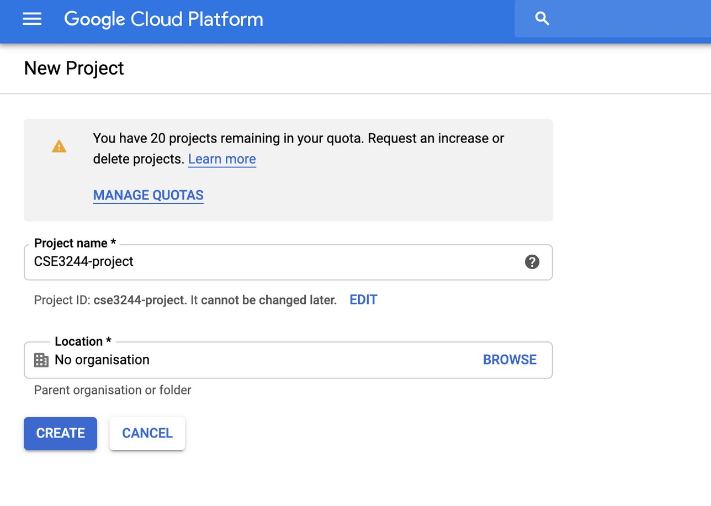
*Figure 1. Creating a new project (CSE3244-project)*

**Step 2. Create a VM instance.** Compute Engine → Create Instance. Choose the `e2-standard-4` machine type (4 vCPU, 16 GB). The estimated monthly cost is shown on the right.

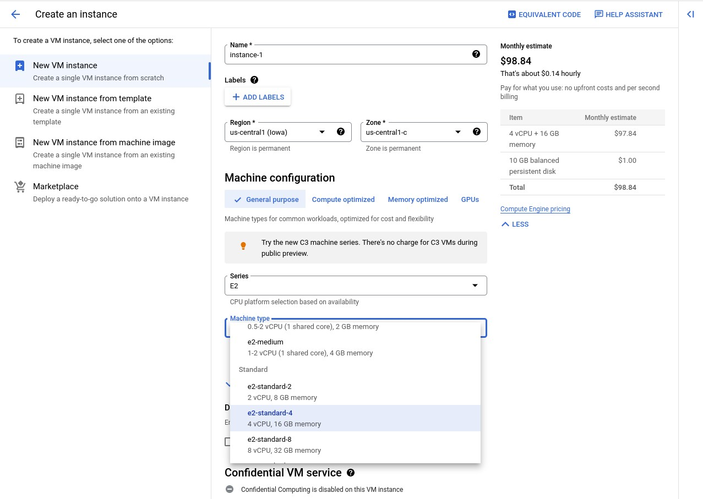
*Figure 2. Choosing the machine type (region us-central1, e2-standard-4)*

Instead of the default boot disk, choose Ubuntu 20.04 LTS and set the size to 50 GB.

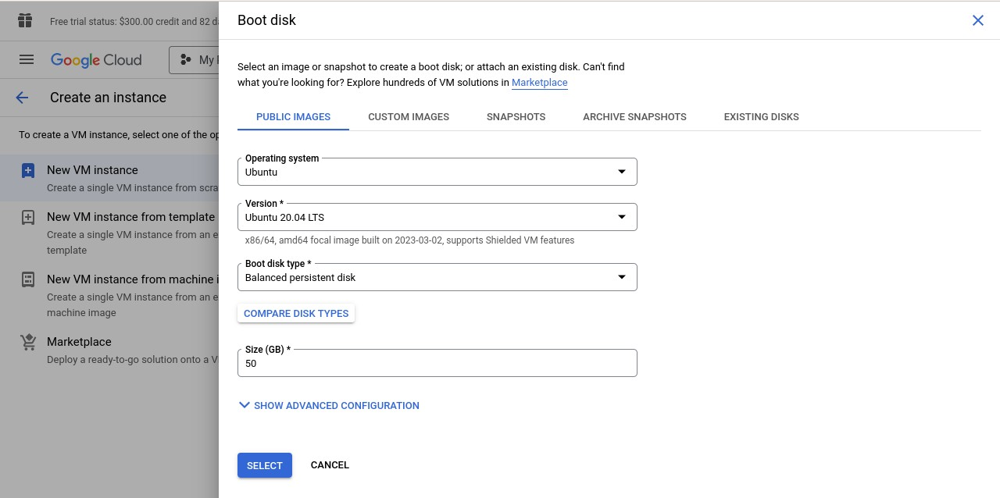
*Figure 3. Boot disk settings (Ubuntu 20.04 LTS, Balanced persistent disk, 50 GB)*

**Step 3. Connect with SSH.** Click **SSH** next to the instance in the VM list to open a terminal in the browser. The internal and external IPs are also shown here.

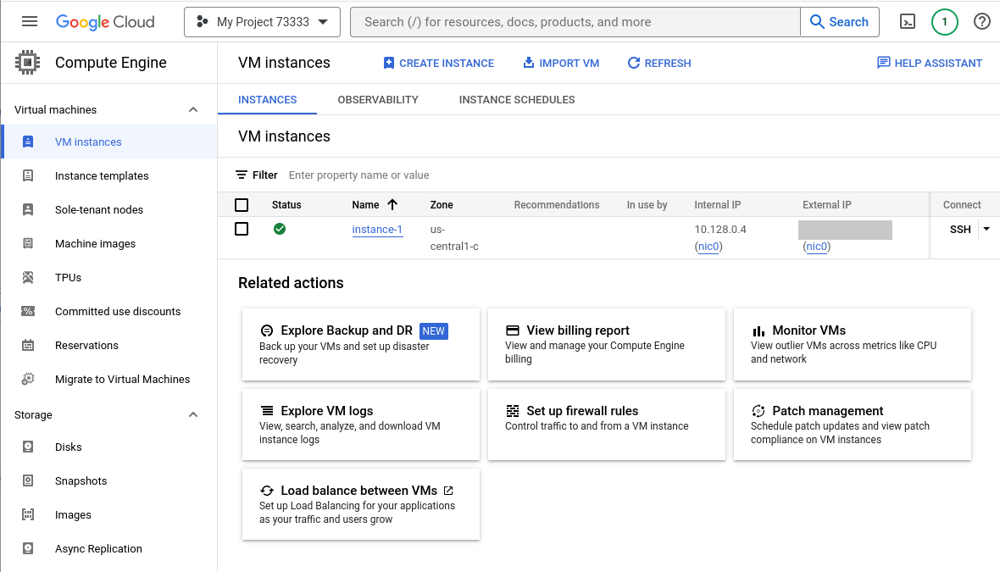
*Figure 4. VM instance list and the SSH button*

**Step 4. Install Docker.** Run `sudo apt update`, then `sudo apt install docker.io`.

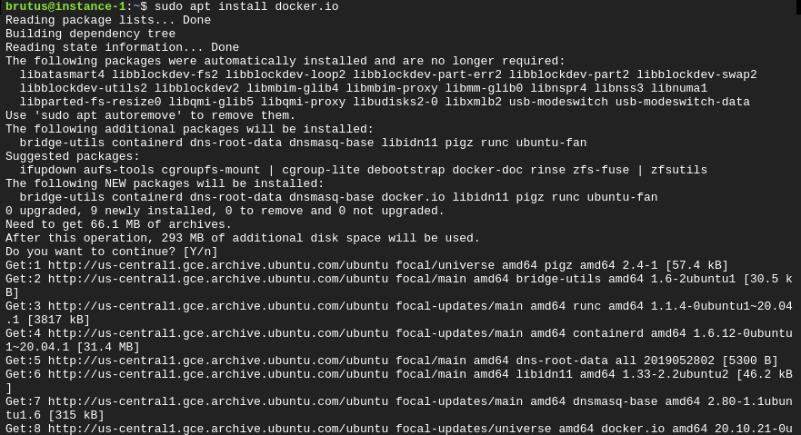
*Figure 5. Installing docker.io (dependencies such as containerd and runc are installed with it)*

**Step 5. Download the Cloudera QuickStart image.** It is about 4.4 GB, so it takes a few minutes. Docker warns that the image uses an outdated (schema1) format.

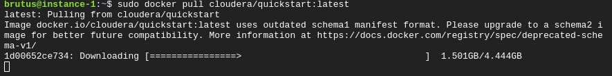
*Figure 6. `docker pull cloudera/quickstart:latest`*

**Step 6. Check the image ID.** `sudo docker images` shows the image ID (`4239cd2958c6`). This value goes into the container run command.

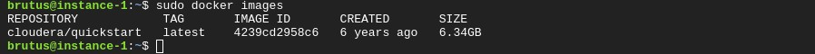
*Figure 7. `docker images` output (6.34 GB)*

**Steps 7–8. Download code and data, then run the container.** Download `gcplab.tar.xz` into `~/tmp`, extract it, and run the container with `-v ~/tmp:/src` to mount it.

**Step 9. Detach, reattach, and exit.** Detach with `Ctrl+P` → `Ctrl+Q`, find the container ID with `docker ps`, and get back in with `docker attach`. The output also shows the container's web ports (80, 7180, 8888) mapped to VM ports.

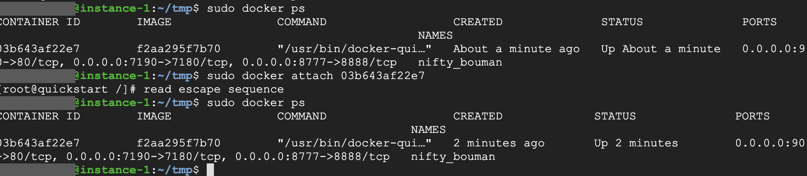
*Figure 8. `docker ps` and `docker attach`*

To stop the VM, open the instance's three-dot menu and choose **Suspend** or **Delete**.

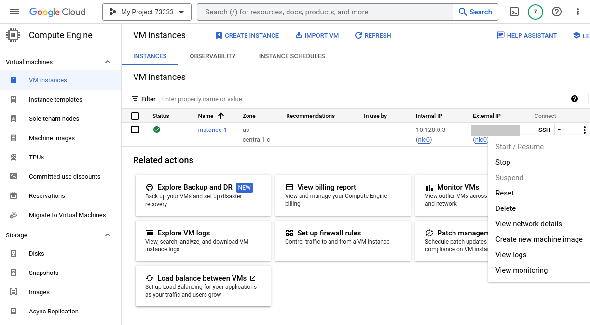
*Figure 9. VM menu (Stop · Suspend · Reset · Delete)*

### Task 2 · Run the MapReduce Program

- Understand the domain: tennis, the ITF, the WTA tour structure, and the tournament naming rules
- Upload the CSV files to HDFS `/tennis`
- Compile `CountWins.java` → build a jar → delete the old output folder → run the job
- Check the top 20 lines of the result file `part-r-00000` and submit
- Bonus task: change the map function to aggregate by player name instead of player ID

**Key commands**

```bash
$ sudo docker run --hostname=quickstart.cloudera --privileged=true \
    -t -i -v ~/tmp:/src <image-id> /usr/bin/docker-quickstart -d

$ hdfs dfs -mkdir /tennis
$ hdfs dfs -put wta_matches_qual_itf_* /tennis

$ hadoop com.sun.tools.javac.Main -Xlint:deprecation CountWins.java
$ jar cf cw.jar CountWins*class
$ hdfs dfs -rm -r /tennis.CountWins
$ hadoop jar cw.jar CountWins /tennis /tennis.CountWins
$ hdfs dfs -cat /tennis.CountWins/part-r-00000 | head -n 20
```

---

## 5. Results

### Task 2 Result · Wins by Player ID × Country (Top 20 Lines)

The output format is `player ID, country, wins`. For example, `200002,USA,63` means player 200002 won 63 matches at tournaments held in the USA.

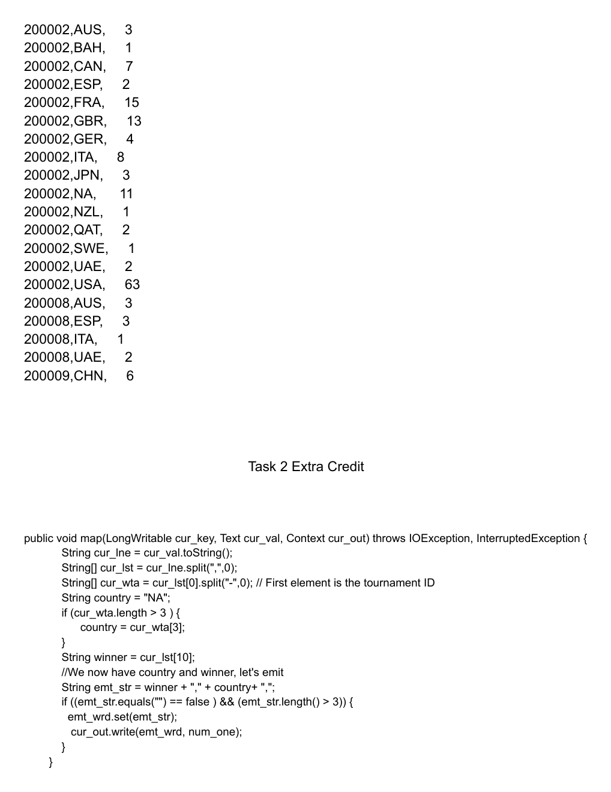
*Figure 10. Submitted result file — top 20 lines of `part-r-00000`, followed by the extra-credit map function*

| Player ID | Country | Wins | Player ID | Country | Wins |
| --- | --- | ---: | --- | --- | ---: |
| 200002 | AUS | 3 | 200002 | NZL | 1 |
| 200002 | BAH | 1 | 200002 | QAT | 2 |
| 200002 | CAN | 7 | 200002 | SWE | 1 |
| 200002 | ESP | 2 | 200002 | UAE | 2 |
| 200002 | FRA | 15 | 200002 | USA | 63 |
| 200002 | GBR | 13 | 200008 | AUS | 3 |
| 200002 | GER | 4 | 200008 | ESP | 3 |
| 200002 | ITA | 8 | 200008 | ITA | 1 |
| 200002 | JPN | 3 | 200008 | UAE | 2 |
| 200002 | NA | 11 | 200009 | CHN | 6 |

- Within the top 20 lines, player 200002's 63 wins in the USA is the highest count.
- `NA` means the country code could not be extracted from the tournament ID. If splitting the ID on `-` gives fewer than 4 pieces, the country is set to `NA`.

### Bonus Task · Changing the Map Function to Aggregate by Player Name

I changed the map function to use the 11th CSV column (`cur_lst[10]`, the winner's name) as the key.

```java
public void map(LongWritable cur_key, Text cur_val, Context cur_out)
        throws IOException, InterruptedException {
    String cur_lne = cur_val.toString();
    String[] cur_lst = cur_lne.split(",",0);
    String[] cur_wta = cur_lst[0].split("-",0); // First element is the tournament ID
    String country = "NA";
    if (cur_wta.length > 3 ) {
        country = cur_wta[3];
    }
    String winner = cur_lst[10];
    //We now have country and winner, let's emit
    String emt_str = winner + "," + country+ ",";
    if ((emt_str.equals("") == false ) && (emt_str.length() > 3)) {
        emt_wrd.set(emt_str);
        cur_out.write(emt_wrd, num_one);
    }
}
```

**What the map function does**

- Splits one line (one match) on commas.
- Splits the first column (tournament ID) on `-` and uses the 4th piece as the country code; if it is missing, uses `NA`.
- Takes the winner's name from the 11th column.
- Emits `"winner name,country,"` as the key and `1` as the value. Reduce then adds up the 1s for each key to produce the win count.

### Bonus Result · Wins by Player Name × Country (Top 20 Lines)

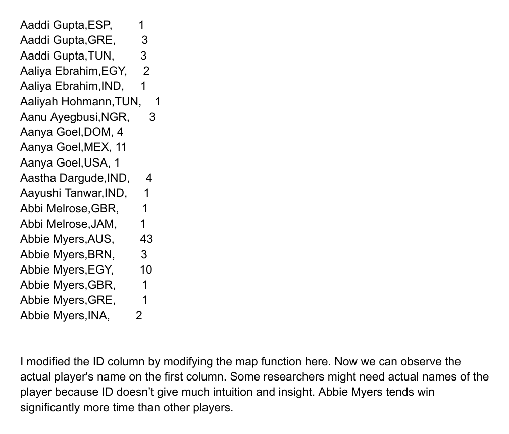
*Figure 11. Submitted result file — top 20 lines aggregated by player name, with my written analysis*

| Player name | Country | Wins | Player name | Country | Wins |
| --- | --- | ---: | --- | --- | ---: |
| Aaddi Gupta | ESP | 1 | Aastha Dargude | IND | 4 |
| Aaddi Gupta | GRE | 3 | Aayushi Tanwar | IND | 1 |
| Aaddi Gupta | TUN | 3 | Abbi Melrose | GBR | 1 |
| Aaliya Ebrahim | EGY | 2 | Abbi Melrose | JAM | 1 |
| Aaliya Ebrahim | IND | 1 | Abbie Myers | AUS | 43 |
| Aaliyah Hohmann | TUN | 1 | Abbie Myers | BRN | 3 |
| Aanu Ayegbusi | NGR | 3 | Abbie Myers | EGY | 10 |
| Aanya Goel | DOM | 4 | Abbie Myers | GBR | 1 |
| Aanya Goel | MEX | 11 | Abbie Myers | GRE | 1 |
| Aanya Goel | USA | 1 | Abbie Myers | INA | 2 |

**Submitted analysis (original)**

> I modified the ID column by modifying the map function here. Now we can observe the actual player's name on the first column. Some researchers might need actual names of the player because ID doesn't give much intuition and insight. Abbie Myers tends win significantly more time than other players.

---

## 6. What I Learned

### ① Cloud resource lifecycle and cost

| Action | Compute billing | Storage billing | Data |
| --- | --- | --- | --- |
| Just closing the SSH session (`Ctrl+D`) | Continues | Continues | Kept |
| Suspend | Stops | Continues | Kept |
| Delete | Stops | Stops | All deleted |

- The VM creation page shows the estimated monthly cost up front. For this lab's spec (4 vCPU, 16 GB, based on a 10 GB disk) it showed about **$98.84/month**, or about **$0.14/hour** (Figure 2).
- Closing the window does not stop the VM; it keeps running and billing. When it is not in use, it must be suspended or deleted.
- Instead of using the defaults, I chose the OS, CPU, memory, and disk to fit the job.

### ② Reproducing a complex environment quickly with containers

- Instead of installing a Hadoop cluster by hand, a single prebuilt image runs it right away.
- A volume mount (`-v ~/tmp:/src`) lets the host and the container share the same files.
- Detaching (`Ctrl+P` → `Ctrl+Q`) keeps the container alive; exiting (`Ctrl+D`) stops it, and it then has to be started again with `docker run`.
- Image and container IDs have to be looked up (`docker images`, `docker ps`) and filled in manually.

### ③ HDFS is separate from the local file system

- Files on the VM or in the container must be uploaded with `hdfs dfs -put` before MapReduce can read them.
- MapReduce will not run if the output folder already exists, so it has to be removed with `hdfs dfs -rm -r` before re-running.

### ④ Thinking in MapReduce

- **Map:** produce key-value pairs from each match record. Here the key was `"player,country"` and the value was `1`.
- **Reduce:** group by key and sum to get the final win count.
- I practiced the deployment flow: write Java → compile → package as a jar → run with `hadoop jar`.
- The choice of key changes what the result means. In the bonus task, switching the key from player ID to player name turned the same aggregation into a result people can read and interpret immediately.
- Incomplete source data (tournament IDs without a country) needs handling with a default value (`NA`).

### ⑤ Data analysis starts with understanding the domain

- Understanding tennis, the ITF, and the tournament structure comes before the code — that is where the idea of pulling the country out of the tournament name comes from.
- As in the bonus task, first decide what question the data can answer, then design Map and Reduce around it.

> This lab is for learning, so it gives the container broad privileges with `--privileged` and uses the old JDK 1.7 and Cloudera QuickStart image. In practice, containers are usually run with least privilege, and teams often use managed services (such as GCP Dataproc) or current Spark/Hadoop environments.
{: .prompt-tip }
