In this project I treated a MySQL server running in a VMware virtual machine at home as an "on-premises" data center, connected it to AWS through an encrypted Site-to-Site VPN, and migrated the database into Amazon RDS with AWS Database Migration Service (DMS). The migration copied all existing data **and** kept replicating new changes in near real time, the same pattern used when a company moves a live database to the cloud without long downtime.

> The AWS console in the screenshots is in Korean. Each figure caption explains what is on the screen. Sensitive values (passwords, the VPN pre-shared key, and my home public IP) are masked or replaced with placeholders such as `<HOME_PUBLIC_IP>`.
{: .prompt-info }

---

## What This Project Shows

| Skill | Where it appears |
| --- | --- |
| Hybrid networking (IPsec Site-to-Site VPN through NAT) | Steps 4–5 |
| VPC design with private subnets only | Step 3 |
| Database migration: full load + change data capture (CDC) | Steps 6–8 |
| Least-privilege database access | Step 6 |
| Migration validation | Step 8 |
| Cost control and resource cleanup | Steps 2 and 9 |

---

## Key Terms (for Readers New to AWS)

- **On-premises (on-prem):** Servers a company runs in its own building. Here, a VM on my laptop plays that role.
- **VPC (Virtual Private Cloud):** A private, isolated network inside AWS.
- **Site-to-Site VPN:** An encrypted tunnel over the internet that joins two private networks so they can talk as if they were on one network.
- **VGW (Virtual Private Gateway):** The AWS end of the VPN tunnel, attached to the VPC.
- **CGW (Customer Gateway):** A record in AWS that describes the *on-prem* end of the tunnel (its public IP).
- **Libreswan:** Open-source IPsec VPN software for Linux. It turns the VM into the on-prem VPN device.
- **Amazon RDS:** A managed database service. AWS handles patching, backups, and hardware.
- **AWS DMS:** A service that copies data from a source database to a target database.
- **Full load:** Copying all data that already exists.
- **CDC (Change Data Capture):** Continuously copying new inserts, updates, and deletes after the full load by reading the source database's change log (the MySQL *binlog*).

---

## Architecture

```text
[Home / "On-Prem"]                                      [AWS ap-southeast-2 (Sydney)]
 VMware Fusion on a Mac (Apple Silicon)                 sql2cloud-vpc  10.0.0.0/16
  └ node1: RHEL 10.2 (aarch64)                            ├ private subnet (AZ 2a)
      192.168.211.129/24                                  ├ private subnet (AZ 2b)
      MySQL 8.4.13, database: shop                        ├ VGW (sql2cloud-vgw)
      Libreswan (VPN device)  ====== IPsec tunnel ======  ├ DMS replication instance
                                                          └ RDS MySQL 8.4 (target)

Data path:  node1 MySQL ─► IPsec tunnel ─► VGW ─► DMS ─► RDS
```

**Migration strategy:** *Replatform*. The database engine stays MySQL, but it moves from a self-managed server to a managed service (RDS).

**Why a VPN instead of opening MySQL to the internet?** Exposing port 3306 to the public internet is a serious security risk. With a VPN, the database stays private on both sides, and all traffic between them is encrypted.

---

## Step 1: Check the Environment

Before choosing any tool, I checked the basics of the source server:

- **CPU architecture:** `aarch64` (ARM). This matters because some migration tools support x86 only. AWS Application Migration Service (MGN), for example, does not support ARM source servers, so I used DMS, which works at the database level and does not care about the CPU.
- **Network:** node1 sits at `192.168.211.129/24` on the VMware NAT network.
- **No overlapping IP ranges:** I chose `10.0.0.0/16` for the AWS VPC so it does not overlap `192.168.211.0/24`. If both sides used the same range, the VPN could not route traffic correctly.

---

## Step 2: Prepare the Source Database and Cost Controls

### 2-1. Source MySQL

On node1 I registered RHEL, installed `mysql8.4-server`, and created a small sample database called `shop`:

- `customers` (5 rows)
- `orders` (7 rows, with a foreign key `orders.customer_id → customers.id`)

I also took a VM snapshot so I could roll back if something broke.

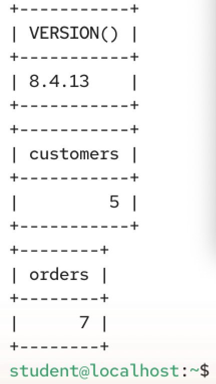
<p style="font-size: 14px; text-align: center; color: #666;">
  Figure 1: Source database on node1. MySQL 8.4.13, 5 rows in customers, 7 rows in orders.
</p>

### 2-2. Budget Alert

Site-to-Site VPN and DMS are not available on the AWS free plan, so this project required a paid account. Before creating anything billable, I set an **AWS Budget of $10/month** that emails me at 85% and 100% of actual spend and at 100% of forecasted spend.

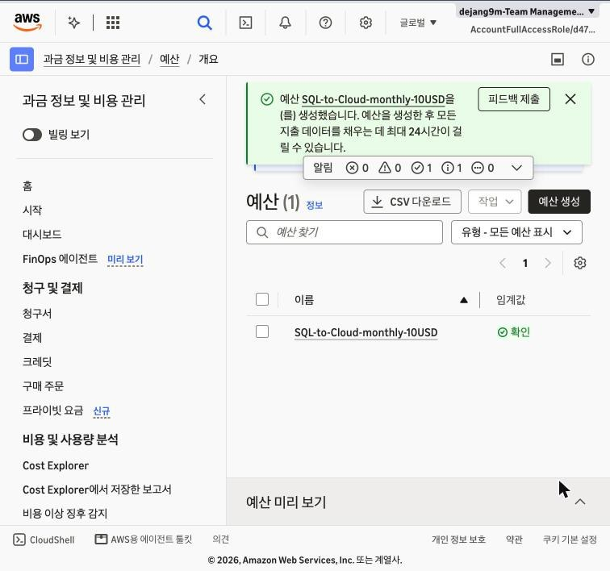
<p style="font-size: 14px; text-align: center; color: #666;">
  Figure 2: The monthly budget "SQL-to-Cloud-monthly-10USD" created in AWS Budgets.
</p>

---

## Step 3: Build the VPC

I used the "VPC and more" wizard to create everything at once:

- VPC `sql2cloud-vpc` with CIDR `10.0.0.0/16`
- 2 Availability Zones, **0 public subnets, 2 private subnets**
- No NAT gateway, no VPC endpoints

**Why this design?**

- RDS requires a *DB subnet group* with subnets in at least **two Availability Zones**, so I created two private subnets.
- The database never needs to reach the internet, so there are no public subnets and no internet route. Less exposure means a smaller attack surface.
- A NAT gateway costs money every hour and was not needed here.

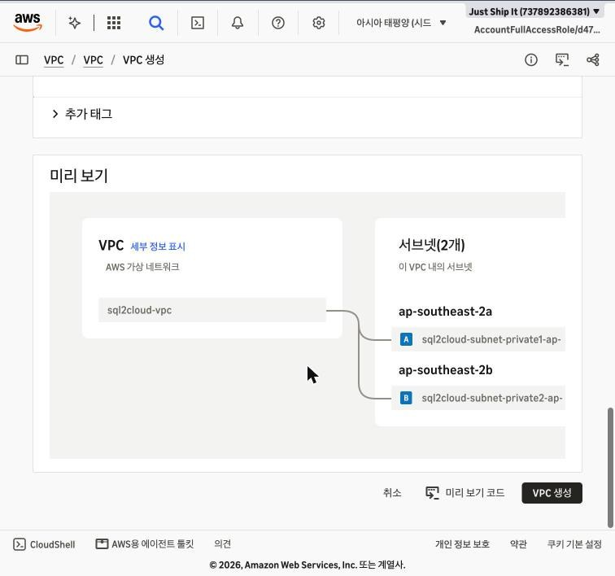
<p style="font-size: 14px; text-align: center; color: #666;">
  Figure 3: VPC preview. sql2cloud-vpc with one private subnet in ap-southeast-2a and one in ap-southeast-2b.
</p>

---

## Step 4: Create the Site-to-Site VPN in AWS

### 4-1. Virtual Private Gateway (VGW)

I created `sql2cloud-vgw` (Amazon default ASN 64512) and **attached it to the VPC**. The VGW is the AWS end of the tunnel; resources in the VPC can only use the tunnel after the VGW is attached.

### 4-2. Customer Gateway (CGW)

The CGW tells AWS where the on-prem VPN device is. I entered my home router's **public IP** (found with `curl ifconfig.me`).

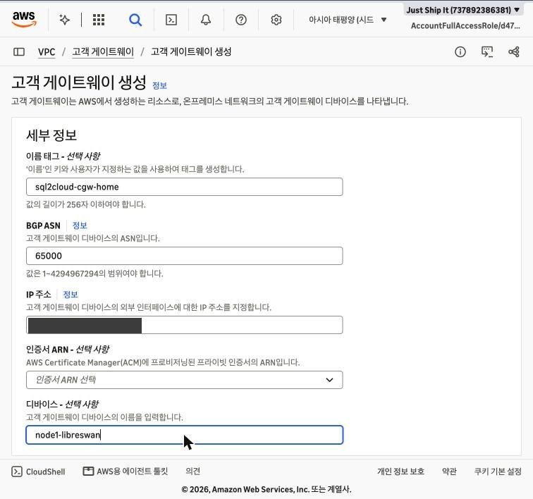
<p style="font-size: 14px; text-align: center; color: #666;">
  Figure 4: Creating the customer gateway "sql2cloud-cgw-home". The IP address field (my home public IP) is masked.
</p>

> **Double NAT:** node1 is behind two layers of NAT, my home router and VMware's NAT network. The IPsec tunnel therefore has to use **NAT Traversal (NAT-T)**, which wraps the VPN traffic in UDP port 4500 so it can pass through NAT devices.
{: .prompt-tip }

### 4-3. VPN Connection

I created `sql2cloud-vpn`, connecting the VGW and the CGW:

- **Routing:** Static, with prefix `192.168.211.0/24` (the home network)
- **Local IPv4 network CIDR** (on-prem side): `192.168.211.0/24`
- **Remote IPv4 network CIDR** (AWS side): `10.0.0.0/16`

**Why static routing?** Dynamic routing requires BGP, and my Libreswan setup does not run BGP. With only one on-prem network, a static route is simpler and easier to troubleshoot.

**Why narrow the CIDRs instead of using the default `0.0.0.0/0`?** These values define which traffic may enter the tunnel (the *traffic selectors*). They must match the Libreswan configuration on node1, or the tunnel negotiation fails.

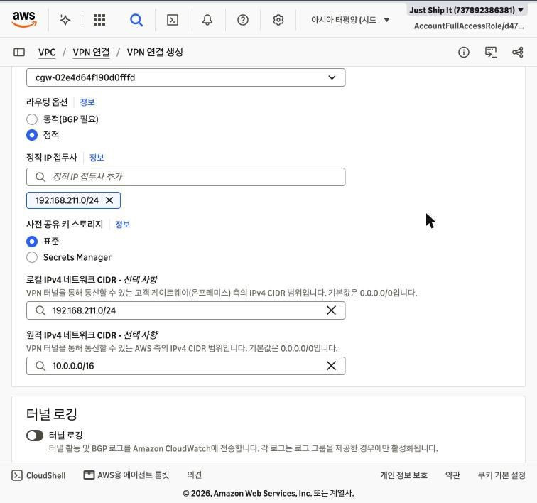
<p style="font-size: 14px; text-align: center; color: #666;">
  Figure 5: VPN connection settings. Static routing, home prefix 192.168.211.0/24, local CIDR 192.168.211.0/24, remote CIDR 10.0.0.0/16.
</p>

### 4-4. Route Tables

Creating a VPN does not automatically send traffic into it. I added the route **`192.168.211.0/24 → sql2cloud-vgw`** to **both** private route tables (the wizard created one per subnet). This tells anything in the VPC (DMS and RDS): "to reach the home network, go through the VPN gateway."

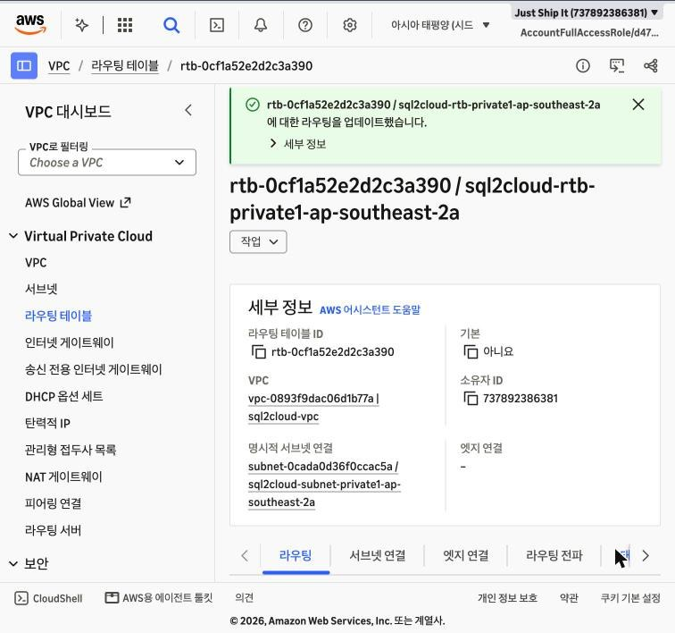
<p style="font-size: 14px; text-align: center; color: #666;">
  Figure 6: Route table for private subnet 1 updated with the route to the home network via the VGW. The same route was added to the second route table.
</p>

### 4-5. Tunnel Details

AWS always creates **two tunnels** with different public IPs for high availability. For this lab I configured only Tunnel 1. In production you would configure both.

I also replaced Tunnel 1's auto-generated pre-shared key (PSK) with my own value. The console font made characters like `O`/`0` and `I`/`l` hard to tell apart, and a single wrong character breaks authentication.

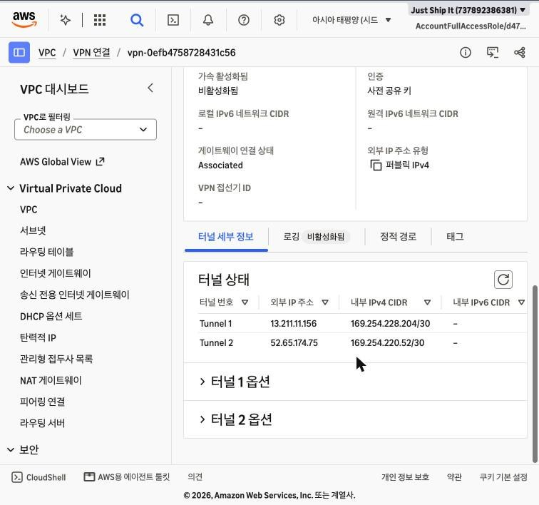
<p style="font-size: 14px; text-align: center; color: #666;">
  Figure 7: The VPN is available with two tunnels. Each has its own AWS outside IP and inside CIDR.
</p>

---

## Step 5: Configure the On-Prem VPN Device (Libreswan on node1)

The key settings in `/etc/ipsec.d/aws.conf`:

```ini
conn aws-tunnel1
    authby=secret
    auto=start
    keyexchange=ikev2
    left=%defaultroute
    leftid=<HOME_PUBLIC_IP>
    leftsubnet=192.168.211.0/24
    right=<AWS_TUNNEL1_OUTSIDE_IP>
    rightsubnet=10.0.0.0/16
    ike=aes256-sha2_256-modp2048
    esp=aes256-sha2_256-modp2048
    ikelifetime=8h
    salifetime=1h
    encapsulation=yes
```

What each important line does:

- **`leftid=<HOME_PUBLIC_IP>`**: node1 only knows its private IP, but AWS expects the public IP registered in the CGW. This is the key setting for VPNs behind NAT.
- **`leftsubnet` / `rightsubnet`**: Must match the VPN connection's local and remote CIDRs from Step 4-3.
- **`ike` / `esp`**: An encryption suite that AWS supports and that RHEL 10's system crypto policy also allows.
- **`encapsulation=yes`**: Forces UDP 4500 (NAT-T), required because of the double NAT.

The PSK goes in `/etc/ipsec.d/aws.secrets` with file permission `600`, so only root can read it.

I then opened the firewall for IPsec and for MySQL (DMS will connect on port 3306), and started the service:

```bash
sudo firewall-cmd --permanent --add-service=ipsec
sudo firewall-cmd --permanent --add-port=3306/tcp
sudo firewall-cmd --reload
sudo systemctl enable --now ipsec
sudo ipsec status | grep -i established
```

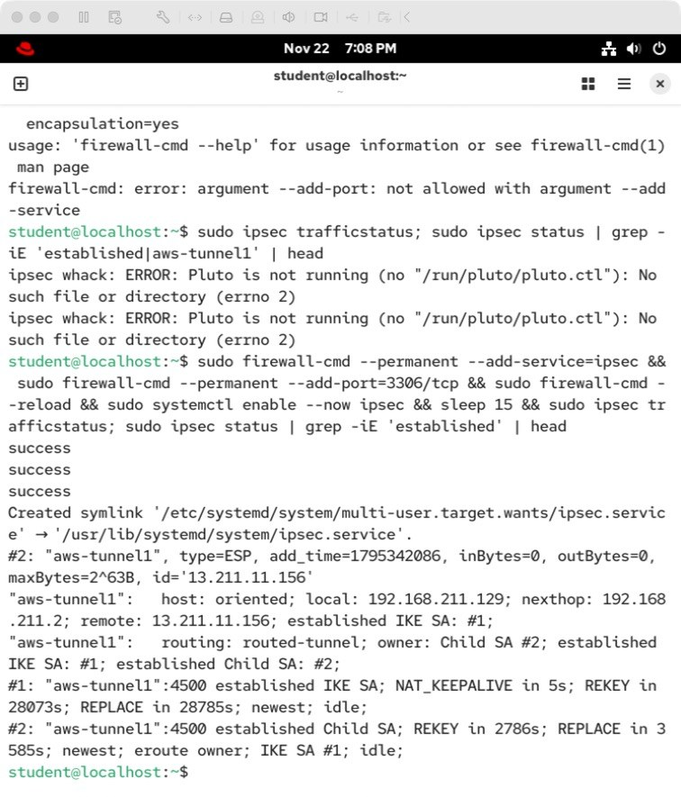
<p style="font-size: 14px; text-align: center; color: #666;">
  Figure 8: The tunnel is up. "established IKE SA" and "established Child SA" on port 4500 with NAT_KEEPALIVE. The error at the top is the troubleshooting case described below.
</p>

**How to read the result:**
- **IKE SA established:** Phase 1, where both sides authenticated each other with the PSK and agreed on keys.
- **Child SA established:** Phase 2, where the encrypted data tunnel itself is ready.
- **`:4500` and `NAT_KEEPALIVE`:** Traffic is going through NAT-T, so the double NAT is handled.

> **Troubleshooting:** My first attempt combined `--add-service` and `--add-port` in one `firewall-cmd` command, which fails with `argument --add-port: not allowed with argument --add-service`. Running them as separate commands fixed it, as shown above.
{: .prompt-warning }

---

## Step 6: Prepare Source, Target, and DMS

### 6-1. Source MySQL: a Dedicated DMS User

```sql
CREATE USER 'dms'@'10.0.%' IDENTIFIED BY '********';
GRANT SELECT, REPLICATION CLIENT, REPLICATION SLAVE ON *.* TO 'dms'@'10.0.%';
FLUSH PRIVILEGES;
```

- **`'dms'@'10.0.%'`**: This account can log in **only from the AWS VPC range** (`10.0.x.x`). That follows the principle of least privilege.
- **`SELECT`**: Needed to read existing rows (full load).
- **`REPLICATION CLIENT` / `REPLICATION SLAVE`**: Needed to read the binlog (CDC).

I also confirmed the binlog settings that DMS needs for CDC. MySQL 8.4 already meets them by default:

| Setting | Required | Actual |
| --- | --- | --- |
| `log_bin` | ON | ON |
| `binlog_format` | ROW | ROW |
| `binlog_row_image` | FULL | FULL |
| `server_id` | non-zero | 1 |
| `bind_address` | accept remote connections | `*` |

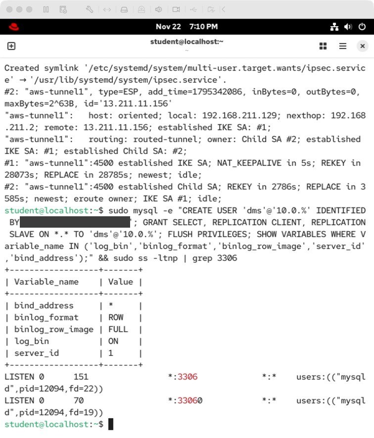
<p style="font-size: 14px; text-align: center; color: #666;">
  Figure 9: Creating the DMS user (password masked), checking binlog variables, and confirming MySQL listens on port 3306.
</p>

### 6-2. Target: Amazon RDS for MySQL

- `sql2cloud-rds`: MySQL 8.4, Dev/Test template, Single-AZ, `db.t3.micro`, 20 GiB gp3
- **Cost savings:** Reduced storage from the 200 GiB default to 20 GiB, turned off storage autoscaling and Enhanced Monitoring
- **Network:** `sql2cloud-vpc`, a new DB subnet group (the two private subnets), **public access: No**, and the VPC's default security group

**Security group logic:** The default security group allows all traffic *between members of the same group*. Putting RDS and the DMS instance in the same group lets DMS reach RDS without writing extra rules, while nothing outside the group can connect.

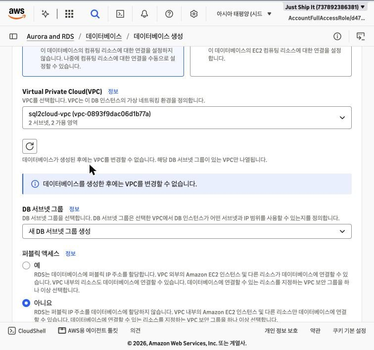
<p style="font-size: 14px; text-align: center; color: #666;">
  Figure 10: RDS connectivity settings. sql2cloud-vpc (2 subnets, 2 AZs), new DB subnet group, public access "No".
</p>

### 6-3. DMS Replication Instance

The replication instance is the server that actually moves the data.

- `sql2cloud-dms`: `dms.t3.small` (the smallest class offered in this Region), 20 GiB, engine 3.5.4, Single-AZ
- Same VPC, **not publicly accessible**, default security group (shared with RDS)
- It got the private IP `10.0.130.10` and took about 9 minutes to create

It does not need a public IP because it reaches node1 **through the VPN** (private route table → VGW → tunnel).

---

## Step 7: Create Endpoints and Run the Migration

### 7-1. Source Endpoint: the Real Test of the VPN

An endpoint tells DMS how to connect to a database. For the source, I entered node1's **private** IP:

- Engine: MySQL, server `192.168.211.129`, port `3306`, user `dms`
- **SSL mode: none.** The whole path is already encrypted by IPsec. The other console options (verify-ca / verify-full) would have required setting up certificates.

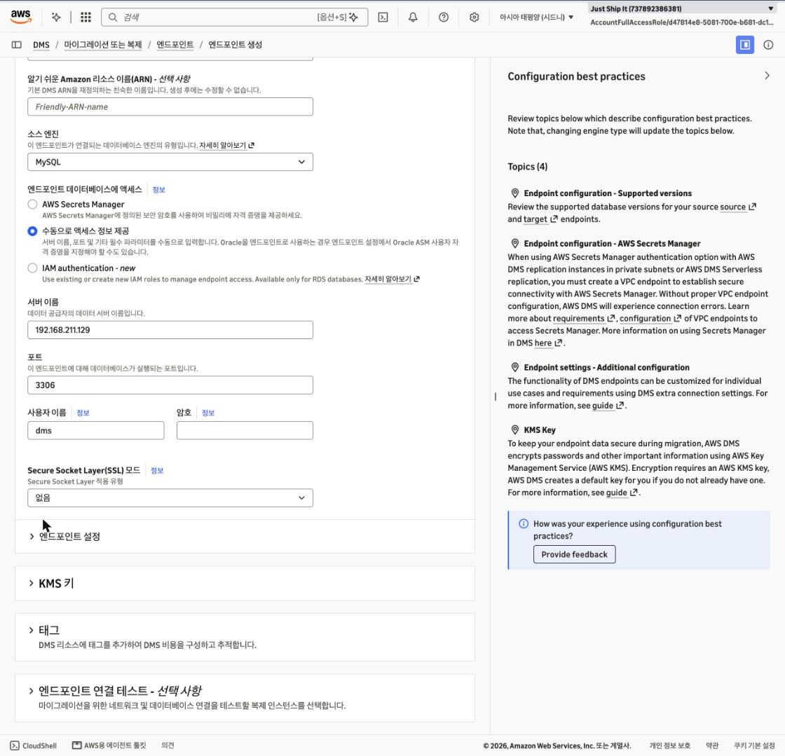
<p style="font-size: 14px; text-align: center; color: #666;">
  Figure 11: Source endpoint pointing to node1's private IP 192.168.211.129:3306.
</p>

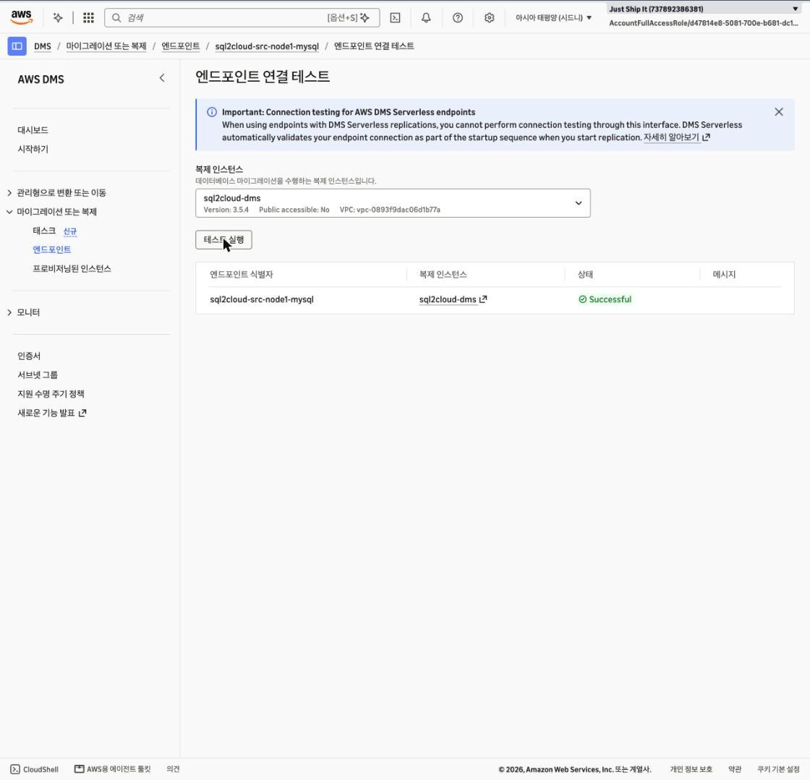
<p style="font-size: 14px; text-align: center; color: #666;">
  Figure 12: Connection test "Successful".
</p>

**This is the most important checkpoint of the project.** A successful test proves the whole path works: DMS (`10.0.130.10`) → private route table → VGW → IPsec tunnel → node1's MySQL at a *private* home IP address. An AWS service is talking to a database inside my home network without that database being exposed to the internet.

> **Note:** If you run the test while the replication instance is still being created, it fails with an "instance not active" error. Wait until the instance shows *Available*, then test again.
{: .prompt-tip }

### 7-2. Target Endpoint

For the target I chose "Select RDS DB instance" and picked `sql2cloud-rds`, which fills in the server address automatically. The connection test also succeeded.

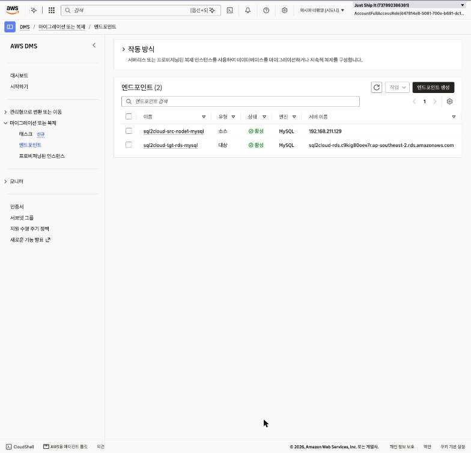
<p style="font-size: 14px; text-align: center; color: #666;">
  Figure 13: Both endpoints active. The source is node1 (192.168.211.129); the target is the RDS endpoint.
</p>

### 7-3. Migration Task

- Task: `sql2cloud-shop-full-cdc`
- **Migration type: "Migrate existing data and replicate ongoing changes"** (full load + CDC)
- **Table mapping** (only the `shop` database):

```json
{
  "rules": [{
    "rule-type": "selection",
    "rule-id": "1",
    "rule-name": "include-shop",
    "object-locator": { "schema-name": "shop", "table-name": "%" },
    "rule-action": "include"
  }]
}
```

- Target table preparation: drop tables on target, then create
- **Data validation: on** (DMS compares source and target rows)
- CloudWatch logs: on, for troubleshooting
- Premigration assessment: off (it requires an extra S3 bucket and IAM role, outside this lab's scope)

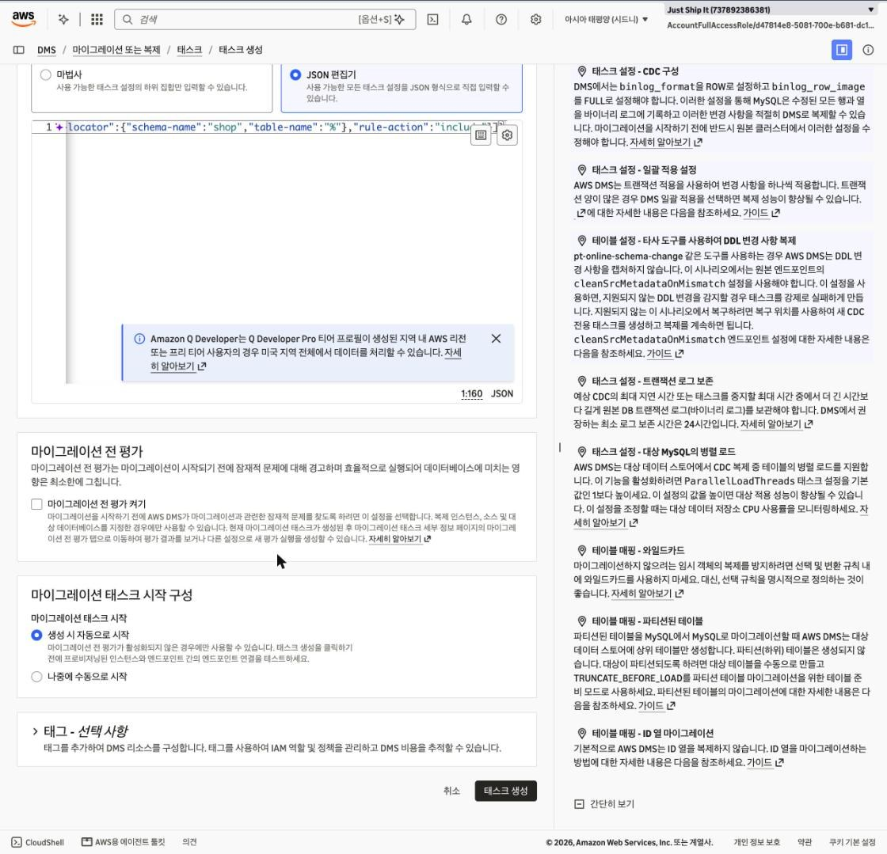
<p style="font-size: 14px; text-align: center; color: #666;">
  Figure 14: Table mapping entered in the JSON editor. Include every table ("%") in the shop schema.
</p>

Within a few minutes the task reported **"Load complete, replication ongoing"** with full load at 100%.

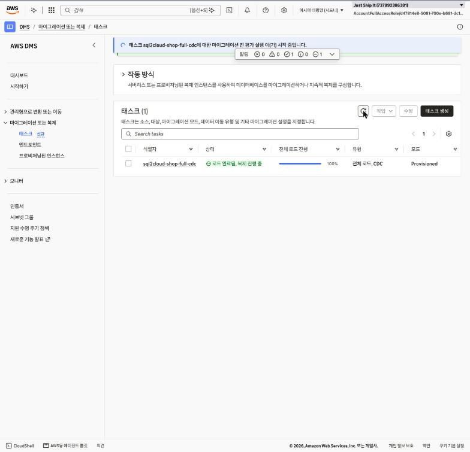
<p style="font-size: 14px; text-align: center; color: #666;">
  Figure 15: Task status "Load complete, replication ongoing", full load 100%, type Full load + CDC.
</p>

---

## Step 8: Validate the Migration

### 8-1. Full Load Validation

- 2 tables: **Table completed**
- **2 Validated, 0 Mismatched records, 0 Validation errors**
- Rows loaded: customers 5, orders 7, matching the source exactly

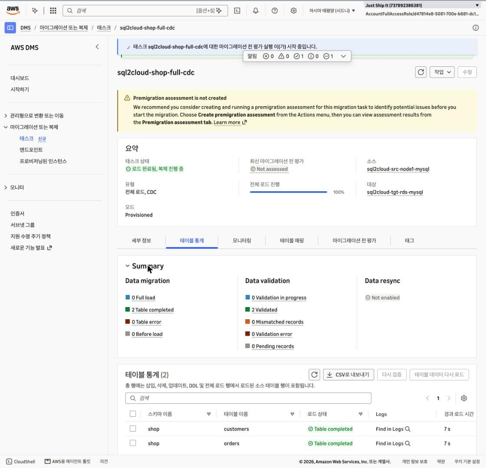
<p style="font-size: 14px; text-align: center; color: #666;">
  Figure 16: Data migration and validation summary. 2 tables completed, 2 validated, 0 mismatched records.
</p>

### 8-2. Real-Time Replication (CDC) Test

A real migration has to keep up with changes made while the old system is still in use. To test this, I inserted new rows **on the source** after the full load had finished:

```sql
INSERT INTO shop.customers (name, email) VALUES ('Song', 'song@example.com');
INSERT INTO shop.orders (customer_id, amount) VALUES (6, 77000);
```

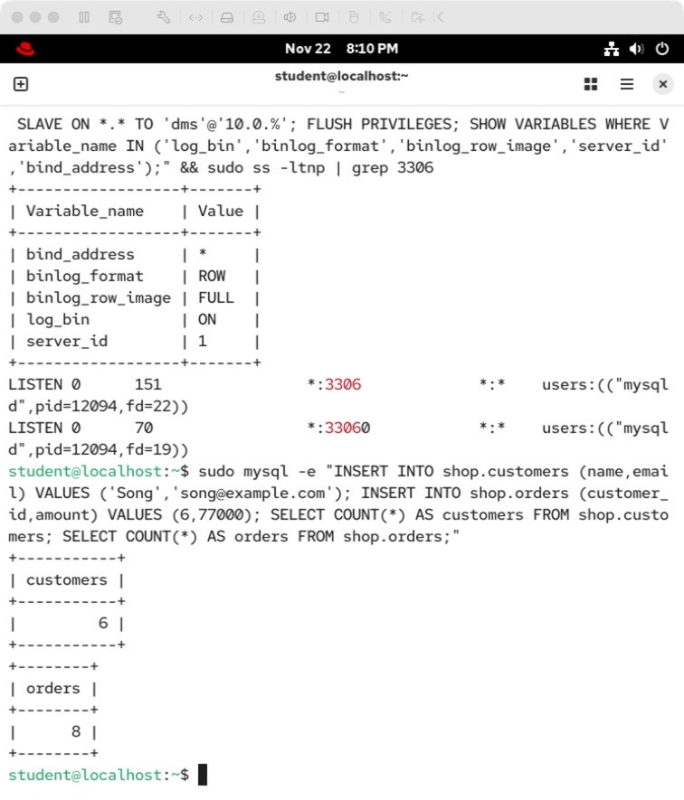
<p style="font-size: 14px; text-align: center; color: #666;">
  Figure 17: New rows inserted on node1. The source now has 6 customers and 8 orders.
</p>

DMS picked up both inserts from the binlog and applied them to RDS automatically:

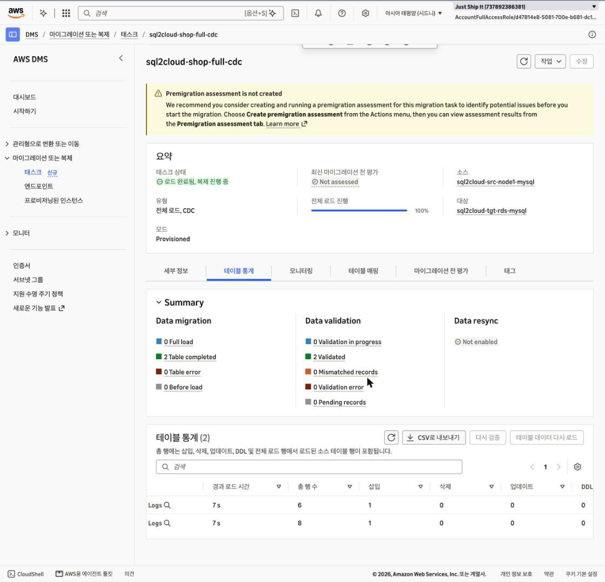
<p style="font-size: 14px; text-align: center; color: #666;">
  Figure 18: Table statistics. Total rows 6 and 8, with 1 insert replicated for each table.
</p>

**Why this matters:** With CDC running, the on-prem database can stay in service while the target catches up. The business only needs a short *cutover* window (stop writes, let the last changes replicate, point the application at RDS) instead of hours of downtime.

### 8-3. VPN Status on the AWS Side

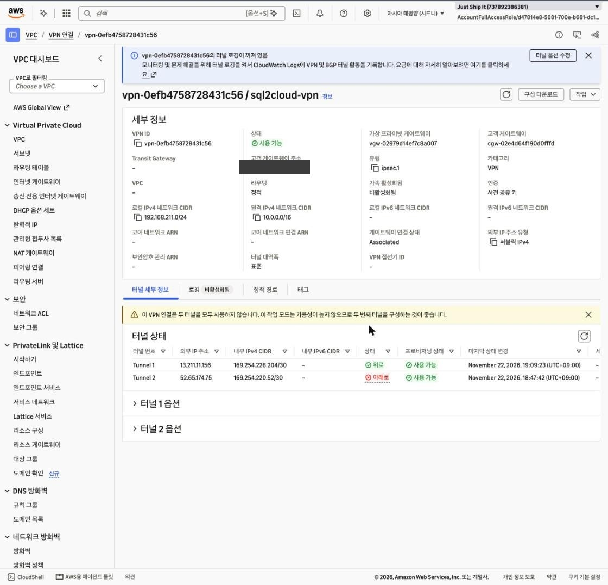
<p style="font-size: 14px; text-align: center; color: #666;">
  Figure 19: Tunnel 1 is UP; Tunnel 2 is DOWN because only one tunnel was configured. The customer gateway address is masked.
</p>

AWS shows a warning that only one tunnel is in use. That is expected for this lab. In production you would configure both tunnels so that AWS maintenance on one tunnel does not cause an outage.

---

## Step 9: Clean Up (Stop All Charges)

VPN connections, DMS instances, and RDS instances are billed by the hour, so I deleted everything right after testing. **The order matters**: delete the things that *use* a resource before the resource itself, or AWS refuses the deletion.

1. **RDS instance**: final snapshot off and automated-backup retention off, so no storage charges remain
2. **DMS task**: stop it first, then delete. It depends on the endpoints and the instance, so it goes first.
3. **DMS endpoints** (both)
4. **DMS replication instance**
5. **VPN connection**: it links the VGW and the CGW, so it must go before either gateway
6. **Customer gateway**
7. **Virtual private gateway**: detach from the VPC, wait until it shows *detached*, then delete
8. **RDS and DMS subnet groups**
9. **VPC**: only possible after the DMS instance's network interface is gone. Deleting the VPC also removed its subnets and route tables.
10. **CloudWatch log group** for the DMS task

On node1, `sudo systemctl disable --now ipsec` stops the VPN service, since the AWS side no longer exists.

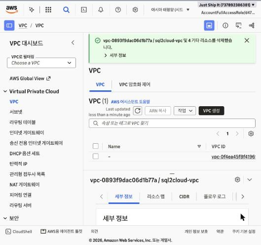
<p style="font-size: 14px; text-align: center; color: #666;">
  Figure 20: sql2cloud-vpc and its 4 related resources deleted. Only the free default VPC remains.
</p>

---

## Lessons Learned

1. **Verify tool compatibility first.** Checking the CPU architecture up front ruled out MGN (x86 only) and led me to DMS, which migrates at the database level.
2. **Plan IP ranges before building.** Non-overlapping CIDRs (`192.168.211.0/24` and `10.0.0.0/16`) are what make VPN routing possible.
3. **NAT changes VPN configuration.** Behind NAT, the VPN device must identify itself with the public IP (`leftid`) and use NAT-T (UDP 4500).
4. **Settings must match on both ends.** The VPN's local/remote CIDRs, the route tables, and Libreswan's `leftsubnet`/`rightsubnet` all describe the same networks. If any one is wrong, traffic stops.
5. **The endpoint connection test is the real proof** that the network path works end to end.
6. **Full load is only half a migration.** CDC is what makes a near-zero-downtime cutover possible.
7. **Least privilege everywhere:** a DMS user limited to the VPC range, no public access on RDS or DMS, private subnets only.
8. **Cost control is part of the job:** set a budget alert before creating resources, and delete everything in dependency order when done.

## What I Would Add in Production

- Configure **both** VPN tunnels for redundancy
- Store credentials in **AWS Secrets Manager** instead of entering them manually
- Use **Multi-AZ** RDS for high availability
- Run a **premigration assessment** before the real migration
- Use SSL on the database connections in addition to IPsec (defense in depth)
- Plan and rehearse the **cutover**: stop writes on the source, confirm CDC latency is zero, switch the application connection string to RDS
