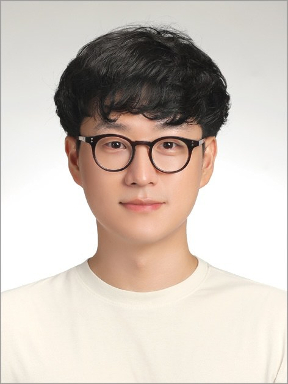

---
# the default layout is 'page'
icon: fas fa-info-circle
order: 1
---

IT Infrastructure · Cloud · Security Engineer — Comprehensive Resume

Jay Song

Hands-on experience building Linux, network, and security infrastructure, responding to incidents, and automating with cloud and AI

RHCSA · CCNA · Security+ · ISO 27001 Lead Auditor · M.S. in Computer Science candidate, Georgia Tech

<b>Date of Birth</b>N/A<b>Military Service</b>ROK Army, Sergeant (Honorably Discharged)
<b>Phone</b>N/A<b>Email</b>N/A
<b>Portfolio</b><a href="https://jaekuk.com">jaekuk.com</a><b>LinkedIn</b><a href="https://www.linkedin.com/in/jaekuk">linkedin.com/in/jaekuk</a>

Education

<table class="rs-tbl">
<tr><td class="rs-date">2026.01 – Present</td><td class="rs-lbl">Georgia Institute of Technology</td><td>M.S. in Computer Science (Online) · GPA 4.0 / 4.0</td></tr>
<tr><td class="rs-date">2021.08 – 2025.05</td><td class="rs-lbl">The Ohio State University</td><td>B.S. in Data Analytics · GPA 3.5 / 4.0 · Cum Laude</td></tr>
</table>

Experience

Volga Partners2025.09 – 2026.05 (9 months)

AI Content Evaluator · Contract &nbsp;/&nbsp; LLM-Generated Code Evaluation

<table class="rs-tbl">
<tr><td class="rs-lbl">Responsibilities</td><td><ul>
<li>Tested and validated LLM-generated Python and SQL code against guidelines</li>
<li>Documented defects and their root causes as structured written feedback</li>
</ul></td></tr>
<tr><td class="rs-lbl">Results</td><td><ul class="rs-check">
<li>Contributed to a 2.2% improvement in model performance through feedback</li>
</ul></td></tr>
</table>

The Ohio State University2023.09 – 2024.05 (9 months)

Research Assistant · College of Optometry &nbsp;/&nbsp; Data Automation &amp; ML Pipeline

<table class="rs-tbl">
<tr><td class="rs-lbl">Responsibilities</td><td><ul>
<li>Automated manual encoding of 1M+ data records using Python and OCR</li>
<li>Optimized an ML imaging pipeline for retinal disease prediction through frame sampling</li>
<li>Explained complex technical and statistical concepts to non-specialist postdoctoral researchers</li>
</ul></td></tr>
<tr><td class="rs-lbl">Results</td><td><ul class="rs-check">
<li>Task time reduced from 3 hours to 1 hour, with 100% accuracy</li>
<li>ML pipeline compute cost reduced by 67%</li>
</ul></td></tr>
</table>

DOmedia (USA)2019.04 – 2019.07 (4 months)

IT Intern &nbsp;/&nbsp; Data Processing &amp; IT Request Support

<table class="rs-tbl">
<tr><td class="rs-lbl">Responsibilities</td><td><ul>
<li>Extracted, updated, and loaded data with SQL queries, and integrated geospatial data via the Google Maps API</li>
<li>Tracked, diagnosed, and resolved IT requests through a ticketing system, following up on escalations through closure</li>
</ul></td></tr>
</table>

Wedding Photography2013.10 – 2016

Wedding Photographer

<table class="rs-tbl">
<tr><td class="rs-lbl">Responsibilities</td><td><ul>
<li>Photographed weddings and edited images with Lightroom and Photoshop</li>
<li>Created and shipped photo albums and responded to customer phone calls</li>
</ul></td></tr>
</table>

Republic of Korea Army2011.08 – 2013.05 (1 year 9 months)

IT Helpdesk Technician · Sergeant (Honorably Discharged) &nbsp;/&nbsp; User Support &amp; IT Operations

<table class="rs-tbl">
<tr><td class="rs-lbl">Responsibilities</td><td><ul>
<li>Provided on-site and phone support for system, application, and network issues for 200+ users, escalating per SOP</li>
<li>Installed and updated 200+ Windows and Linux machines; replaced end-of-life ports and switches and monitored routers</li>
<li>Processed 400+ access requests, including account creation and termination, permission changes, and password resets</li>
</ul></td></tr>
<tr><td class="rs-lbl">Results</td><td><ul class="rs-check">
<li>Received 5 Army commendations (including 3 from a Brigadier General)</li>
</ul></td></tr>
</table>

Lotte Cinema2010.01 – 2010.12

Ticketing, Admission Control &amp; Concessions Staff

University Cafeteria2010.01 – 2010.12

Cafeteria Staff

Projects

<table class="rs-tbl">
<tr><td class="rs-lbl">RHEL 10 Home Lab</td><td>Built two RHEL 10 VMs on VMware with a DVD-based offline repository, additional disks, static IPs via nmcli, and SSH key authentication; ran Apache on a non-standard port with SELinux and firewalld; practiced LVM, NFS autofs, and chrony</td></tr>
<tr><td class="rs-lbl">Cisco Network Home Lab</td><td>Configured VLANs, 802.1Q trunks, LACP, OSPF, and IPv4/IPv6 subnets in Packet Tracer, and diagnosed and fixed configuration errors</td></tr>
<tr><td class="rs-lbl">STP Simulation</td><td>Georgia Tech CS 6250: simulated root bridge election and loop-free path selection in Python</td></tr>
<tr><td class="rs-lbl">HTB Holmes CTF 2026</td><td>Team of 4, ranked 176th of ~8,000 (top ~2.2%); solved 8 of 9 DFIR scenarios through log analysis and forensics</td></tr>
<tr><td class="rs-lbl">AI Study App · Automation</td><td>Built a custom study app with AI coding tools and scored 88/99 on the ASVAB in 2 weeks / Set up a scheduled task that filters job postings by criteria and reports them by email / Built 4 Tableau dashboards</td></tr>
</table>

Certifications

<table class="rs-tbl rs-certs">
<tr><td class="rs-date">2026.10</td><td>Red Hat Certified System Administrator</td></tr>
<tr><td class="rs-date">2026.09</td><td>Cisco Certified Network Associate</td></tr>
<tr><td class="rs-date">2026.05</td><td>CompTIA Security+ CE</td></tr>
<tr><td class="rs-date">2025</td><td>AWS Cloud Essentials</td></tr>
<tr><td class="rs-date">2015.05</td><td>ISO 27001 Lead Auditor (expired)</td></tr>
</table>

Awards

<table class="rs-tbl rs-certs">
<tr><td class="rs-date">2026.09</td><td>HTB Holmes CTF, top ~2.2% (176th)</td></tr>
<tr><td class="rs-date">2021–2025</td><td>Veeam Scholarship</td></tr>
<tr><td class="rs-date">2021–2025</td><td>OSU Dean's List</td></tr>
<tr><td class="rs-date">2012.07</td><td>ROK Army Brigadier General Commendation (identified a threat during CCTV surveillance)</td></tr>
<tr><td class="rs-date">2013</td><td>Best Poster Award, IT Awareness Campaign</td></tr>
<tr><td class="rs-date">2013</td><td>Award, KFN Video Contest</td></tr>
<tr><td class="rs-date">2013</td><td>Commendation for Apprehending a Sexual Assailant While on Leave</td></tr>
<tr><td class="rs-date">2013</td><td>Award for Outstanding Conduct During Driver Training</td></tr>
</table>

Technical Skills

<table class="rs-tbl">
<tr><td class="rs-lbl">Linux · Server</td><td>RHEL 10 (systemd, LVM, SELinux, firewalld, NFS·autofs, chrony, sudo·ACL), Windows, Active Directory</td></tr>
<tr><td class="rs-lbl">Virtualization · Cloud</td><td>VMware (VM provisioning, snapshots), offline repository setup, AWS fundamentals (EC2, S3, VPC, IAM), preparing for SAA-C03</td></tr>
<tr><td class="rs-lbl">Networking</td><td>TCP/IP, DNS, DHCP, VLAN, 802.1Q, LACP, OSPF, STP, switch and router replacement and monitoring</td></tr>
<tr><td class="rs-lbl">Security</td><td>Access control and privilege management, server security configuration, log monitoring, DFIR, ISO 27001</td></tr>
<tr><td class="rs-lbl">Scripting · Docs · Languages</td><td>Bash, Python, PowerShell, SQL, Git, Tableau, SOP·README documentation &nbsp;/&nbsp; Korean (native), English</td></tr>
</table>

<b>JAY SONG</b>IT Infrastructure · Cloud · Security Engineer

